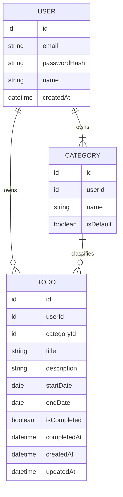

# TodoList 도메인 정의서 (초안)

## 버전 이력

| 버전 | 일자 | 작성자 | 상태 | 비고 |
|------|------|--------|------|------|
| v0.1 | 2026-11-03 | chaenamo | 초안 | 최초 작성 |
| v0.2 | 2026-11-03 | chaenamo | 초안 | 5개 기준 평가 결과 반영 |
| v0.3 | 2026-11-04 | chaenamo | 초안 | PRD v0.1과 정합성 맞춤 |

## 변경 이력

| 버전 | 일자 | 변경 섹션 | 변경 내용 | 변경자 |
|------|------|-----------|-----------|--------|
| v0.1 | 2026-11-03 | 전체 | 도메인 정의서 초안 작성 | chaenamo |
| v0.2 | 2026-11-03 | 2, 3, 4, 5, 6, 7, 8 | 문제정의(P)·기능요구(FR)·상태판정(ST) ID 부여, UC에 근거·관련 BR 컬럼 추가, BR의 "(가정)"을 A ID로 연결하고 누락된 가정 보충(A-08~A-15), 필터 조합·주 시작 요일·'오늘' 기준 명시, 완료일시·수정 시 규칙(BR-13, BR-17) 보충, BR-04 수정 항목 확정, BR-14 UI 절차 분리, 핵심 UC 수용 기준 추가, Q에 영향 범위 추가, ER 속성 4.1과 일치 | chaenamo |
| v0.3 | 2026-11-04 | 4.1, 4.2, 8.2 | 비밀번호를 해시 저장으로 표기(PRD NFR-09), 미결 사항에 PRD 9.2의 처리 결과 컬럼 추가(Q-03·Q-05 결정, 나머지 MVP 이후) | chaenamo |

> ID(P, FR, ST, BR, UC, AC, A, Q)는 삭제되어도 재사용하거나 다시 매기지 않는다.

## 1. 개요

### 1.1 목적
인증된 사용자가 **개인별로** 할일을 카테고리로 분류하고, **시작일자~종료일자** 기간을 지정하며, 진행 상태를 확인하고 **월/주/일 캘린더**에서 한꺼번에 조회할 수 있도록 한다.

### 1.2 범위
| 포함 | 제외 (현 단계) |
|------|----------------|
| 회원가입, 로그인, 로그아웃(A-14), 본인 정보 수정 | 할일 공유·협업, 팀/그룹 |
| 카테고리 관리 (기본 카테고리 포함, A-13) | 반복 일정, 알림/리마인더 |
| 할일 등록·조회·수정·삭제, 완료 처리 | 시간(시:분) 단위 일정 |
| 상태/카테고리별 필터링 | 외부 캘린더 연동 |
| 월/주/일 캘린더 뷰 | 첨부파일, 하위 할일 |

## 2. 문제 정의와 기능 요구사항

### 2.1 문제 정의
| ID | 문제 |
|----|------|
| P-01 | 인증된 사용자 **개인별로** 할일을 관리할 수 있는 앱이 없다. |
| P-02 | 기존 할일 관리에는 **시작일과 종료일(기간)** 을 다루는 기능이 부족하다. |
| P-03 | 할일을 **월별·주별·일별 캘린더**에서 한꺼번에 조회할 수 없다. |

### 2.2 기능 요구사항 (원 요구사항)
| ID | 요구사항 | 근거 |
|----|----------|------|
| FR-01 | 회원가입 후 로그인(인증)해야 앱을 사용할 수 있다. | P-01 |
| FR-02 | 카테고리별로 할일을 등록하며, 미지정 시 '기본' 카테고리로 간주한다. | P-01 |
| FR-03 | 로그인한 사용자는 자신의 정보를 수정할 수 있다. | P-01 |
| FR-04 | 할일 등록 시 시작일자·종료일자를 캘린더로 선택·지정한다. | P-02 |
| FR-05 | 할일 목록을 카테고리 / 시작 전 / 진행 중 / 완료 / 기한 초과로 필터링한다. | P-02 |
| FR-06 | 인증된 사용자가 할일을 삭제할 수 있다. | P-01 |
| FR-07 | 인증된 사용자가 편집 화면으로 할일을 수정할 수 있다. | P-01 |
| FR-08 | 할일은 캘린더 화면(월, 주, 일)에 나타난다. | P-03 |

## 3. 유비쿼터스 언어 (용어집)

| 용어 | 정의 |
|------|------|
| 사용자 (User) | 회원가입 후 로그인(인증)한 앱 이용자. 자신의 데이터만 소유·접근한다. |
| 인증 | 사용자가 로그인하여 본인임이 확인된 상태. 모든 기능 이용의 전제 조건. |
| 할일 (Todo) | 사용자가 수행할 작업 단위. 제목, 기간(시작일자~종료일자), 카테고리, 완료 여부를 가진다. |
| 카테고리 (Category) | 할일을 분류하는 사용자별 그룹. |
| 기본 카테고리 | 사용자마다 하나씩 존재하는 이름 '기본'의 카테고리. 카테고리 미지정 할일이 속한다. 규칙은 BR-05, BR-06 참조. |
| 시작일자 | 할일 수행을 시작하는 날짜(날짜 단위, 시간 없음). |
| 종료일자 | 할일을 마쳐야 하는 날짜(마감일, 날짜 단위). |
| 완료 여부 | 사용자가 할일을 완료로 표시했는지 여부(예/아니오). 사용자가 직접 바꾸는 값이며, 아래 '할일 상태'와 구분한다. |
| 할일 상태 | 완료 여부와 오늘 날짜로 **파생**되는 값: 시작 전 / 진행 중 / 완료 / 기한 초과. 저장하지 않는다(5장). |
| 기한 초과 | 종료일자가 지났는데 아직 완료되지 않은 상태(ST-04). |
| 오늘 | 사용자 기기(브라우저) 시간대 기준 현재 날짜(A-01). 상태 판정의 기준. |
| 필터 | 할일 목록을 카테고리 또는 할일 상태로 좁혀 보는 조건(BR-15). |
| 캘린더 뷰 | 할일을 기간(시작일자~종료일자)에 걸쳐 표시하는 화면. 월/주/일 단위가 있다(BR-16). |

## 4. 핵심 도메인 엔티티

### 4.1 엔티티와 주요 속성

| 엔티티 | 주요 속성 | 비고 |
|--------|-----------|------|
| User | 식별자, 이메일(로그인 ID), 비밀번호 해시, 이름, 가입일시 | 이메일은 시스템 내 고유(BR-03) |
| Category | 식별자, 소유 사용자, 이름, 기본 여부 | 이름은 사용자 내 고유(BR-07) |
| Todo | 식별자, 소유 사용자, 카테고리, 제목, 설명(선택), 시작일자, 종료일자, 완료 여부, 완료일시, 생성/수정일시 | 상태는 파생 값(5장) |

### 4.2 관계
- User 1 : N Category (사용자당 '기본' 카테고리 정확히 1개 포함)
- User 1 : N Todo
- Category 1 : N Todo (할일은 반드시 하나의 카테고리에 속함)

## 5. 할일 상태 정의와 판정 규칙

할일 상태는 저장하지 않고 **완료 여부 + 오늘 날짜 대비 시작일자/종료일자**로 매번 파생한다. 날짜 비교는 **날짜 단위**이며 시작일자와 종료일자는 **모두 기간에 포함(inclusive)** 된다. '오늘'의 기준은 A-01을 따른다.

| ID | 상태 | 판정 조건 |
|----|------|-----------|
| ST-01 | 완료 | 완료 여부 = 예 (날짜와 무관) |
| ST-02 | 시작 전 | 미완료 AND 오늘 < 시작일자 |
| ST-03 | 진행 중 | 미완료 AND 시작일자 ≤ 오늘 ≤ 종료일자 |
| ST-04 | 기한 초과 | 미완료 AND 오늘 > 종료일자 |

판정 순서: **완료 → 기한 초과 → 진행 중 → 시작 전** (완료가 항상 우선).

경계 예시 (시작일자 11/10, 종료일자 11/12):
- 오늘 11/09 → 시작 전
- 오늘 11/10, 11/12 → 진행 중 (양 끝 포함)
- 오늘 11/13 → 기한 초과
- 시작일자 = 종료일자인 하루짜리 할일은 그 날 하루만 진행 중

네 상태는 상호 배타적이며 모든 할일은 정확히 하나의 상태를 가진다.

## 6. 비즈니스 규칙

| ID | 규칙 | 근거 |
|----|------|------|
| BR-01 | 회원가입·로그인을 제외한 모든 기능은 인증된 사용자만 사용할 수 있다. | FR-01 |
| BR-02 | 사용자는 **본인 소유**의 할일·카테고리만 조회·수정·삭제할 수 있다. | P-01 |
| BR-03 | 이메일은 시스템 내에서 고유하다. | FR-01 |
| BR-04 | 사용자가 수정할 수 있는 본인 정보는 **이름, 비밀번호** 두 가지다. 이메일은 변경할 수 없고, 비밀번호 변경 시 현재 비밀번호를 확인한다. | FR-03, A-06, A-08 |
| BR-05 | 회원가입 시 해당 사용자의 '기본' 카테고리가 자동 생성된다. | FR-02 |
| BR-06 | '기본' 카테고리는 삭제·이름 변경할 수 없다. | A-03 |
| BR-07 | 카테고리 이름은 앞뒤 공백을 제거한 값으로 저장·비교하며, 제거 후 빈 문자열일 수 없고 사용자 내에서 고유하다. | A-09 |
| BR-08 | 할일 등록 시 카테고리를 지정하지 않으면 '기본' 카테고리에 속한다. | FR-02 |
| BR-09 | 카테고리 삭제 시 소속 할일은 삭제되지 않고 '기본' 카테고리로 이동한다. | A-04 |
| BR-10 | 할일의 제목, 시작일자, 종료일자는 필수다. | FR-04, A-02 |
| BR-11 | 종료일자 ≥ 시작일자 여야 한다 (같은 날 허용). | FR-04 |
| BR-12 | 과거 날짜로 시작일자/종료일자를 지정하는 것을 허용한다. | A-10 |
| BR-13 | 완료 처리 시 완료일시를 기록하고, 완료 취소 시 완료일시를 비운다. 취소 후 상태는 ST-02~04로 다시 판정된다. 종료일자가 지나도 자동 완료되지 않는다. | FR-05, A-07 |
| BR-14 | 할일 삭제는 영구 삭제이며 복구할 수 없다. (삭제 전 확인 절차는 UI 설계에서 다룬다.) | FR-06, A-05 |
| BR-15 | 필터는 카테고리(단일 선택)와 상태(복수 선택, 상태 간 OR)를 AND로 조합한다. 선택하지 않은 조건은 전체로 본다. | FR-05, A-11 |
| BR-16 | 캘린더 뷰에서 할일은 시작일자부터 종료일자까지 **기간 전체**에 걸쳐 표시되며, 뷰 기간과 하루라도 겹치면 표시된다. 주간 뷰는 일요일~토요일이다. | FR-08, A-12 |
| BR-17 | 할일 수정 시에도 BR-08, BR-10, BR-11, BR-12를 동일하게 적용한다. 완료된 할일도 수정할 수 있다. | FR-07, A-15 |

## 7. 주요 유스케이스

모든 유스케이스에는 BR-01, BR-02가 공통 적용된다(UC-01, UC-02의 로그인 제외).

| ID | 유스케이스 | 액터 | 근거 | 관련 규칙 |
|----|-----------|------|------|-----------|
| UC-01 | 회원가입 | 방문자 | FR-01 | BR-03, BR-05 |
| UC-02 | 로그인 / 로그아웃 | 방문자 / 사용자 | FR-01, A-14 | BR-01 |
| UC-03 | 내 정보 수정 | 사용자 | FR-03 | BR-04 |
| UC-04 | 카테고리 등록·수정·삭제 | 사용자 | FR-02, A-13 | BR-06, BR-07, BR-09 |
| UC-05 | 할일 등록 (캘린더로 시작일자·종료일자 선택, 카테고리 선택) | 사용자 | FR-02, FR-04 | BR-08, BR-10, BR-11, BR-12 |
| UC-06 | 할일 목록 조회 및 필터링 (카테고리 / 상태) | 사용자 | FR-05 | BR-15, ST-01~04 |
| UC-07 | 할일 수정 (편집 화면) | 사용자 | FR-07 | BR-17 |
| UC-08 | 할일 완료 처리 / 완료 취소 | 사용자 | FR-05 | BR-13 |
| UC-09 | 할일 삭제 | 사용자 | FR-06 | BR-14 |
| UC-10 | 캘린더 조회 (월 / 주 / 일 전환) | 사용자 | FR-08 | BR-16 |

### 7.1 핵심 수용 기준

그 밖의 유스케이스는 관련 규칙을 충족하는 것을 수용 기준으로 한다.

| ID | UC | Given | When | Then |
|----|----|-------|------|------|
| AC-01 | UC-05 | 카테고리를 지정하지 않은 할일 | 등록한다 | '기본' 카테고리에 속한다 |
| AC-02 | UC-05 | 시작일자 11/12, 종료일자 11/10 | 등록한다 | 등록이 거부된다 |
| AC-03 | UC-06 | 오늘 11/13, 할일(11/10~11/12, 미완료) | 상태 '기한 초과' / '진행 중'으로 각각 필터한다 | '기한 초과'에는 포함, '진행 중'에는 미포함 |
| AC-04 | UC-06 | 카테고리 '업무' + 상태 '시작 전', '진행 중' 선택 | 목록을 조회한다 | '업무' 카테고리이면서 두 상태 중 하나인 할일만 나온다 |
| AC-05 | UC-10 | 할일(2026-10-30~2026-11-02) | 2026년 11월 월간 뷰를 연다 | 11/01, 11/02 칸에 표시된다 |
| AC-06 | UC-10 | 할일(2026-11-14(토)~2026-11-16(월)) | 2026-11-08(일)~11-14(토) 주간 뷰를 연다 | 11/14 칸에 표시된다 |

## 8. 미결 사항 / 가정

### 8.1 가정 (확인 필요)
| ID | 가정 | 관련 |
|----|------|------|
| A-01 | 날짜는 시간 없는 날짜 단위로 다루며, '오늘'은 사용자 기기(브라우저) 시간대 기준 날짜다. | ST-01~04, BR-16 |
| A-02 | 시작일자·종료일자는 모두 필수다. | BR-10 |
| A-03 | '기본' 카테고리는 사용자별로 1개, 삭제·이름 변경 불가. | BR-06 |
| A-04 | 카테고리 삭제 시 소속 할일은 '기본' 카테고리로 이동한다. | BR-09 |
| A-05 | 할일 삭제는 영구 삭제(복구 불가). | BR-14 |
| A-06 | 이메일(로그인 ID)은 변경 불가. | BR-04 |
| A-07 | 완료 여부는 사용자가 직접 표시하며, 종료일이 지나도 자동 완료되지 않는다. | BR-13 |
| A-08 | 비밀번호 변경 시 현재 비밀번호를 확인한다. | BR-04 |
| A-09 | 카테고리 이름은 앞뒤 공백 제거 후 비교하며, 비어 있을 수 없고 사용자 내 고유하다. | BR-07 |
| A-10 | 과거 날짜로 시작일자/종료일자를 지정할 수 있다. | BR-12 |
| A-11 | 필터는 카테고리(단일) AND 상태(복수, OR)로 조합하며, 미선택 조건은 전체다. | BR-15 |
| A-12 | 주간 캘린더 뷰는 일요일에 시작한다. | BR-16 |
| A-13 | 원 요구사항은 '카테고리별 등록'만 명시하므로, 카테고리 등록·수정·삭제 기능을 둔다고 가정한다. | UC-04 |
| A-14 | 로그아웃 기능을 제공한다. | UC-02 |
| A-15 | 완료된 할일도 수정할 수 있다. | BR-17 |

### 8.2 미결 사항
처리 결과의 원본은 PRD(`docs/2-PRD.md`) 9.2절이다.

| ID | 미결 사항 | 영향 | 처리 (PRD 9.2) |
|----|-----------|------|----------------|
| Q-01 | 회원 탈퇴 기능 필요 여부 및 탈퇴 시 데이터 처리 방식. | UC 신규, BR-02 | MVP 이후 (Could) |
| Q-02 | 비밀번호 찾기/재설정 기능 범위. | UC-02, BR-04 | MVP 이후 (Could) |
| Q-03 | 캘린더 뷰에서 상태/카테고리 필터 적용 여부 및 상태별 시각 구분 방식. | BR-15, BR-16, UC-10 | 결정: 완료 항목 시각 구분만 MVP, 캘린더 필터는 Should |
| Q-04 | 캘린더에서 날짜 드래그로 할일 기간 변경 기능 필요 여부. | UC-07, UC-10, BR-17 | 이번 릴리스 제외 (Won't) |
| Q-05 | 할일 목록 기본 정렬 기준 (종료일자 순 등). | UC-06 | 결정: 종료일자 오름차순, 동일 시 생성일시 오름차순 |
| Q-06 | 할일 우선순위·검색 기능 필요 여부. | 4.1 Todo, UC-06 | MVP 이후 (Could) |
