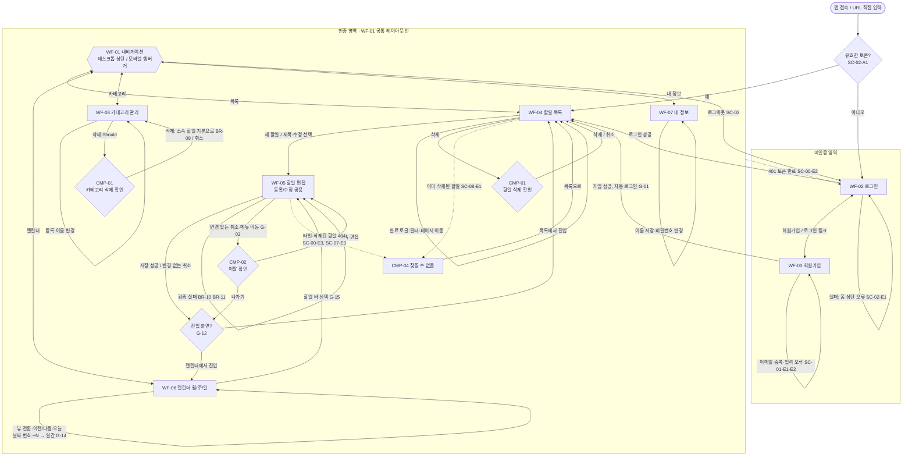

# TodoList 와이어프레임

## 버전 이력

| 버전 | 일자 | 작성자 | 상태 | 비고 |
|------|------|--------|------|------|
| v0.1 | 2026-11-04 | chaenamo | 초안 | 최초 작성 |
| v0.2 | 2026-11-04 | chaenamo | 초안 | 전체 화면 흐름도 보강 |
| v0.3 | 2026-11-04 | chaenamo | 초안 | 완료 토글 동작 결정 반영 |

## 변경 이력

| 버전 | 일자 | 변경 섹션 | 변경 내용 | 변경자 |
|------|------|-----------|-----------|--------|
| v0.1 | 2026-11-04 | 전체 | 도메인 정의서 v0.3, PRD v0.3, 사용자 시나리오 v0.2 기반 저충실도 와이어프레임 최초 작성 | chaenamo |
| v0.2 | 2026-11-04 | 4 | 전체 화면 흐름도로 교체: 앱 진입 토큰 확인, 공통 내비 허브, 진입 화면 복귀 분기(G-12), 할일/카테고리 삭제 확인 분리, 404·401 경로 보강 | chaenamo |
| v0.3 | 2026-11-04 | 기준 문서, WF-04, 6.1(G-11) | 완료 토글: 요청 중 비활성, 성공 후 즉시 재조회(필터와 안 맞으면 바로 사라짐), 실패 시 원 상태 유지 (아키텍처 AQ-03 결정) | chaenamo |

> 기준 문서: `docs/1-domain-definition.md` (v0.3), `docs/2-PRD.md` (v0.3), `docs/3-user-scenario.md` (v0.3).
> 도메인·PRD·시나리오 ID(P, FR, ST, BR, UC, AC, A, Q, NFR, TC, SC, G)는 **참조만** 하며 재정의하지 않는다. 규칙 본문은 원 문서를 따른다.
> 이 문서 고유 ID: 화면 `WF-xx`, 공통 컴포넌트 `CMP-xx`. 삭제되어도 **재사용하거나 다시 매기지 않는다.**

## 0. 읽는 법

- 저충실도(lo-fi): 레이아웃·배치·라벨만 표현한다. 색상·폰트·브랜딩은 다루지 않는다. 접근성은 범위 제외(NFR-17).
- 데스크톱 ≈1280px, 모바일 360px 두 버전을 그린다. 반응형 웹이며 네이티브 패턴은 쓰지 않는다(TC-01, NFR-16). 두 버전이 거의 같으면 차이점만 적는다.
- 표기: `[ 텍스트 ]` 버튼, `[____]` 입력란, `[선택 v]` 드롭다운, `[ ]`/`[x]` 체크박스·토글, `<목록>` 현재 화면(내비), `(n)` 아래 요소 설명 표의 번호, `~제목~` 취소선(완료 항목), `*` 오늘, `!` 오류 문구.
- 모든 화면(WF-02, WF-03 제외)은 WF-01 공통 레이아웃 안에 렌더링되며 BR-01, BR-02를 전제로 한다.

## 1. 화면·컴포넌트 목록

| ID | 화면 / 컴포넌트 | PRD 3.1 | 우선순위 |
|----|-----------------|---------|----------|
| WF-01 | 공통 레이아웃 (내비게이션) | 전 화면 | Must |
| WF-02 | 로그인 | 로그인 / 회원가입 | Must |
| WF-03 | 회원가입 | 로그인 / 회원가입 | Must |
| WF-04 | 할일 목록 | 할일 목록 | Must |
| WF-05 | 할일 편집 (등록/수정 공용) | 할일 편집 | Must |
| WF-06 | 캘린더 (월/주/일) | 캘린더 | Must |
| WF-07 | 내 정보 | 내 정보 | Must |
| WF-08 | 카테고리 관리 | 카테고리 관리 | Must(등록) / Should(변경·삭제) |
| CMP-01 | 삭제 확인 모달 | 할일 목록 (삭제) | Must |
| CMP-02 | 이탈 확인 모달 | 할일 편집 | Must (G-02 가정) |
| CMP-03 | 토스트 / 오류 메시지 | 공통 | Must |
| CMP-04 | 404 "찾을 수 없음" | 공통 | Must |
| CMP-05 | 상태 배지 | 할일 목록, 캘린더 | Must |

---

## 2. 화면 와이어프레임

### WF-01 공통 레이아웃

**데스크톱**

```text
┌───────────────────────────────────────────────────────────────────────────┐
│ (1)TodoList      <목록>  [캘린더]  [카테고리]  [내 정보]  [로그아웃] (2)  │
├───────────────────────────────────────────────────────────────────────────┤
│                                                                           │
│        (3) 본문 영역: 각 화면 (최대 폭 ≈ 960px, 중앙 정렬)                │
│                                                                           │
└───────────────────────────────────────────────────────────────────────────┘
```

**모바일 (360px)** 메뉴 닫힘 / 열림

```text
┌────────────────────────────────────┐
│ (1)TodoList        [메뉴] (2)      │
├────────────────────────────────────┤
│                                    │
│   (3) 본문 영역 (전체 폭)          │
│                                    │
└────────────────────────────────────┘
```

```text
┌────────────────────────────────────┐
│ TodoList           [닫기]          │
├────────────────────────────────────┤
│  <목록>                            │
│  [캘린더]                          │
│  [카테고리]                        │
│  [내 정보]                         │
│  [로그아웃]  (4)                   │
└────────────────────────────────────┘
```

| # | 요소 | 동작 | 참조 |
|---|------|------|------|
| 1 | 로고 / 앱 이름 | 클릭 시 할일 목록(WF-04)으로 이동 | SC-02 |
| 2 | 내비 항목: 목록 / 캘린더 / 카테고리 / 내 정보 | 해당 화면으로 이동, 현재 화면 항목 강조. 모바일은 [메뉴]로 펼치는 세로 목록 | SC-03, SC-05, SC-09, SC-10, NFR-16 |
| 3 | 본문 영역 | 화면별 콘텐츠. 가로 스크롤 없음 | NFR-16 |
| 4 | 로그아웃 | 토큰 폐기 후 로그인(WF-02)으로 이동. 모바일은 메뉴 맨 아래에 두어 오조작 방지 | SC-02, NFR-10, A-14 |

**모바일 내비 선택: 햄버거(드롭다운 메뉴).** 근거: 항목이 5개이고 로그아웃이 포함되어 하단 탭(항목당 약 72px)에서는 오조작 위험이 크며, 상단 한 줄 + 본문 전체 높이 확보가 목록·캘린더에 유리하다.

---

### WF-02 로그인

**데스크톱** (WF-01 내비 없음, 중앙 카드)

```text
┌──────────────────────────────────────────────────────────────────────────┐
│                                                                          │
│                         TodoList                                         │
│                                                                          │
│                   로그인                                                 │
│                                                                          │
│                   이메일      [____________________]  (1)                │
│                   비밀번호    [____________________]  (2)                │
│                                                                          │
│                   ! 이메일 또는 비밀번호가 올바르지 않습니다  (3)        │
│                                                                          │
│                   [      로그인      ] (4)                               │
│                                                                          │
│                   계정이 없으신가요?  [회원가입] (5)                     │
│                                                                          │
└──────────────────────────────────────────────────────────────────────────┘
```

**모바일**: 동일 구성. 카드 테두리 없이 전체 폭, 라벨은 입력란 위, 버튼은 전체 폭.

```text
┌────────────────────────────────────┐
│  TodoList                          │
│  로그인                            │
│  이메일                            │
│  [______________________]          │
│  비밀번호                          │
│  [______________________]          │
│  ! 이메일 또는 비밀번호가          │
│    올바르지 않습니다               │
│  [        로그인        ]          │
│  계정이 없으신가요? [회원가입]     │
└────────────────────────────────────┘
```

| # | 요소 | 동작 | 참조 |
|---|------|------|------|
| 1, 2 | 이메일 / 비밀번호 입력 | 비밀번호는 마스킹. 빈 값 제출 시 해당 필드 아래 오류 | SC-02 |
| 3 | 로그인 오류 (폼 상단·버튼 위, 일반 문구 1개) | 이메일·비밀번호 중 무엇이 틀렸는지 구분하지 않음. 실패 시에만 표시, 입력값 유지 | SC-02-E1, G-04 |
| 4 | 로그인 버튼 | 성공 시 할일 목록(WF-04)으로 이동. 유효 토큰 보유 시 이 화면 생략 | SC-02, SC-02-A1 |
| 5 | 회원가입 링크 | WF-03으로 전환 | SC-01 |
| - | 미인증 접근 / 토큰 만료(401) | 이 화면으로 이동. 작성 중 입력은 보존하지 않음, 로그인 후 목록으로 | SC-00-E1, SC-00-E2, G-03 |

---

### WF-03 회원가입

**데스크톱**

```text
┌──────────────────────────────────────────────────────────────────────────┐
│                                                                          │
│                         TodoList                                         │
│                   회원가입                                               │
│                                                                          │
│                   이메일      [____________________]  (1)                │
│                   ! 이미 사용 중인 이메일입니다  (2)                     │
│                   비밀번호    [____________________]  (3)                │
│                   ! 비밀번호 규칙 안내 / 오류 (규칙 G-05 미정)           │
│                   이름        [____________________]  (4)                │
│                   ! 이름을 입력하세요                                    │
│                                                                          │
│                   [      가입하기      ] (5)                             │
│                   이미 계정이 있으신가요?  [로그인] (6)                  │
│                                                                          │
└──────────────────────────────────────────────────────────────────────────┘
```

**모바일**: WF-02 모바일과 동일한 폭·배치(라벨 위, 필드 아래, 오류는 필드 바로 아래).

| # | 요소 | 동작 | 참조 |
|---|------|------|------|
| 1 | 이메일 | 형식 검증 | SC-01-E2, G-05 |
| 2 | 이메일 중복 오류 (이메일 필드 바로 아래) | 가입 거부, 입력값 유지 | SC-01-E1, BR-03 |
| 3 | 비밀번호 | 마스킹. 규칙 위반 시 필드 아래 오류. 확인용 재입력란 없음 | SC-01-E2, G-05 |
| 4 | 이름 | 필수 | SC-01-E2 |
| 5 | 가입하기 | 성공 시 자동 로그인 후 빈 상태의 할일 목록으로 이동 ('기본' 카테고리 자동 생성) | SC-01, BR-05, G-01 |
| 6 | 로그인 링크 | WF-02로 전환 | SC-02 |

---

### WF-04 할일 목록

**데스크톱**

```text
┌───────────────────────────────────────────────────────────────────────────────┐
│ TodoList      <목록>  [캘린더]  [카테고리]  [내 정보]  [로그아웃]  (WF-01)    │
├───────────────────────────────────────────────────────────────────────────────┤
│  할일 목록                                              [+ 새 할일] (1)       │
│                                                                               │
│  카테고리 [전체 v] (2)   상태 [ ]시작 전 [x]진행 중 [ ]완료 [ ]기한 초과 (3)  │
│  정렬: 종료일자 오름차순 (고정) (4)                    [필터 초기화] (5)      │
│                                                                               │
│  [ ] 보고서          업무    11/10 ~ 11/12   [기한 초과]  [수정] [삭제]  (6)  │
│  [x] 발표 준비       업무    11/13 ~ 11/16   [완료]       [수정] [삭제]       │
│  [ ] 스터디          기본    11/13 ~ 11/13   [진행 중]    [수정] [삭제]       │
│  [ ] 장보기          기본    11/20 ~ 11/20   [시작 전]    [수정] [삭제]       │
│                                                                               │
│  [< 이전]   1  [2]  3  4  5   [다음 >]   (7)                                  │
└───────────────────────────────────────────────────────────────────────────────┘
```

빈 상태 두 가지 (본문 영역만)

```text
┌──────────────────────────────────────────────────────────────────────────┐
│  등록된 할일이 없습니다.                    (8a: 할일 0건)               │
│  [+ 첫 할일 등록]                                                        │
├──────────────────────────────────────────────────────────────────────────┤
│  조건에 맞는 할일이 없습니다.               (8b: 필터 결과 0건)          │
│  [필터 초기화]                                                           │
└──────────────────────────────────────────────────────────────────────────┘
```

**모바일 (360px)**: 필터는 세로 배치, 항목은 3줄 카드, 페이지네이션은 번호 대신 `n / N`.

```text
┌─────────────────────────────────────┐
│ TodoList           [메뉴]           │
├─────────────────────────────────────┤
│  할일 목록  [+ 새 할일] (1)         │
│  카테고리 [전체 v] (2)              │
│  상태 (3)                           │
│  [ ]시작 전  [x]진행 중             │
│  [ ]완료     [ ]기한 초과           │
│  정렬: 종료일자 ↑  [초기화]         │
│                                     │
│  [ ] 보고서             [삭제] (6)  │
│      업무 · 11/10 ~ 11/12           │
│      [기한 초과]                    │
│  [x] 발표 준비          [삭제]      │
│      업무 · 11/13 ~ 11/16           │
│      [완료]                         │
│                                     │
│  [< 이전]   2 / 5   [다음 >] (7)    │
└─────────────────────────────────────┘
```

| # | 요소 | 동작 | 참조 |
|---|------|------|------|
| 1 | 새 할일 | 빈 편집 화면(WF-05, 등록)으로 이동 | SC-04 |
| 2 | 카테고리 필터 (단일 선택, 기본 '전체') | 변경 시 첫 페이지부터 재조회. 목록에는 '기본'과 사용자 카테고리 | SC-05, BR-15, G-09 |
| 3 | 상태 필터 (체크박스 복수 선택, 기본 모두 해제 = 전체) | 카테고리 AND (상태 OR). 변경 시 첫 페이지로 | SC-05, BR-15, AC-03, AC-04 |
| 4 | 정렬 표시 | 종료일자 오름차순, 동일 시 생성일시 오름차순. 변경 컨트롤 없음(표시만) | Q-05 |
| 5 | 필터 초기화 | 카테고리·상태 모두 해제 | SC-05-A1 |
| 6 | 항목 행: 완료 토글 / 제목 / 카테고리 / 기간 / 상태 배지(CMP-05) / 수정 / 삭제 | 토글: 요청 중 비활성, 성공 시 즉시 재조회해 새 상태 표시(필터와 안 맞게 된 항목은 바로 사라짐), 실패 시 원 상태 그대로 오류(CMP-03). 제목 또는 [수정]: 편집(WF-05, 수정). [삭제]: CMP-01 | SC-06, SC-07, SC-08, ST-01~04, BR-13, G-11 |
| 7 | 페이지네이션 (**가정**: 번호 방식) | 기본 50건/페이지. 결과가 1페이지면 숨김. 필터 변경 시 1페이지로 | NFR-06, G-09 |
| 8a, 8b | 빈 상태 | 8a: 할일 자체가 없을 때 등록 유도. 8b: 필터 결과 없음 + 초기화 | SC-05-A3, G-09 |

---

### WF-05 할일 편집 (등록/수정 공용)

제목만 "할일 등록" / "할일 수정"으로 다르고, 수정 시 기존 값이 채워진다. 완료 토글·삭제는 두지 않는다(G-16).

**데스크톱**

```text
┌────────────────────────────────────────────────────────────────────────────────────────┐
│ TodoList      [목록]  [캘린더]  [카테고리]  [내 정보]  [로그아웃]  (WF-01)             │
├────────────────────────────────────────────────────────────────────────────────────────┤
│  할일 등록   (수정 시: 할일 수정) (1)                                                  │
│                                                                                        │
│  제목 *          [______________________________________]  (2)                         │
│                  ! 제목을 입력하세요  (3)                                              │
│  설명            [______________________________________]  (4)                         │
│                  [______________________________________]                              │
│  카테고리        [기본 v]  (5)                                                         │
│  시작일자 *      [2026-11-10 달력]  (6)    종료일자 *  [2026-11-12 달력]  (7)          │
│                  ! 시작일자를 선택하세요   ! 종료일자는 시작일자 이후여야 합니다  (8)  │
│                                                                                        │
│                  [ 저장 ] (9)   [ 취소 ] (10)                                          │
└────────────────────────────────────────────────────────────────────────────────────────┘
```

날짜 피커 열림 상태 (입력란 아래 팝업, 시작일자 예시)

```text
┌──────────────────────────────────────────┐
│ [2026-11-10 달력]                        │
│ [<]   2026년 11월   [>]                  │
│ 일  월  화  수  목  금  토               │
│  1   2   3   4   5   6   7               │
│  8   9 [10] 11  12  13* 14               │
│ 15  16  17  18  19  20  21               │
└──────────────────────────────────────────┘
```

**모바일 (360px)**: 라벨 위·입력란 아래 세로 1열. 시작일자·종료일자도 세로로 쌓고, 오류는 각 필드 바로 아래. 날짜 피커 팝업은 입력란 폭에 맞춘다. 저장/취소는 하단에 가로 2버튼(전체 폭).

```text
┌────────────────────────────────────┐
│ TodoList           [메뉴]          │
├────────────────────────────────────┤
│  할일 등록                         │
│  제목 *                            │
│  [______________________]          │
│  ! 제목을 입력하세요               │
│  설명                              │
│  [______________________]          │
│  카테고리                          │
│  [기본 v]                          │
│  시작일자 *                        │
│  [2026-11-10 달력]                 │
│  종료일자 *                        │
│  [2026-11-09 달력]                 │
│  ! 종료일자는 시작일자 이후여야    │
│    합니다                          │
│  [   저장   ]  [   취소   ]        │
└────────────────────────────────────┘
```

| # | 요소 | 동작 | 참조 |
|---|------|------|------|
| 1 | 화면 제목 | 등록/수정 구분 표시 | SC-04, SC-07 |
| 2, 3 | 제목 (필수) + 오류 | 비어 있으면 저장 거부, 필드 아래 오류. 길이 제한 미정 | BR-10, SC-04-E1, G-05 |
| 4 | 설명 (선택, 여러 줄) | 비워도 저장 가능 | 도메인 4.1 |
| 5 | 카테고리 드롭다운 | 기본값 '기본'(미지정 = 기본). 항목: '기본' + 사용자 카테고리. 수정 시 비우면 '기본' | BR-08, AC-01, SC-04-A1, SC-07-A2 |
| 6, 7 | 시작일자 / 종료일자 (필수) | 입력란 선택 시 날짜 피커 팝업. 같은 날·과거 날짜 허용 | FR-04, BR-10, BR-12, SC-04-A2, SC-04-A3 |
| 8 | 날짜 오류 (각 필드 바로 아래) | 누락 시 해당 필드, 종료일자 < 시작일자면 종료일자 필드 아래 | BR-10, BR-11, AC-02, SC-04-E2 |
| 9 | 저장 | 검증 통과 시 저장하고 **진입했던 화면(목록/캘린더)으로 복귀**. 서버 거부 시 오류 표시(CMP-03). 타인·삭제된 할일이면 CMP-04 | SC-04, SC-07, BR-17, G-12, SC-00-E4 |
| 10 | 취소 | 변경이 있으면 CMP-02, 없으면 즉시 진입 화면으로 복귀 | SC-04-A4, SC-07-A3, G-02 |

---

### WF-06 캘린더 (월/주/일)

공통: 오늘이 포함된 월간 뷰로 시작한다(G-13). 주 시작은 일요일(A-12). 할일 바는 시작일자~종료일자 모든 칸에 걸쳐 표시하며(BR-16), 뷰 밖으로 이어지면 끝 기호 `<` `>`로 표시한다. 완료 항목은 취소선(`~제목~`). 바를 선택하면 편집(WF-05, 수정)으로 이동한다. 완료 토글·삭제·빈 날짜 클릭 등록은 없다(G-15, G-16). 아래 예시는 오늘 = 2026-11-13 기준.

**데스크톱 — 월간**

```text
┌───────────────────────────────────────────────────────────────────────────────────────┐
│ TodoList      [목록]  <캘린더>  [카테고리]  [내 정보]  [로그아웃]  (WF-01)            │
├───────────────────────────────────────────────────────────────────────────────────────┤
│  [< 이전] (1)  [오늘] (2)  [다음 >] (1)    2026년 11월 (3)        [월] [주] [일] (4)  │
│                                                                                       │
│    일    │   월    │   화    │   수    │   목    │   금    │   토                     │
│ ─────────┼─────────┼─────────┼─────────┼─────────┼─────────┼─────────                 │
│ 11/1     │2        │3        │4        │5        │6        │7                         │
│ <실습 과제========]│         │         │         │         │                          │
│ ─────────┼─────────┼─────────┼─────────┼─────────┼─────────┼─────────                 │
│ 8        │9        │10       │11       │12       │13*      │14                        │
│          │         │[보고서=====================]│[~발표 준비~======>                 │
│          │         │         │[스터디=]│         │         │                          │
│          │         │         │[회의===]│         │         │                          │
│ ─────────┼─────────┼─────────┼─────────┼─────────┼─────────┼─────────                 │
│ 15       │16       │17       │18       │19       │20       │21                        │
│ <~발표 준비~======]│         │         │         │[장보기=]│                          │
│ ─────────┼─────────┼─────────┼─────────┼─────────┼─────────┼─────────                 │
│ 22       │23       │24       │25       │26       │27       │28                        │
│ ─────────┼─────────┼─────────┼─────────┼─────────┼─────────┼─────────                 │
│ 29       │30       │12/1     │2        │3        │4        │5                         │
└───────────────────────────────────────────────────────────────────────────────────────┘
```

**데스크톱 — 주간** (2026-11-08 ~ 11-14)

```text
┌──────────────────────────────────────────────────────────────────────────────────┐
│  [< 이전]  [오늘]  [다음 >]    2026.11.08 ~ 11.14                [월] <주> [일]  │
│                                                                                  │
│    일    │   월    │   화    │   수    │   목    │   금    │   토                │
│ ─────────┼─────────┼─────────┼─────────┼─────────┼─────────┼─────────            │
│ 8        │9        │10       │11       │12       │13*      │14                   │
│          │         │[보고서=====================]│[~발표 준비~======>            │
│          │         │         │[스터디=]│         │         │                     │
│          │         │         │[회의===]│         │         │                     │
└──────────────────────────────────────────────────────────────────────────────────┘
```

**데스크톱 — 일간** (2026-11-11)

```text
┌──────────────────────────────────────────────────────────────────────────────────┐
│  [< 이전]  [오늘]  [다음 >]    2026년 11월 11일 (수)             [월] [주] <일>  │
│                                                                                  │
│  [보고서]       업무   11/10 ~ 11/12   [진행 중]  (6)                            │
│  [스터디]       기본   11/11 ~ 11/11   [진행 중]                                 │
│  [회의]         기본   11/11 ~ 11/11   [진행 중]                                 │
│                                                                                  │
│  (할일이 없으면: "이 날 할일이 없습니다")  (7)                                   │
└──────────────────────────────────────────────────────────────────────────────────┘
```

**모바일 (360px) — 월간**: 칸이 좁아 바에는 제목 일부만 보이고, 칸당 2줄을 넘으면 `+N`으로 축약한다. 숨은 항목도 기간 내 모든 날짜 칸에 집계된다(BR-16). 아래는 11/11 칸에 할일 3건이 겹쳐 `+1`이 표시된 예.

```text
┌────────────────────────────────────┐
│ TodoList           [메뉴]          │
├────────────────────────────────────┤
│ [<]  [오늘]  [>]  (1)(2)           │
│ 2026년 11월 (3)                    │
│ [월]  [주]  [일] (4)               │
│  일 │ 월 │ 화 │ 수 │ 목 │ 금 │ 토  │
│ ────┼────┼────┼────┼────┼────┼──── │
│ 11/1│2   │3   │4   │5   │6   │7    │
│ <실습 .=]│    │    │    │    │     │
│ ────┼────┼────┼────┼────┼────┼──── │
│ 8   │9   │10  │11  │12  │13* │14   │
│     │    │[보고서======]│[~발표 .> │
│     │    │    │[.=]│    │    │     │
│     │    │    │+1  │    │    │     │
│ ────┼────┼────┼────┼────┼────┼──── │
│ 15  │16  │17  │18  │19  │20  │21   │
│ <~발표 .]│    │    │    │[.=]│     │
│ ────┼────┼────┼────┼────┼────┼──── │
│ 22  │23  │24  │25  │26  │27  │28   │
│ ────┼────┼────┼────┼────┼────┼──── │
│ 29  │30  │12/1│2   │3   │4   │5    │
└────────────────────────────────────┘
```

**모바일 — 주간/일간**: 주간은 월간과 같은 7열 방식(+N 포함), 일간은 데스크톱 일간 목록과 같되 1열 카드로 표시한다. 뷰 전환 컨트롤은 3줄째에 둔다.

| # | 요소 | 동작 | 참조 |
|---|------|------|------|
| 1 | 이전 / 다음 | 현재 뷰 단위(월/주/일)로 기간 이동, 해당 기간 할일만 조회 | SC-09, NFR-06 |
| 2 | 오늘 | 오늘이 포함된 기간으로 이동 | SC-09 |
| 3 | 기간 표시 | 현재 뷰의 월/주 범위/날짜 | SC-09 |
| 4 | 뷰 전환 (월/주/일) | 기준 날짜를 유지한 채 전환. 현재 뷰 강조 | SC-09, FR-08 |
| 5 | 할일 바 | 기간 전체 칸에 연속 표시(`<` `>`는 뷰 밖으로 이어짐). 완료는 취소선. 클릭 시 WF-05(수정) | BR-16, AC-05, AC-06, Q-03, SC-07, SC-09-A1, SC-09-A2 |
| 6 | 일간 목록 행 | 제목 / 카테고리 / 기간 / 상태 배지(CMP-05). 클릭 시 WF-05(수정) | SC-09 |
| 7 | 빈 기간 | 빈 캘린더(칸은 표시) / 일간은 안내 문구 | SC-09-A4 |
| 8 | `+N` (모바일 월간·주간) | 선택 시 해당 날짜의 일간 뷰로 이동 | NFR-16, SC-09-A3, G-14 |
| 9 | 날짜 번호 (월간) | 선택 시 해당 날짜의 일간 뷰로 이동 (**가정**, G-13의 일간 진입 방법) | G-13 |
| - | 필터 | 제공하지 않음 | Q-03 |

---

### WF-07 내 정보

**데스크톱**

```text
┌─────────────────────────────────────────────────────────────────────────────┐
│ TodoList      [목록]  [캘린더]  [카테고리]  <내 정보>  [로그아웃]  (WF-01)  │
├─────────────────────────────────────────────────────────────────────────────┤
│  내 정보                                                                    │
│                                                                             │
│  이메일     user@example.com    (읽기 전용) (1)                             │
│  이름       [____________________]  [ 이름 저장 ] (2)                       │
│             ! 이름을 입력하세요  (3)                                        │
│                                                                             │
│  비밀번호 변경                                                              │
│  현재 비밀번호  [____________________]  (4)                                 │
│                 ! 현재 비밀번호가 일치하지 않습니다  (5)                    │
│  새 비밀번호    [____________________]                                      │
│                 ! 비밀번호 규칙 안내 / 오류 (규칙 G-05 미정)                │
│                 [ 비밀번호 변경 ] (6)                                       │
└─────────────────────────────────────────────────────────────────────────────┘
```

**모바일**: 모든 필드를 라벨 위·입력란 아래 1열로 쌓고 [이름 저장], [비밀번호 변경]은 전체 폭 버튼. 이메일은 입력란이 아닌 텍스트로 표시.

| # | 요소 | 동작 | 참조 |
|---|------|------|------|
| 1 | 이메일 | 텍스트로만 표시, 편집 불가 | A-06, SC-10-E3 |
| 2 | 이름 + 이름 저장 | 이름만 별도 저장. 성공 시 토스트(CMP-03) | SC-10, BR-04 |
| 3 | 이름 오류 | 공백이면 저장 거부, 필드 아래 | SC-10-E2 |
| 4, 5 | 현재 비밀번호 + 오류 | 불일치 시 변경 거부, 필드 아래 오류 | SC-10-E1, BR-04, A-08 |
| 6 | 비밀번호 변경 | 이름 저장과 독립 동작. 성공 시 입력란 비우고 토스트. 기존 토큰은 유지(G-06) | SC-10, G-05, G-06 |

---

### WF-08 카테고리 관리

**데스크톱**

```text
┌─────────────────────────────────────────────────────────────────────────────┐
│ TodoList      [목록]  [캘린더]  <카테고리>  [내 정보]  [로그아웃]  (WF-01)  │
├─────────────────────────────────────────────────────────────────────────────┤
│  카테고리 관리                                                              │
│                                                                             │
│  새 카테고리   [____________________]  [ 등록 ] (1)                         │
│                ! 이름을 입력하세요 / 이미 있는 이름입니다  (2)              │
│                                                                             │
│  기본                (변경·삭제 불가) (3)                                   │
│  업무                          [ 이름 변경 ]  [ 삭제 ]  (4)  Should         │
│  학업                          [ 이름 변경 ]  [ 삭제 ]                      │
│                                                                             │
│  이름 변경 중:  [업무________]  [ 저장 ]  [ 취소 ]  (5)  Should             │
└─────────────────────────────────────────────────────────────────────────────┘
```

**모바일**: 등록 입력란과 [등록] 버튼은 세로 배치(전체 폭), 목록 행은 이름 한 줄 + 버튼 우측 정렬(좁으면 이름 아래 줄로 내림).

```text
┌────────────────────────────────────┐
│ TodoList           [메뉴]          │
├────────────────────────────────────┤
│  카테고리 관리                     │
│  새 카테고리                       │
│  [______________________]          │
│  [         등록         ] (1)      │
│  ! 이미 있는 이름입니다 (2)        │
│  기본  (변경·삭제 불가) (3)        │
│  업무   [이름 변경] [삭제] (4)     │
│  학업   [이름 변경] [삭제]         │
└────────────────────────────────────┘
```

| # | 요소 | 동작 | 참조 |
|---|------|------|------|
| 1 | 새 카테고리 입력 + 등록 | 앞뒤 공백 제거 후 등록, 목록에 즉시 추가, 편집 드롭다운·목록 필터에 반영 (Must) | SC-03, BR-07, UC-04 |
| 2 | 입력 오류 (입력란 바로 아래) | 공백만 / 중복('기본' 포함) 시 거부 | SC-03-E1, SC-03-E2, BR-07 |
| 3 | '기본' 행 | 버튼 없이 "변경·삭제 불가"만 표시(동작 비노출) | BR-06, SC-03-E3 |
| 4 | 이름 변경 / 삭제 (Should, M-05) | 이름 변경: 해당 행이 5의 인라인 편집으로 전환. 삭제: CMP-01(카테고리용 문구) 후 삭제, 소속 할일은 '기본'으로 이동 | SC-03-A1, SC-03-A2, BR-09, G-07 |
| 5 | 인라인 이름 변경 (Should) | BR-07 동일 검증, 오류는 행 아래. 삭제한 카테고리가 목록 필터에 선택돼 있으면 필터 해제 | SC-03-A1, BR-07, G-08 |

---

## 3. 공통 컴포넌트

### CMP-01 삭제 확인 모달

```text
┌──────────────────────────────────────────────────────────┐
│  할일을 삭제할까요?                                      │
│  삭제하면 복구할 수 없습니다.  (1)                       │
│                                                          │
│            [ 취소 ] (2)   [ 삭제 ] (3)                   │
└──────────────────────────────────────────────────────────┘
```

```text
┌──────────────────────────────────────────────────────────┐
│  카테고리 '업무'를 삭제할까요?  (카테고리용, Should)     │
│  소속 할일은 삭제되지 않고 '기본'으로 이동합니다.        │
│            [ 취소 ]   [ 삭제 ]                           │
└──────────────────────────────────────────────────────────┘
```

| # | 요소 | 동작 | 참조 |
|---|------|------|------|
| 1 | 안내 문구 | 영구 삭제·복구 불가를 명시 | BR-14, SC-08 |
| 2 | 취소 | 변경 없이 닫음 | SC-08-A1 |
| 3 | 삭제 | 영구 삭제 후 목록 갱신, 성공 토스트. 이미 삭제된 경우 CMP-04 안내 후 목록 갱신 | SC-08, SC-08-E1, BR-14 |

모바일: 화면 폭의 약 90% 모달, 버튼은 가로 2개 유지. 모달 바깥은 반투명 배경으로 막는다.

### CMP-02 이탈 확인 모달

```text
┌──────────────────────────────────────────────────────────┐
│  저장하지 않은 변경 사항이 있습니다.                     │
│  나가면 변경 내용이 사라집니다.  (1)                     │
│                                                          │
│        [ 계속 편집 ] (2)   [ 나가기 ] (3)                │
└──────────────────────────────────────────────────────────┘
```

| # | 요소 | 동작 | 참조 |
|---|------|------|------|
| 1 | 안내 문구 | 편집(WF-05)에서 값이 바뀐 상태로 취소·내비 이동·뒤로 가기 시에만 표시 | SC-04-A4, SC-07-A3, G-02 |
| 2 | 계속 편집 | 모달 닫고 편집 화면 유지 | G-02 |
| 3 | 나가기 | 변경 폐기 후 이동 대상 또는 진입했던 화면으로 | G-02, G-12 |

모바일: CMP-01과 같은 크기 규칙.

### CMP-03 토스트 / 오류 메시지

```text
┌─────────────────────────────────────────────────────────────────────────────────┐
│        [ 저장되었습니다.                         [x] ]   (1) 토스트: 성공       │
│        [ 저장하지 못했습니다. 다시 시도해 주세요.  [x] ]   (2) 토스트: 실패     │
│                                                                                 │
│  [ ] 보고서    ...  (3) 필드 오류: 입력란 바로 아래 "! 문구", 폼 오류: 버튼 위  │
└─────────────────────────────────────────────────────────────────────────────────┘
```

| # | 요소 | 동작 | 참조 |
|---|------|------|------|
| 1 | 성공 토스트 | 화면 상단 중앙(내비 아래), 약 3초 후 자동 닫힘. 모바일도 같은 위치·폭 90% | SC-10, SC-08 |
| 2 | 실패 토스트 | 서버 거부·네트워크 실패. 닫기 전까지 유지. 서버가 검증으로 거부하면 메시지 그대로 표시 | SC-06-E1, SC-00-E4, NFR-13 |
| 3 | 인라인 오류 | 입력 검증 오류는 토스트가 아니라 필드 아래(WF-02~08 참고). 토스트는 필드에 귀속되지 않는 결과 안내에만 사용 | BR-07, BR-10, BR-11 |

### CMP-04 404 "찾을 수 없음"

```text
┌─────────────────────────────────────────────────────────────────────────────┐
│ TodoList      [목록]  [캘린더]  [카테고리]  [내 정보]  [로그아웃]  (WF-01)  │
├─────────────────────────────────────────────────────────────────────────────┤
│                                                                             │
│                 요청하신 항목을 찾을 수 없습니다.  (1)                      │
│                 [ 할일 목록으로 ] (2)                                       │
│                                                                             │
└─────────────────────────────────────────────────────────────────────────────┘
```

| # | 요소 | 동작 | 참조 |
|---|------|------|------|
| 1 | 안내 문구 | 타인 소유·삭제된·존재하지 않는 항목을 구분하지 않고 동일 문구(존재 여부 비노출) | SC-00-E3, BR-02, NFR-12 |
| 2 | 목록으로 이동 | WF-04로 이동 | SC-07-E2, SC-07-E3, SC-08-E1 |

모바일: 같은 구성, 가운데 정렬 1열, 버튼 전체 폭.

### CMP-05 상태 배지

| 배지 | 상태 | 비고 |
|------|------|------|
| `[시작 전]` | ST-02 | 텍스트 라벨로 구분(색상 지정은 이 문서 범위 밖) |
| `[진행 중]` | ST-03 | |
| `[완료]` | ST-01 | 완료 항목은 제목에 취소선도 적용(캘린더 Q-03) |
| `[기한 초과]` | ST-04 | |

판정은 ST-01~04·A-01을 따르며, 화면은 브라우저 날짜 기준 값을 표시만 한다.

---

## 4. 화면 흐름도

실선은 사용자 동작, 점선은 시스템이 강제하는 이동이다. 토스트(CMP-03)와 상태 배지(CMP-05)는 화면 위에 겹쳐 표시될 뿐 이동이 없으므로 그리지 않는다.



이전 판(v0.1) 대비 바로잡은 경로:
- 카테고리 삭제 확인(CMP-01) 후 할일 목록이 아니라 카테고리 관리로 돌아간다.
- 이탈 확인에서 '나가기'는 항상 목록이 아니라 진입했던 화면(목록 또는 캘린더)으로 돌아간다(G-12).
- 앱 접속 시 토큰 확인(SC-02-A1), 모든 화면에서의 내비 이동·로그아웃, 목록에서의 404(SC-08-E1)를 추가했다.

## 5. SC → WF 매핑

| SC | 시나리오 | 수행 화면 | 비고 |
|----|----------|-----------|------|
| SC-01 | 회원가입 | WF-03 → WF-04 | 오류 SC-01-E1/E2는 WF-03 필드 아래 |
| SC-02 | 로그인 / 로그아웃 / 토큰 만료 | WF-02, WF-01(로그아웃) | SC-02-E1은 WF-02 폼 상단 |
| SC-03 | 카테고리 등록 (+ 변경·삭제) | WF-08, CMP-01 | 변경·삭제는 Should |
| SC-04 | 할일 등록 | WF-04 → WF-05, CMP-02 | |
| SC-05 | 목록 조회·필터 | WF-04 | 페이지네이션, 빈 상태 포함 |
| SC-06 | 완료 / 완료 취소 | WF-04 | 캘린더·편집 화면에는 없음(G-15, G-16) |
| SC-07 | 할일 수정 | WF-04 또는 WF-06 → WF-05, CMP-02, CMP-04 | |
| SC-08 | 할일 삭제 | WF-04, CMP-01, CMP-04 | |
| SC-09 | 캘린더 월/주/일 조회 | WF-06 | 항목 선택 시 WF-05 |
| SC-10 | 내 정보 수정 | WF-07, CMP-03 | |
| SC-11 | 종단 시나리오 | WF-03 → WF-08 → WF-05 → WF-04 → WF-06 | 단계별: 가입 WF-03, 카테고리 WF-08, 등록 WF-05, 캘린더 WF-06, 완료 토글·필터 WF-04 |
| SC-00-E1~E2 | 미인증 / 토큰 만료 | WF-02 | |
| SC-00-E3 | 타인 소유 접근 | CMP-04 | |
| SC-00-E4 | 서버 검증 거부 | CMP-03, 각 화면 필드 오류 | |

SC-01~SC-11 모두 1개 이상의 WF에 매핑된다.

## 6. 와이어프레임에서 내린 디자인 결정 / 확인 필요

### 6.1 시나리오 G 가정을 화면으로 구체화한 항목 (모순 없음)

| G | 가정 | 와이어프레임 반영 | 화면 |
|---|------|-------------------|------|
| G-01 | 가입 후 자동 로그인 | 가입 성공 시 빈 상태 목록으로 이동, 별도 완료 화면 없음 | WF-03 |
| G-02 | 변경 있으면 이탈 확인 | 변경 없으면 즉시 복귀, 있으면 CMP-02 | WF-05, CMP-02 |
| G-03 | 토큰 만료 시 입력 비보존, 로그인 후 목록 | 401은 WF-02로 이동, 복귀 경로 없음 | WF-02 |
| G-04 | 로그인 실패 메시지 비구분 | 폼 상단 일반 문구 1개 | WF-02 |
| G-05 | 비밀번호 규칙·길이 제한 **미정** | 규칙 안내·오류 문구 자리만 두고 값은 표기하지 않음. **확정 필요** | WF-03, 04~05, 07, 08 |
| G-06 | 변경 후 기존 토큰 유지 | 비밀번호 변경 후 로그아웃 없이 화면 유지 | WF-07 |
| G-07 | 카테고리 삭제 확인 | CMP-01 카테고리용 문구. 이동될 할일 **수 표기는 하지 않음**(필요 시 확인) | CMP-01 |
| G-08 | 필터 중 카테고리 삭제 시 필터 해제 | WF-08 삭제 후 WF-04 진입 시 '전체' | WF-04, WF-08 |
| G-09 | 필터 변경 시 첫 페이지, 빈 상태 구분 | 번호 페이지네이션 + 빈 상태 2종(8a/8b) | WF-04 |
| G-10 | 재조회 시 상태 갱신 | 별도 자동 갱신 UI 없음 | WF-04 |
| G-11 | 성공 후 즉시 재조회, 바로 제외 | 토글 성공 시 목록 재조회, 필터와 안 맞으면 바로 사라짐 | WF-04 |
| G-12 | 진입 화면 복귀 | 저장·취소 모두 목록 또는 캘린더로 복귀 | WF-05 |
| G-13 | 캘린더 초기는 월간 | 오늘 포함 월간으로 시작, 일간 진입은 6.2 참조 | WF-06 |
| G-14 | `+N` → 일간 뷰 | 모바일 월간·주간 `+N` 선택 시 해당 날짜 일간 뷰 | WF-06 |
| G-15 | 캘린더에 토글·등록 없음 | 바 선택은 편집 이동만. 새 할일 버튼 없음 | WF-06 |
| G-16 | 편집 화면에 토글·삭제 없음 | 저장/취소만 | WF-05 |

### 6.2 이 문서에서 새로 내린 결정 / 확인 필요

| 항목 | 결정 | 근거 / 확인 필요 |
|------|------|------------------|
| 모바일 내비 | 햄버거(드롭다운), 로그아웃은 메뉴 맨 아래 | 항목 5개 + 오조작 방지 + 본문 높이 확보. 대안: 하단 탭 |
| 페이지네이션 **(가정)** | 번호 방식(이전/다음 + 번호, 모바일 `n / N`) | SC-05의 "다음 페이지로 이동"·필터 변경 시 첫 페이지 복귀와 자연스럽게 맞음. 대안: "더 보기" — 확인 필요 |
| 정렬 | 고정(종료일자 오름차순), 변경 컨트롤 없음 | Q-05는 기본 정렬만 결정. 사용자 정렬 변경 필요 여부 확인 필요 |
| 목록 → 편집 진입 | 제목 클릭과 [수정] 버튼 둘 다 | 모바일은 제목 선택만(버튼 생략) |
| 상태 필터 UI | 체크박스 4개, 모두 해제 = 전체 | BR-15. 모두 선택해도 결과는 같음 |
| 편집 화면 형태 | 모달이 아닌 별도 화면 | PRD 3.1 "편집 화면"; 복귀 처리(G-12)가 단순 |
| 카테고리 기본값 | 편집 드롭다운 기본 선택 '기본', "비움" 선택지 없음 | BR-08은 결과적으로 동일 |
| 날짜 입력 | 입력란 선택 시 피커 팝업. 직접 타이핑 허용 여부, 시작일자 선택 시 종료일자 자동 채움 여부는 미정 | FR-04 확인 필요 |
| 날짜 검증 시점 | 저장 시점에 검증(종료일자 < 시작일자 포함) | 즉시 검증 여부는 구현 시 결정 |
| 가입 입력 | 이메일·비밀번호·이름만, 비밀번호 확인란 없음 | PRD 3.1 기준 |
| 캘린더 일간 진입 **(가정)** | 월간 날짜 번호 선택 시 해당 날짜 일간 뷰(데스크톱·모바일), 뷰 전환 시 기준 날짜 유지 | G-13의 "일간 뷰 진입 방법"을 구체화. 확인 필요 |
| 캘린더 칸 표시량 | 데스크톱은 칸 높이를 늘려 전부 표시, 모바일만 칸당 2줄 + `+N` | NFR-16 |
| 토스트 | 상단 중앙, 성공 3초 자동 닫힘, 실패는 수동 닫기 | 타이밍 값은 가정 |
| 내 정보 | 이름 저장과 비밀번호 변경은 별도 버튼·별도 요청 | SC-10 단계 분리 |
| 카테고리 삭제 확인 | 이동될 할일 수 표시 없음 | G-07, 필요 시 확인 |
