# TodoList 기술 아키텍처 다이어그램

## 버전 이력

| 버전 | 일자 | 작성자 | 상태 | 비고 |
|------|------|--------|------|------|
| v0.1 | 2026-11-04 | chaenamo | 초안 | 최초 작성 |
| v0.2 | 2026-11-04 | chaenamo | 초안 | AQ-01~03 결정 반영 |

## 변경 이력

| 버전 | 일자 | 변경 섹션 | 변경 내용 | 변경자 |
|------|------|-----------|-----------|--------|
| v0.1 | 2026-11-04 | 전체 | 도메인 정의서 v0.3, PRD v0.3, 사용자 시나리오 v0.2, 와이어프레임 v0.2, 프로젝트 구조 설계 원칙 v0.1 기반 아키텍처·시퀀스 다이어그램 최초 작성 | chaenamo |
| v0.2 | 2026-11-04 | 기준 문서, AD-06, AD-07, AD-10, 4 | AQ-01(로그인 401 공통 처리 제외), AQ-02(409에 필드 포함), AQ-03(완료 토글 후 즉시 재조회) 결정을 다이어그램과 확인 필요 표에 반영 | chaenamo |

> 기준 문서: `docs/1-domain-definition.md` (v0.3), `docs/2-PRD.md` (v0.3), `docs/3-user-scenario.md` (v0.3), `docs/4-wireframe.md` (v0.3), `docs/5-project-principle.md` (v0.2).
> 기준 문서 ID(P, FR, ST, BR, UC, AC, A, Q, NFR, TC, M, R, K, SC, G, WF, CMP, PR, U)는 **참조만** 하며 재정의하지 않는다. 구조 결정은 `5-project-principle.md`를 따른다.
> 이 문서 고유 ID: 다이어그램 `AD-xx`, 확인 필요 `AQ-xx`. 삭제되어도 **재사용하거나 다시 매기지 않는다.**

## 0. 읽는 법

- 다이어그램은 원칙 문서(PR)가 정한 것만 그린다. 원칙 문서에 없는 기술(캐시 서버, 메시지 큐, ORM, 마이크로서비스 등)은 쓰지 않는다(PR-08).
- **미정** = 기존 미결 ID(U, G)로 아직 결정되지 않음. **잠정** = 원칙 문서의 잠정 처리 또는 이 문서의 가정. API 경로·메서드·파라미터 이름은 후속 API 문서에서 확정하며 여기서는 모두 잠정이다(PRD 3.2, U-04).
- 시퀀스의 에러 응답은 PR-20 형식 `error.code / message / fields`와 코드↔상태 매핑을 따른다.

| 구분 | 다이어그램 |
|------|------------|
| 1부 기술 아키텍처 | AD-01 시스템 구성, AD-02 FE 내부 구조, AD-03 BE 레이어, AD-04 데이터 모델, AD-05 배포 뷰(미정) |
| 2부 시퀀스 | AD-06 회원가입, AD-07 로그인·인증·401, AD-08 목록 조회·필터, AD-09 할일 등록/수정, AD-10 완료 토글, AD-11 카테고리 삭제, AD-12 캘린더 조회 |

---

# 1부. 기술 아키텍처

## AD-01 시스템 컨텍스트 / 전체 구성

브라우저의 React SPA가 HTTPS로 Express API를 호출하고, API만 PostgreSQL에 접근한다. 배포 형태는 미정(U-01)이며 k6는 M-04에서만 API에 부하를 건다.

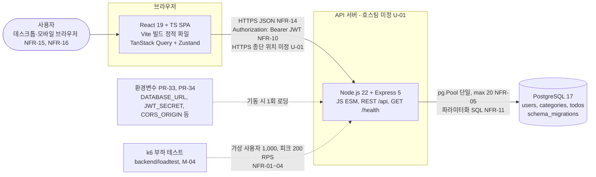

- 개발 환경: Vite dev 서버 프록시 `/api` → BE로 CORS 없이 동작(PR-35). 운영은 FE·BE 분리 가정 + `CORS_ORIGIN` 화이트리스트(U-01 잠정).
- 세션 저장소 없음(JWT 무상태, NFR-10). 서버 시계로 '오늘'을 정하지 않는다(PR-05).

## AD-02 프론트엔드 내부 구조

`pages → hooks → api` 단방향(PR-13). 서버 데이터는 TanStack Query 캐시에만, Zustand는 토큰과 UI 상태만 가진다(PR-14).

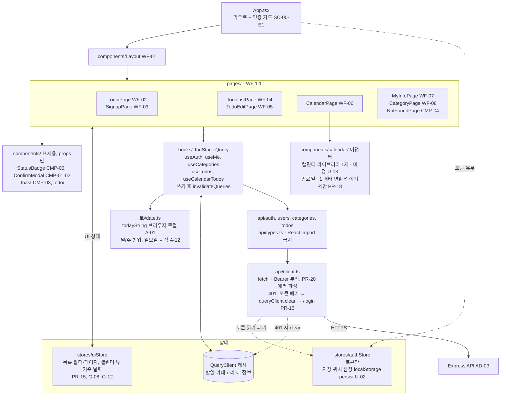

- 금지: 페이지·컴포넌트의 직접 `fetch`, 서버 응답의 Zustand 복사, FE의 상태 판정(상태는 응답 값을 표시만, PR-03).
- 로그아웃도 401 처리와 같은 함수(토큰 폐기 + `queryClient.clear()`)를 쓴다(PR-16, A-14). 로그아웃 API 없음(PR-37).

## AD-03 백엔드 레이어 구조

`app.js`가 미들웨어 → 라우터 → 404 → 에러 미들웨어 순으로 조립한다. 의존은 `routes → services → repositories` 한 방향이며 `validators/`·`domain/`은 순수 함수다(PR-09).

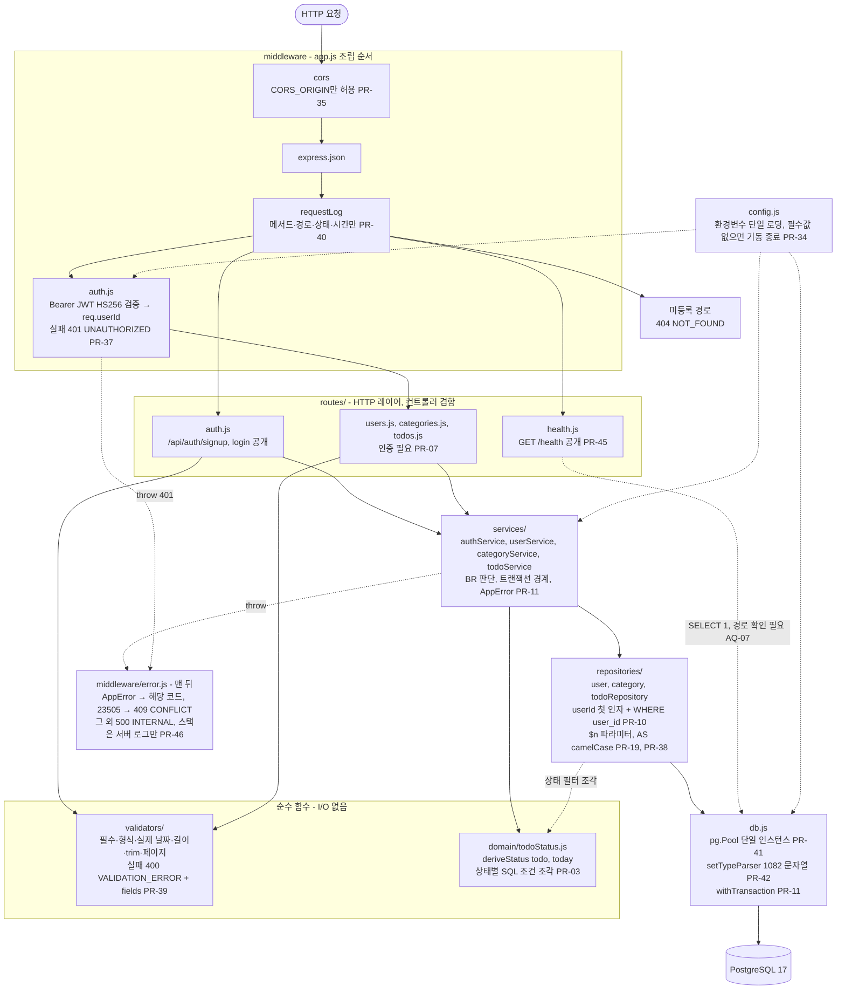

| 레이어 | 금지 (PR-09 표) |
|--------|-----------------|
| routes | SQL, `pg` 직접 사용, BR 판단 |
| services | `req`/`res` 접근, SQL 문자열 |
| repositories | 비즈니스 판단, HTTP 상태코드 결정 |
| domain, validators | DB·HTTP·전역 상태 접근 |

## AD-04 데이터 모델

도메인 4장 ER과 같은 엔티티·관계이며 테이블·컬럼명은 PR 3.1 네이밍(snake_case 복수형)을 따른다. 상태 컬럼은 두지 않는다(PR-03). 식별자 타입과 길이는 잠정이며 DDL은 후속 DB 설계 문서에서 확정한다.

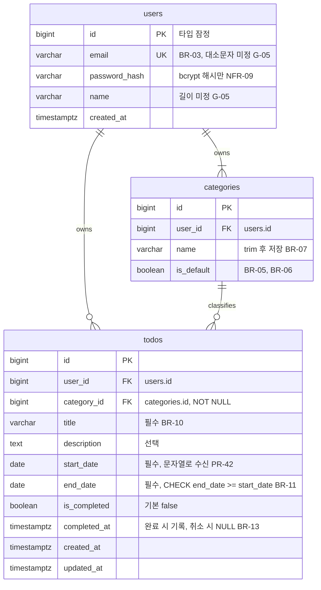

주요 제약·인덱스 (모두 잠정, NFR-07 상세는 DB 설계 문서)

| 대상 | 제약 / 인덱스 | 근거 |
|------|---------------|------|
| `users` | `UNIQUE (email)` → 위반 23505는 409 | BR-03, PR-46 |
| `categories` | `UNIQUE (user_id, name)` | BR-07 |
| `categories` | 부분 유니크 `(user_id) WHERE is_default` - 사용자당 '기본' 1개 | BR-05, 도메인 4.2 |
| `todos` | `CHECK (end_date >= start_date)` - 서버 검증(validators)의 최후 방어선 | BR-11, PR-06 |
| `todos.category_id` | FK `ON DELETE` 동작 없음(RESTRICT) - 삭제 전 '기본'으로 이동을 service가 보장 | BR-09, PR-11 |
| `todos` | 인덱스 `(user_id, end_date, created_at)` - 목록 정렬 | Q-05, NFR-07 |
| `todos` | 인덱스 `(user_id, category_id)` - 카테고리 필터·BR-09 이동 | BR-15, NFR-07 |
| `todos` | 인덱스 `(user_id, start_date, end_date)` - 캘린더 기간 겹침 | BR-16, NFR-07 |
| `schema_migrations` | 마이그레이션 적용 기록(ER 생략) | PR-44 |

## AD-05 배포 뷰 (미정, U-01)

배포 환경은 **미정**이다. 원칙 문서의 잠정안(A)과 대안(B)만 표시한다. 어느 쪽이든 DB는 1개, API 인스턴스 구성·HTTPS 종단은 확정 후 갱신한다.

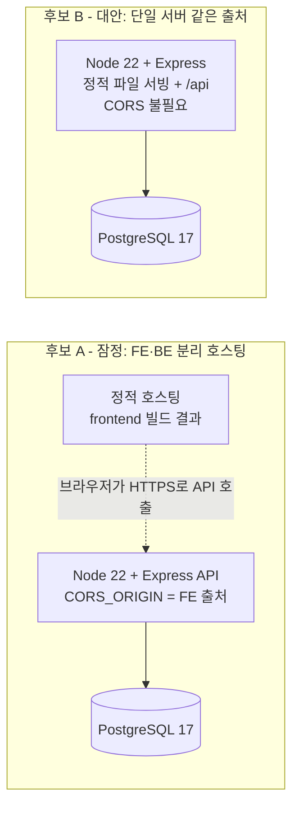

- HTTPS 종단 위치(프록시/호스팅 플랫폼), 로컬 실행 방식(로컬 설치/Docker Compose DB 1개, U-09)은 미정.
- 배포 전 확인: `GET /health` 200, 마이그레이션 적용(`scripts/migrate.js`), 환경변수 필수값(PR-34).

---

# 2부. 비즈니스 로직 시퀀스

공통 참여자: User, FE page, Query hook/api(api client 포함), Express auth mw, Route, Validator/Domain, Service, Repository, PostgreSQL. 다이어그램마다 필요한 참여자만 쓴다. 에러는 service·validator가 던지고 에러 미들웨어(AD-03)가 PR-20 형식으로 응답한다. 시퀀스에서는 이를 Route → hook 응답 화살표로 줄여 그린다.

## AD-06 회원가입 + '기본' 카테고리 자동 생성

bcrypt 해시는 트랜잭션 밖에서 먼저 계산해 커넥션 점유 시간을 줄이고, 사용자·'기본' 카테고리 INSERT만 한 트랜잭션으로 묶는다(BR-05, PR-11). 성공 시 토큰을 발급해 자동 로그인한다(G-01).

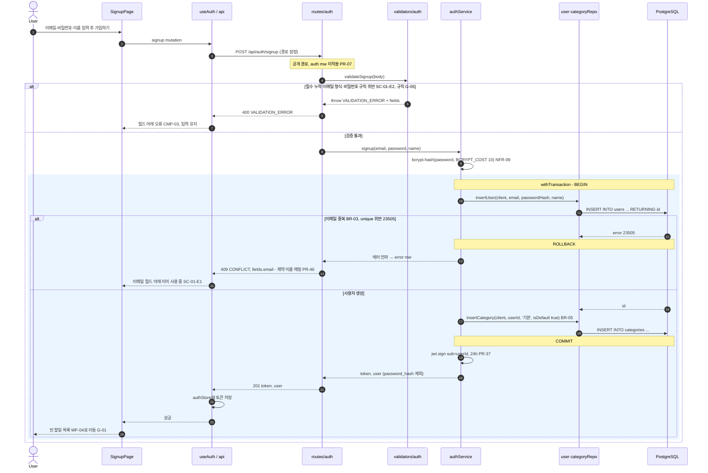

## AD-07 로그인 + 인증 요청 처리 + 토큰 만료 401

로그인 성공 시 JWT를 받아 `authStore`에 두고, 이후 모든 보호 요청에 Bearer를 붙인다. 보호 요청의 401은 api client 한 곳에서 처리한다(PR-16, SC-00-E2, G-03).

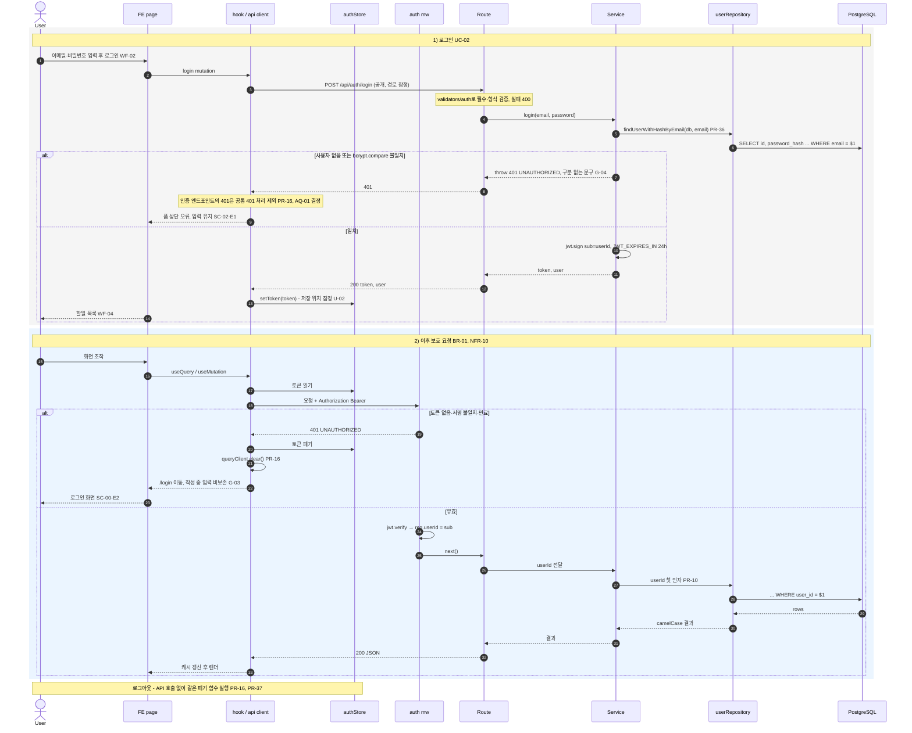

## AD-08 할일 목록 조회: today 전달, 필터, 정렬, 페이지네이션, 상태 파생

FE가 브라우저 로컬 날짜 `today`를 보내고(PR-05), BE는 이 값으로 상태 필터를 SQL 조건으로 바꾼 뒤 결과마다 상태를 파생한다(PR-03). 카테고리 AND (상태 OR) 조합(BR-15).

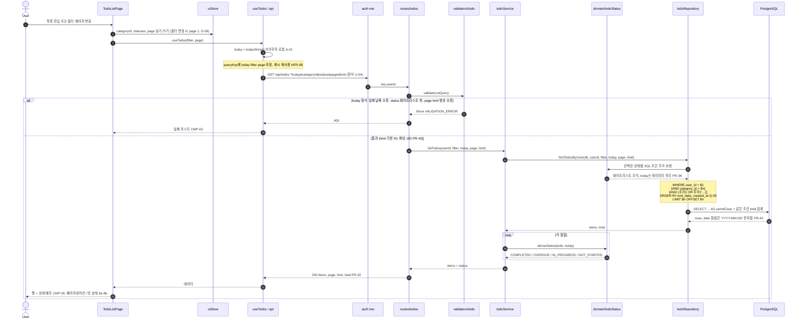

`domain/todoStatus.js` 판정 ↔ SQL 조각 대응 (두 표현이 같은 규칙이어야 하므로 한 파일에 둔다, PR-29 경계 테스트로 확인)

| 상태 코드 | ST | `deriveStatus` 판정 (순서: 완료 → 기한 초과 → 진행 중 → 시작 전) | SQL 조각 (`$t` = today) |
|-----------|----|--------------------------------------------------|-------------------------|
| `COMPLETED` | ST-01 | `isCompleted` | `is_completed` |
| `OVERDUE` | ST-04 | 미완료 AND today > endDate | `NOT is_completed AND end_date < $t` |
| `IN_PROGRESS` | ST-03 | 미완료 AND startDate ≤ today ≤ endDate | `NOT is_completed AND start_date <= $t AND end_date >= $t` |
| `NOT_STARTED` | ST-02 | 미완료 AND today < startDate | `NOT is_completed AND start_date > $t` |

AC-03 확인: today 11/13, 할일 11/10~11/12 미완료 → `end_date < $t` 참이므로 OVERDUE에 포함, IN_PROGRESS 조건 `end_date >= $t` 거짓이므로 미포함.

## AD-09 할일 등록 / 수정

등록·수정이 같은 검증과 카테고리 규칙을 쓴다(BR-17). 카테고리 미지정은 '기본'(BR-08), 지정 시 본인 소유 확인(PR-10), 수정 대상이 본인 것이 아니면 404(NFR-12). 완료 여부·완료일시는 수정으로 바꾸지 않는다(SC-07-A1).

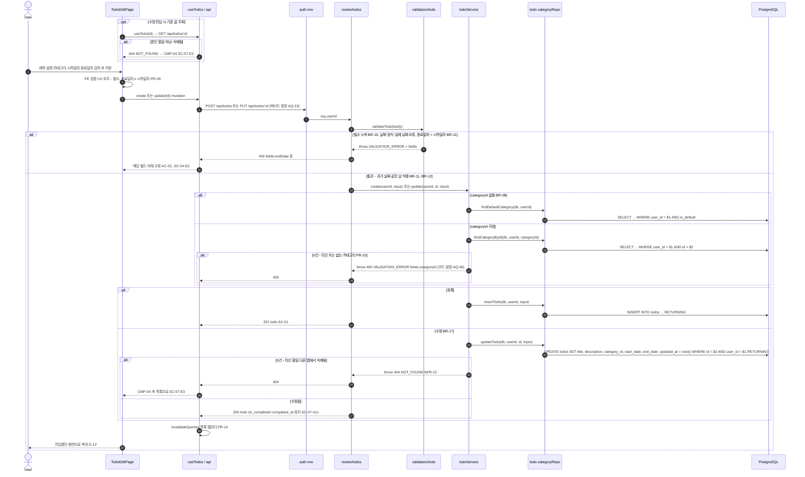

- 쓰기 요청에는 `today`가 없으므로(PR-05는 조회에만 전달) 응답에 상태를 넣지 않고 재조회 결과로 표시한다(잠정, AQ-09).

## AD-10 완료 토글

완료 시 완료일시 기록, 취소 시 비움(BR-13). 낙관적 업데이트 없이 성공 후 즉시 재조회한다(PR-14, AQ-03 결정). 상태 필터와 안 맞게 된 항목은 재조회 결과에서 바로 사라지고(G-11), 실패 시 캐시가 바뀐 적이 없어 토글이 원 상태로 남는다(SC-06-E1).

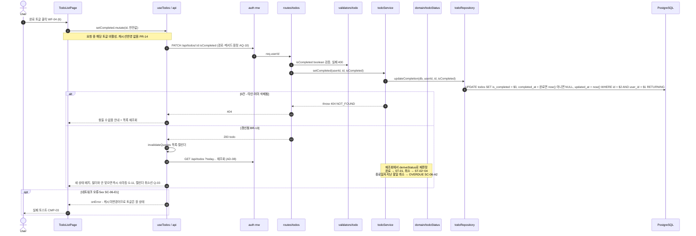

## AD-11 카테고리 삭제 (Should, M-05)

'기본' 카테고리 삭제는 거부하고(BR-06), 소속 할일을 '기본'으로 옮긴 뒤 삭제하는 두 쓰기를 한 트랜잭션으로 묶는다(BR-09, PR-11).

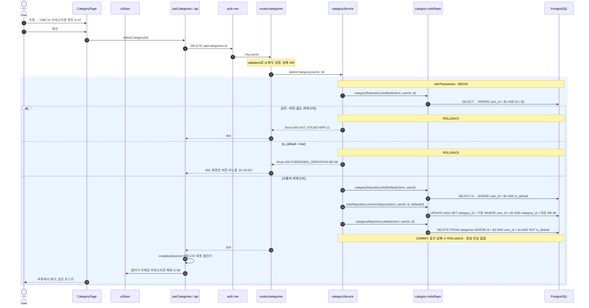

## AD-12 캘린더 조회 (월/주/일)

뷰 범위 `from`~`to`(PR-43 이름. 요청의 start/end, rangeStart/rangeEnd와 같은 뜻)로 기간 겹침 할일만 조회하고(BR-16), 라이브러리 형식 변환은 어댑터 한 곳에서 한다(PR-18). 라이브러리 선택은 미정(U-03), 아래는 FullCalendar 계열 가정.

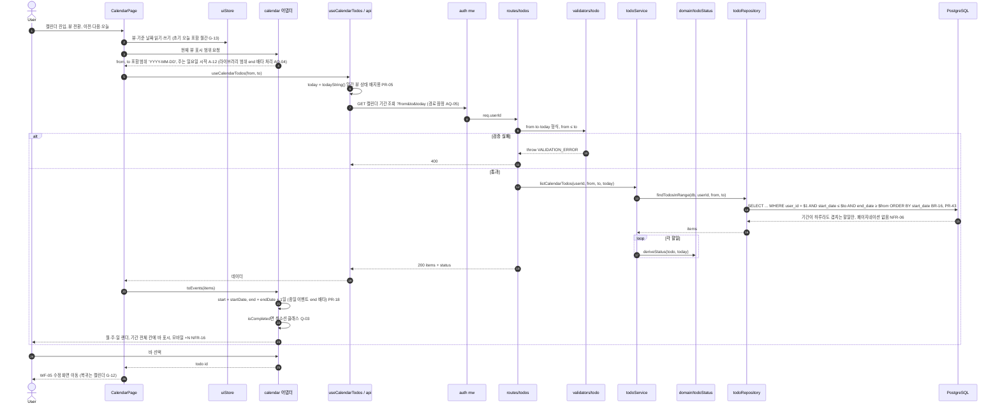

AC 확인: AC-05 할일 10/30~11/02, 11월 월간 from 11/01 → `start_date 10/30 ≤ to` AND `end_date 11/02 ≥ 11/01` 참 → 포함, 어댑터 end = 11/03(배타)으로 11/01·11/02 칸에 표시. AC-06 할일 11/14~11/16, 주간 11/08~11/14 → `11/14 ≤ 11/14` AND `11/16 ≥ 11/08` 참 → 11/14 칸 표시.

---

## 3. 추적 표 (AD → 근거 ID)

| AD | 제목 | PR | BR / ST / AC | NFR / TC | SC / WF / G |
|----|------|----|--------------|----------|-------------|
| AD-01 | 시스템 구성 | PR-05, PR-08, PR-32~35, PR-41 | - | NFR-01~05, NFR-10, NFR-11, NFR-14, TC-02~06 | U-01 |
| AD-02 | FE 내부 구조 | PR-03, PR-13~16, PR-18, PR-24, PR-28 | A-01, A-12 | NFR-08, TC-02, TC-03 | WF-01~08, CMP-01~05, G-08, G-12, U-02, U-03 |
| AD-03 | BE 레이어 | PR-07, PR-09~12, PR-19, PR-20, PR-34~46 | BR-01, BR-02 | NFR-05, NFR-10~14, TC-04, TC-05 | SC-00-E1~E4 |
| AD-04 | 데이터 모델 | PR-03, PR-04, PR-42, PR-44, 3.1 네이밍 | BR-03, BR-05~11, BR-13, 도메인 4장 | NFR-07, NFR-09, TC-06 | G-05, U-05 |
| AD-05 | 배포 뷰 | PR-35, PR-45 | - | NFR-14 | U-01, U-09 |
| AD-06 | 회원가입 | PR-07, PR-11, PR-36, PR-37, PR-46 | BR-03, BR-05 | NFR-09, NFR-13 | SC-01, SC-01-E1·E2, WF-03, G-01, G-05 |
| AD-07 | 로그인·401 | PR-10, PR-16, PR-36, PR-37 | BR-01 | NFR-03, NFR-10 | SC-02, SC-00-E1·E2, WF-02, G-03, G-04, U-02 |
| AD-08 | 목록 조회 | PR-03, PR-05, PR-20, PR-38, PR-43 | BR-15, ST-01~04, A-01, Q-05, AC-03, AC-04 | NFR-06, NFR-08, NFR-12 | SC-05, WF-04, G-09, U-04 |
| AD-09 | 할일 등록/수정 | PR-06, PR-10, PR-14, PR-39 | BR-08, BR-10~12, BR-17, AC-01, AC-02 | NFR-12, NFR-13 | SC-04, SC-07, WF-05, G-12 |
| AD-10 | 완료 토글 | PR-03, PR-10, PR-14 | BR-13, ST-01~04 | NFR-12 | SC-06, SC-06-E1, WF-04, G-11 |
| AD-11 | 카테고리 삭제 | PR-10, PR-11, PR-20 | BR-06, BR-09 | NFR-12 | SC-03-A2·E3, WF-08, CMP-01, G-07, G-08 |
| AD-12 | 캘린더 조회 | PR-05, PR-18, PR-28, PR-43 | BR-16, A-12, Q-03, AC-05, AC-06 | NFR-06, NFR-16 | SC-09, WF-06, G-12~14, U-03 |

## 4. 확인 필요

### 4.1 이 문서에서 새로 발견한 사항

| ID | 내용 | 영향 다이어그램 | 관련 |
|----|------|-----------------|------|
| AQ-01 | **결정(2026-11-04)**: 로그인·회원가입 요청의 401은 공통 401 처리에서 제외하고 화면이 폼 오류로 표시한다. PR-16에 반영 | AD-07 | PR-16, PR-20, SC-02-E1, G-04 |
| AQ-02 | **결정(2026-11-04)**: 409 `CONFLICT` 응답에 `fields`로 충돌 필드를 담는다. error 미들웨어가 unique 제약 이름을 필드(`email`, `name`)와 한국어 문구로 매핑한다. PR-20, PR-46에 반영 | AD-06, AD-11 | PR-21, PR-46, SC-01-E1, SC-03-E2, CMP-03 |
| AQ-03 | **결정(2026-11-04)**: 낙관적 업데이트 없이 성공 후 즉시 재조회한다. 필터와 안 맞게 된 항목은 바로 사라진다. PR-14, 시나리오 G-11·SC-06-A1, 와이어프레임 WF-04에 반영 | AD-10 | PR-14, G-11, SC-06-E1, WF-04 |
| AQ-04 | FullCalendar는 이벤트 `end`뿐 아니라 뷰 표시 범위(`datesSet`)의 `end`도 배타적이다. PR-18은 이벤트 쪽만 언급한다. 또한 ±1일 계산은 PR-4장 체크리스트 "날짜를 `Date`로 변환하지 않는다"와 부딪히므로 `lib/date.ts` 또는 어댑터 안에서 UTC 기준 날짜 산술을 예외로 허용할지 명시 필요 | AD-02, AD-12 | PR-04, PR-18, PR-28, U-03 |
| AQ-05 | 캘린더 조회는 기간 필수(PR-43)지만 기간 길이 상한이 없어 넓은 `from`~`to`로 사실상 전체 조회가 가능하다(NFR-06). 최대 기간 검증 여부, 엔드포인트 경로, 응답 형식(PR-20 목록 형식 `items, page, limit, total` 적용 여부) 확정 필요 | AD-12 | PR-20, PR-43, NFR-06, U-04 |
| AQ-06 | 타인·없는 `categoryId`로 할일 등록·수정 시 응답 코드 미정(PR-10은 확인만, PR-29는 "거부"). 이 문서는 400 `VALIDATION_ERROR` + `fields.categoryId`로 잠정. 확인과 INSERT/UPDATE 사이에 카테고리가 삭제되면 FK 위반(23503)이 PR-46상 500이 되는 점도 처리 필요 | AD-09 | PR-10, PR-29, PR-46, NFR-12 |
| AQ-07 | `GET /health`의 `SELECT 1`은 route가 DB에 직접 접근하는 형태라 PR-09(routes의 `pg` 직접 사용 금지)와 충돌한다. 헬스체크만 예외로 둘지, `db.js` 헬퍼 호출로 볼지 명시 필요 | AD-03 | PR-09, PR-45 |
| AQ-08 | Q-05 정렬(종료일자, 생성일시)만으로는 동률이 생길 수 있어 OFFSET 페이지네이션에서 행이 중복·누락될 수 있다. `id` 보조 정렬 추가 여부, `total` 집계 방식(별도 COUNT / 윈도 함수) 확인 필요 | AD-08 | Q-05, NFR-02, NFR-06 |
| AQ-09 | 쓰기 요청(등록·수정·토글)에는 `today`가 없어(PR-05는 조회만) 응답에 상태를 붙일 수 없다. 응답에서 상태를 빼고 재조회로 표시하는 것으로 잠정 | AD-09, AD-10 | PR-03, PR-05 |
| AQ-10 | 할일 수정과 완료 토글의 API 형태 미정: 수정에서 `isCompleted` 변경 허용 여부(편집 화면에 토글 없음 G-16), 토글 전용 경로 vs 공용 PATCH, PUT/PATCH 선택 | AD-09, AD-10 | PR 3.1 API 경로, G-16, BR-13, BR-17 |
| AQ-11 | FE 인증 가드는 토큰 유무만 알 수 있어, 만료 토큰으로 재방문하면 보호 화면이 잠깐 보인 뒤 첫 요청 401로 로그인 이동한다. SC-02-A1의 "유효한 토큰" 판정 방법(클라이언트 `exp` 확인 여부) 확인 필요 | AD-02, AD-07 | SC-02-A1, PR-16, U-02 |
| AQ-12 | 식별자 타입(bigint identity / uuid), 할일의 카테고리가 같은 사용자 소유임을 DB 복합 FK로도 강제할지(현재는 service 확인만, PR-10) 후속 DB 설계 문서에서 확정 필요 | AD-04 | PR-10, NFR-07, NFR-12 |

### 4.2 다이어그램에 반영한 기존 미결 사항 (재정의하지 않음)

| 기존 ID | 다이어그램 표시 |
|---------|------------------|
| U-01 배포 환경·HTTPS 종단 | AD-01 "호스팅 미정", AD-05 후보 A(잠정)/B |
| U-02 토큰 저장 위치 | AD-02 authStore "잠정 localStorage persist", AD-07 |
| U-03 캘린더 라이브러리 | AD-02 어댑터, AD-12 "FullCalendar 계열 가정" |
| U-04 today·상태 필터 파라미터 형식 | AD-08, AD-12 쿼리 파라미터 "형식 U-04" |
| U-05 / G-05 길이·비밀번호 규칙·이메일 대소문자 | AD-04 컬럼 주석, AD-06 검증 분기 |
| U-09 실행 방식 | AD-05 주석 |
| G-01 자동 로그인 | AD-06 가입 성공 시 토큰 발급 |
| G-03 만료 시 입력 비보존 | AD-07 401 분기 |
| G-11 필터 중 토글 | AD-10, AQ-03 |
