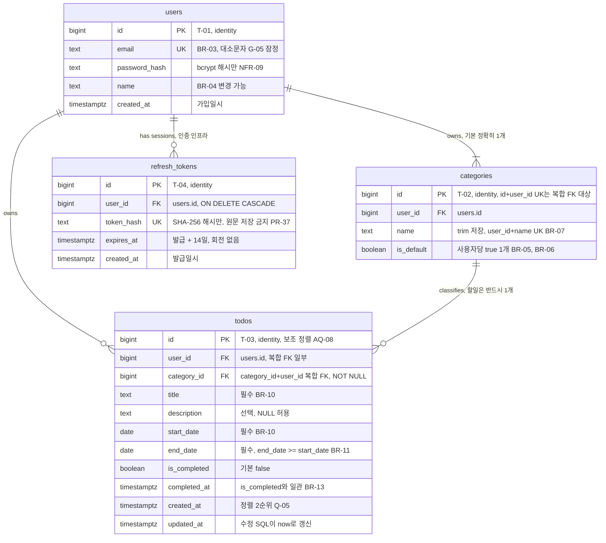

# TodoList ERD (데이터 모델)

## 버전 이력

| 버전 | 일자 | 작성자 | 상태 | 비고 |
|------|------|--------|------|------|
| v0.1 | 2026-11-04 | chaenamo | 초안 | 최초 작성 |
| v0.2 | 2026-11-04 | chaenamo | 초안 | 인증: JWT HS384 + refresh token(localStorage, 14일, 회전 없음) 반영 |
| v0.3 | 2026-11-04 | chaenamo | 초안 | 문서 간 정합성 검토 반영 |
| v0.4 | 2026-11-05 | chaenamo | 초안 | 부하 테스트·배포 범위 제외 반영 |

## 변경 이력

| 버전 | 일자 | 변경 섹션 | 변경 내용 | 변경자 |
|------|------|-----------|-----------|--------|
| v0.1 | 2026-11-04 | 전체 | `6-arch-diagram.md` AD-04(데이터 모델)에서 분리해 최초 작성. 논리 ERD, 테이블 정의, 제약 이름(PR-46 매핑 대상), 인덱스(NFR-07), 마이그레이션 파일 매핑 정의. AQ-08(`id` 보조 정렬), AQ-12(ID 타입, 소유자 일치 복합 FK) 결정 | chaenamo |
| v0.2 | 2026-11-04 | 기준 문서, 1, 2(T-04), 3(CN-16~18), 4(IX-04), 5, 6, 7.3(EQ-02) | 인증: JWT HS384 + refresh token(localStorage, 14일, 회전 없음) 반영. 인증 인프라 테이블 T-04 `refresh_tokens`(해시만 저장, 사용자 삭제 시 CASCADE), 제약 CN-16~18, 인덱스 IX-04, 마이그레이션 `004_create_refresh_tokens.sql` 추가 | chaenamo |
| v0.3 | 2026-11-04 | 기준 문서, 7.3(EQ-02) | 문서 간 정합성 검토 반영: 기준 원칙 v0.4, 아키텍처 v0.5로 갱신. EQ-02를 결정(잠정 기본값 채택: 테이블별 파일 001~004)으로 표기, 원칙 문서 6.2 트리 갱신 완료 | chaenamo |
| v0.4 | 2026-11-05 | 기준 문서, 4 | 부하 테스트를 이번 범위에서 하지 않으므로 상태 필터 인덱스 가정의 확인 시점(M-04 부하 테스트) 문구를 "가정으로 남긴다"로 변경. 기준 PRD v0.5, 원칙 v0.6, 아키텍처 v0.6 | chaenamo |

> 기준 문서: `docs/1-domain-definition.md` (v0.3), `docs/2-PRD.md` (v0.5), `docs/5-project-principle.md` (v0.6), `docs/6-arch-diagram.md` (v0.6).
> 기준 문서 ID(P, FR, ST, BR, UC, AC, A, Q, NFR, TC, M, R, K, SC, G, WF, CMP, PR, U, AD, AQ)는 **참조만** 하며 재정의하지 않는다. 도메인 4.2의 개념 ER은 개념 모델로 유지하고, 이 문서는 그 물리(PostgreSQL 17) 구현이다.
> 이 문서 고유 ID: 테이블 `T-xx`, 제약 `CN-xx`, 인덱스 `IX-xx`, 확인 필요 `EQ-xx`. 삭제되어도 **재사용하거나 다시 매기지 않는다.**

표기: **잠정** = 미결 ID(G, U, Q, AQ, EQ)가 확정되면 바뀔 수 있음.

## 1. 논리 ERD

- 식별자: `bigint GENERATED ALWAYS AS IDENTITY`. 근거: DB 1개·단일 API(AD-01)라 분산 생성이 필요 없고, 8바이트 순번이 인덱스·정렬 보조키(AQ-08)에 유리하다. 추측 가능성은 소유권 조건 + 404(NFR-12, PR-10)로 막으므로 uuid의 이점이 없다(AQ-12 결정).
- 문자열은 `text`. 길이 제한은 G-05 미정이므로 `validators/` 상수로 검사하고(PR-39) DB에 길이를 두지 않는다. G-05 확정 시 마이그레이션이 필요 없다(U-05의 "DB 컬럼 길이" 영향 제거, 잠정).
- 상태 컬럼은 없다(5장, PR-03). 날짜는 `date`(TC-06, A-01), 일시는 `timestamptz`(PR-04).



`schema_migrations`(PR-44, 마이그레이션 기록)는 도메인 데이터가 아니므로 ERD에서 생략한다. `refresh_tokens`(T-04)도 도메인 데이터가 아닌 **인증 인프라 테이블**(세션 데이터)이지만, `users`와 FK로 연결되고 API 동작(NFR-10, PR-37)에 쓰이므로 ERD에 표시한다. 할일 상태·도메인 규칙(BR)과 무관하다.

## 2. 테이블 정의

### T-01 `users`

| 컬럼 | 타입 | NULL | 기본값 | 제약 | 근거 ID |
|------|------|------|--------|------|---------|
| `id` | `bigint` | N | identity (ALWAYS) | CN-01 | AQ-12 |
| `email` | `text` | N | - | CN-02 | BR-03, A-06(변경 불가) |
| `password_hash` | `text` | N | - | - | NFR-09, PR-36 |
| `name` | `text` | N | - | CN-03 | 도메인 4.1, BR-04, SC-10-E2 |
| `created_at` | `timestamptz` | N | `now()` | - | 도메인 4.1(가입일시) |

### T-02 `categories`

| 컬럼 | 타입 | NULL | 기본값 | 제약 | 근거 ID |
|------|------|------|--------|------|---------|
| `id` | `bigint` | N | identity (ALWAYS) | CN-04, CN-07 | AQ-12 |
| `user_id` | `bigint` | N | - | CN-05, CN-06, CN-07, CN-08 | BR-02, 도메인 4.2 |
| `name` | `text` | N | - | CN-06, CN-09 | BR-07, A-09 |
| `is_default` | `boolean` | N | `false` | CN-08 | BR-05, BR-06, A-03 |

### T-03 `todos`

| 컬럼 | 타입 | NULL | 기본값 | 제약 | 근거 ID |
|------|------|------|--------|------|---------|
| `id` | `bigint` | N | identity (ALWAYS) | CN-10 | AQ-12, AQ-08 |
| `user_id` | `bigint` | N | - | CN-11, CN-12 | BR-02, NFR-12 |
| `category_id` | `bigint` | N | - | CN-12 | 도메인 4.2, BR-08, BR-09 |
| `title` | `text` | N | - | CN-13 | BR-10 |
| `description` | `text` | Y | `NULL` | - | 도메인 4.1(선택) |
| `start_date` | `date` | N | - | CN-14 | BR-10, BR-12, TC-06, A-01 |
| `end_date` | `date` | N | - | CN-14 | BR-10, BR-11, BR-12, TC-06 |
| `is_completed` | `boolean` | N | `false` | CN-15 | BR-13, A-07 |
| `completed_at` | `timestamptz` | Y | `NULL` | CN-15 | BR-13 |
| `created_at` | `timestamptz` | N | `now()` | - | 도메인 4.1, Q-05 |
| `updated_at` | `timestamptz` | N | `now()` | - | 도메인 4.1. 트리거 없이 수정·토글 SQL이 `updated_at = now()` 설정(AD-09, AD-10) |

### T-04 `refresh_tokens`

인증 인프라 테이블. 도메인 엔터티가 아니며 상태·도메인 규칙과 무관하다. 행 1개 = 로그인 세션 1개(기기·브라우저별). 회전이 없으므로 행은 발급 후 갱신되지 않고, 로그아웃(해당 행)·비밀번호 변경(사용자 전체)·로그인 시 만료 정리로만 삭제된다(PR-37, AD-07).

| 컬럼 | 타입 | NULL | 기본값 | 제약 | 근거 ID |
|------|------|------|--------|------|---------|
| `id` | `bigint` | N | identity (ALWAYS) | CN-16 | AQ-12 |
| `user_id` | `bigint` | N | - | CN-17 | NFR-10, PR-37 |
| `token_hash` | `text` | N | - | CN-18 | refresh token(`crypto.randomBytes(32)` base64url)의 SHA-256 해시. 원문은 저장하지 않는다(R-05, PR-37) |
| `expires_at` | `timestamptz` | N | - | - | 발급 시각 + `REFRESH_TOKEN_TTL_DAYS`(14일). service가 계산해 넣는다(NFR-10) |
| `created_at` | `timestamptz` | N | `now()` | - | 발급일시 |

## 3. 제약 조건

이름 규칙: `pk_/fk_/uq_/ck_<테이블>_<내용>`. PostgreSQL 기본 이름(`users_email_key` 등)에 의존하지 않고 **명시적으로 이름을 붙인다**. error 미들웨어는 `err.constraint`로 이 이름을 받는다(PR-46).

| ID | 이름 | 테이블 | 종류 | 정의 | 근거 |
|----|------|--------|------|------|------|
| CN-01 | `pk_users` | users | PK | `(id)` | - |
| CN-02 | `uq_users_email` | users | UNIQUE | `(email)`. 23505 → 409, **PR-46 매핑 `email`**. 대소문자: G-05 미정. 잠정으로 입력값 그대로 저장·비교(구분함). 구분하지 않기로 하면 validators에서 소문자로 정규화해 이 제약을 그대로 쓴다 | BR-03, PR-46, G-05 |
| CN-03 | `ck_users_name_not_blank` | users | CHECK | `btrim(name) <> ''` | SC-10-E2, NFR-13 |
| CN-04 | `pk_categories` | categories | PK | `(id)` | - |
| CN-05 | `fk_categories_user_id` | categories | FK | `(user_id) → users(id) ON DELETE RESTRICT`. 회원 탈퇴 미정(Q-01). 결정 시 새 마이그레이션으로 변경 | BR-02, Q-01 |
| CN-06 | `uq_categories_user_id_name` | categories | UNIQUE | `(user_id, name)`. 23505 → 409, **PR-46 매핑 `name`**. 대소문자는 구분(BR-07은 trim만 규정) | BR-07, PR-46 |
| CN-07 | `uq_categories_id_user_id` | categories | UNIQUE | `(id, user_id)`. CN-12 복합 FK의 참조 대상으로만 존재(`id`가 PK라 위반될 수 없음, PR-46 매핑 불필요) | AQ-12 |
| CN-08 | `uq_categories_user_id_default` | categories | **partial UNIQUE INDEX** | `(user_id) WHERE is_default`. 사용자당 '기본' 최대 1개. "최소 1개"는 가입 트랜잭션(BR-05, AD-06)과 '기본' 삭제 거부(BR-06, AD-11의 `AND NOT is_default`)로 보장. 정상 흐름에서 위반되지 않으므로 PR-46 매핑 없음(위반 시 `fields` 없는 409) | BR-05, BR-06, 도메인 4.2 |
| CN-09 | `ck_categories_name_trimmed` | categories | CHECK | `name <> '' AND name = btrim(name)`. trim은 validators가 하고(PR-39) DB는 최후 방어선 | BR-07, A-09 |
| CN-10 | `pk_todos` | todos | PK | `(id)` | - |
| CN-11 | `fk_todos_user_id` | todos | FK | `(user_id) → users(id) ON DELETE RESTRICT` (Q-01 미정, CN-05와 동일) | BR-02, Q-01 |
| CN-12 | `fk_todos_category_owner` | todos | **복합 FK** | `(category_id, user_id) → categories(id, user_id) ON DELETE RESTRICT` | 아래 3.1 |
| CN-13 | `ck_todos_title_not_blank` | todos | CHECK | `btrim(title) <> ''` | BR-10 |
| CN-14 | `ck_todos_date_range` | todos | CHECK | `end_date >= start_date` (같은 날 허용). 서버 검증(PR-06) 뒤의 최후 방어선 | BR-11, AC-02 |
| CN-15 | `ck_todos_completed_at` | todos | CHECK | `is_completed = (completed_at IS NOT NULL)`. 완료면 일시 있음, 미완료면 NULL | BR-13 |
| CN-16 | `pk_refresh_tokens` | refresh_tokens | PK | `(id)` | - |
| CN-17 | `fk_refresh_tokens_user_id` | refresh_tokens | FK | `(user_id) → users(id) ON DELETE CASCADE`. 도메인 데이터가 아닌 세션 데이터이므로 사용자가 삭제되면 함께 삭제한다. Q-01(회원 탈퇴) 결정과 무관하게 안전하다(CN-05·CN-11의 RESTRICT가 도메인 데이터 보호를 맡음) | NFR-10, PR-37 |
| CN-18 | `uq_refresh_tokens_token_hash` | refresh_tokens | UNIQUE | `(token_hash)`. refresh·logout의 해시 조회 인덱스를 겸한다. 32바이트 무작위 값이라 정상 흐름에서 위반되지 않으므로 **PR-46 매핑 대상 아님**(위반 시 `fields` 없는 409) | PR-37 |

필수값(BR-10)은 `NOT NULL`로, 과거 날짜 허용(BR-12)은 날짜 하한 CHECK를 두지 않는 것으로 반영한다. BR-06(이름 변경 금지)·BR-09(이동)·BR-13의 시각 기록은 service 규칙이며 DB 트리거를 두지 않는다(PR-01).

### 3.1 소유자 일치 복합 FK 결정 (AQ-12, AQ-06, NFR-12)

**결정: 강제한다.** `todos.(category_id, user_id) → categories.(id, user_id)`.

- 근거: NFR-12/BR-02 위반(타인 카테고리에 할일 연결)은 데이터 오염이며 service 확인(PR-10)이 한 곳만 빠져도 생긴다(R-04). 비용은 CN-07 유니크 인덱스 1개뿐이다.
- service 확인(PR-10, AD-09)은 **유지한다**: 정상 경로에서 400 `fields.categoryId`(AQ-06 잠정)를 주는 것은 service이고, 복합 FK는 누락·경합 시의 안전망이다.
- `ON DELETE RESTRICT`: BR-09에 따라 service가 같은 트랜잭션에서 할일을 '기본'으로 옮긴 뒤 삭제한다(AD-11, PR-11). 옮기지 않은 할일이 남으면 삭제가 실패해 할일 유실을 막는다. `CASCADE`·`SET NULL`은 BR-09·도메인 4.2(반드시 하나의 카테고리)와 맞지 않아 쓰지 않는다.
- 경합 시 동작(AQ-06): 할일 등록·수정의 확인과 INSERT/UPDATE 사이에 카테고리가 삭제되거나, 카테고리 삭제 트랜잭션의 이동과 DELETE 사이에 할일이 들어오면 23503(`fk_todos_category_owner`)이 난다. 현재 PR-46은 23503을 500으로 처리한다 → EQ-01.

핵심 스니펫 (전체 DDL은 마이그레이션 파일에서 작성):

```sql
CONSTRAINT fk_todos_category_owner FOREIGN KEY (category_id, user_id)
  REFERENCES categories (id, user_id) ON DELETE RESTRICT
CREATE UNIQUE INDEX uq_categories_user_id_default ON categories (user_id) WHERE is_default;
```

## 4. 인덱스 (NFR-07)

PK·UNIQUE가 만드는 인덱스(CN-01·02·04·06·07·08·10·16·18)는 별도로 만들지 않는다. 모든 할일 쿼리는 `user_id = $1`로 시작하므로(PR-10) 인덱스 첫 컬럼은 `user_id`다.

| ID | 이름 | 정의 | 대상 쿼리 | 근거 |
|----|------|------|-----------|------|
| IX-01 | `ix_todos_user_id_end_date` | `todos (user_id, end_date, created_at, id)` | 목록(카테고리 필터 없음): `WHERE user_id = $1 [AND 상태 조각] ORDER BY end_date, created_at, id LIMIT/OFFSET` — 정렬을 인덱스 순서로 처리해 Sort 없음 | Q-05, AQ-08, NFR-06, NFR-07 |
| IX-02 | `ix_todos_user_id_category_id` | `todos (user_id, category_id, end_date, created_at, id)` | 목록(카테고리 필터): `WHERE user_id = $1 AND category_id = $2 ... ORDER BY end_date, created_at, id`. 같은 인덱스로 BR-09 이동(`UPDATE ... WHERE user_id AND category_id`)과 CN-12 RESTRICT 검사(카테고리 삭제 시 참조 할일 탐색)도 처리 | BR-15, BR-09, NFR-07 |
| IX-03 | `ix_todos_user_id_start_date` | `todos (user_id, start_date, end_date)` | 캘린더 기간 겹침: `WHERE user_id = $1 AND start_date <= $to AND end_date >= $from` — `start_date` 범위 스캔 + `end_date`는 인덱스 내 필터 | BR-16, PR-43, AQ-05 |
| IX-04 | `ix_refresh_tokens_user_id` | `refresh_tokens (user_id)` | 비밀번호 변경 시 전체 폐기 `DELETE ... WHERE user_id = $1`, 로그인 시 만료 정리 `DELETE ... WHERE user_id = $1 AND expires_at < now()`, CN-17 CASCADE 검사 | NFR-10, PR-37, G-06 |
| (CN-02) | `uq_users_email` | `users (email)` | 로그인·가입 중복 확인 `WHERE email = $1` | BR-03, PR-36 |
| (CN-06) | `uq_categories_user_id_name` | `categories (user_id, name)` | 카테고리 목록 `WHERE user_id = $1`, 소유 확인 | BR-02, PR-10 |
| (CN-08) | `uq_categories_user_id_default` | `categories (user_id) WHERE is_default` | '기본' 조회 `WHERE user_id = $1 AND is_default` | BR-08, BR-09 |
| (CN-18) | `uq_refresh_tokens_token_hash` | `refresh_tokens (token_hash)` | refresh·logout `WHERE token_hash = $1` | PR-37 |

- 상태 필터(`is_completed`, 날짜 비교 조각)는 별도 인덱스 없이 IX-01/02 스캔 중 필터로 처리한다. 사용자당 할일 수가 작다는 가정이며, 부하 테스트는 이번 범위에서 하지 않으므로 가정으로 남긴다.
- IX-03의 범위 조건 `start_date <= $to`에는 하한이 없어 사용자의 과거 할일 전체를 훑는다. 사용자당 수가 커지면 `daterange` GiST 인덱스로 바꾼다(지금은 `btree_gist` 확장 불필요, PR-01).
- 데이터가 적으면 플래너가 Seq Scan을 고르는 것이 정상이다. NFR-07 확인은 시드 데이터를 충분히 넣거나 `SET enable_seqscan = off`로 `EXPLAIN` 해 인덱스 사용 가능 여부를 본다.

## 5. 파생 값 / 저장하지 않는 것

- 할일 상태(ST-01~04)는 **컬럼이 없다**(PR-03). 조회 시 `today` 파라미터(PR-05)로 SQL 조건을 만들고(`is_completed`, `end_date < $t`, `start_date <= $t AND end_date >= $t`, `start_date > $t`), 응답 상태는 `deriveStatus`가 붙인다. 조각 대응표는 `6-arch-diagram.md` AD-08이 원본이다.
- '오늘', 캘린더 표시용 배타 종료일(+1일, PR-18)은 저장하지 않는다.
- 비밀번호 평문은 어디에도 저장하지 않는다(NFR-09).
- refresh token 원문과 access token은 저장하지 않는다. DB에는 refresh token의 SHA-256 해시만 둔다(PR-37).

## 6. 마이그레이션 파일 매핑

`backend/db/migrations/NNN_설명.sql`, 번호순 트랜잭션 적용, 적용 후 수정 금지, down 없음(PR-44). FK 의존 순서로 나눈다.

| 파일 | 내용 |
|------|------|
| `001_create_users.sql` | T-01, CN-01~03 |
| `002_create_categories.sql` | T-02, CN-04~09 |
| `003_create_todos.sql` | T-03, CN-10~15, IX-01~03 |
| `004_create_refresh_tokens.sql` | T-04, CN-16~18, IX-04 (001~003은 아직 적용 전이지만 파일 분리 원칙을 지켜 새 파일로 추가) |

이후 변경(예: Q-01 탈퇴 시 ON DELETE 변경, G-05 대소문자 정책)은 `005_*.sql`부터 새 파일로 추가한다.

## 7. 확인 필요

### 7.1 이 문서에서 결정한 기존 항목

| 기존 ID | 결정 |
|---------|------|
| AQ-08 | 목록 정렬에 `id` 보조 정렬을 추가한다: `ORDER BY end_date, created_at, id` (IX-01·02가 이 순서를 포함). `total`은 같은 WHERE로 별도 `COUNT(*)` 잠정(윈도 함수는 마지막 페이지 밖에서 0행이면 total을 못 얻음). 최종 확정은 API 문서 |
| AQ-12 | ID 타입 `bigint identity`(1장). 소유자 일치는 복합 FK CN-12로 DB에서도 강제(3.1). service 확인(PR-10)은 유지 |

### 7.2 반영한 기존 미결 (재정의하지 않음)

| 기존 ID | 이 문서의 처리 |
|---------|----------------|
| Q-01 회원 탈퇴 | CN-05, CN-11 `ON DELETE RESTRICT` 잠정 |
| G-05 / U-05 길이·이메일 대소문자 | 컬럼 `text`, 길이는 validators(PR-39). CN-02 대소문자 구분 잠정 |
| AQ-05 캘린더 기간 상한 | IX-03으로 인덱스는 지원. 기간 상한·경로·응답 형식은 AQ-05 그대로 미정 |
| AQ-06 타인 카테고리 응답 코드 | DB는 CN-12로 거부. 응답 코드와 경합 시 23503 처리는 EQ-01 |

### 7.3 새로 발견한 사항

| ID | 내용 | 관련 |
|----|------|------|
| EQ-01 | 23503(FK 위반)이 PR-46상 500이 된다. `fk_todos_category_owner` 위반을 할일 등록·수정에서는 400 `VALIDATION_ERROR` `fields.categoryId`로, 카테고리 삭제에서는 재시도 가능한 409로 매핑할지, 또는 경합 자체를 막기 위해 카테고리 삭제 트랜잭션에서 대상 카테고리를 `FOR UPDATE`, 할일 쓰기에서 `FOR SHARE`로 잠글지 결정 필요. 결정 시 PR-46 갱신 | CN-12, AQ-06, PR-46, NFR-04 |
| EQ-02 | **결정(2026-11-04, 실행 계획의 잠정 기본값 채택)**: 테이블별 파일 4개(001~004, 6장). 원칙 문서 6.2 트리를 v0.4에서 이에 맞춰 갱신했다. (원 내용) 마이그레이션 파일 구성: 원칙 문서 6.2 트리는 `001_init.sql` 1개로 예시했으나 이 문서는 테이블별 4개(v0.2에서 `004_create_refresh_tokens.sql` 추가)로 나눴다(6장). 원칙 문서 트리를 갱신할지 확인 필요 | PR-44, 5-project-principle 6.2 |
| EQ-03 | 할일 제목의 공백만 입력 처리: CN-13은 `btrim(title) <> ''`로 거부한다. 제목도 카테고리 이름처럼 trim 후 저장할지(BR-07은 카테고리만 규정) 확인 필요 | BR-10, PR-39, G-05 |
