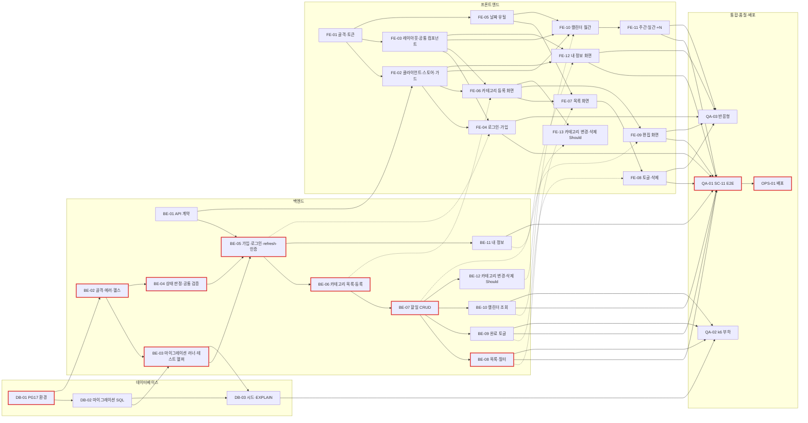

# TodoList 실행 계획 (WBS)

## 버전 이력

| 버전 | 일자 | 작성자 | 상태 | 비고 |
|------|------|--------|------|------|
| v0.1 | 2026-11-04 | chaenamo | 초안 | 최초 작성 |
| v0.2 | 2026-11-04 | chaenamo | 초안 | 인증: JWT HS384 + refresh token(localStorage, 14일, 회전 없음) 반영 |
| v0.3 | 2026-11-04 | chaenamo | 초안 | 문서 간 정합성 검토 반영 |

## 변경 이력

| 버전 | 일자 | 변경 섹션 | 변경 내용 | 변경자 |
|------|------|-----------|-----------|--------|
| v0.1 | 2026-11-04 | 전체 | 도메인 정의서~ERD·schema.sql 기반 DB/BE/FE/QA/OPS Task 분해, 의존성·크리티컬 패스, 착수 전 결정 목록, UC·AC 추적 표 최초 작성 | chaenamo |
| v0.2 | 2026-11-04 | 기준 문서, 1, 2, BE-01, DB-02, BE-02, BE-03, BE-05, BE-11, FE-02, FE-04, FE-12, QA-01, QA-02, OPS-01, 7, 8.3 | 인증: JWT HS384 + refresh token(localStorage, 14일, 회전 없음) 반영. BE-05를 토큰 쌍 발급·refresh·logout·HS384로 확장(제목 변경), BE-01 계약에 refresh·logout 추가·비밀번호 변경 응답 200 `{ refreshToken }`, DB-02·BE-03·OPS-01 마이그레이션 4개(004 추가), BE-11 비밀번호 변경 시 전체 refresh 폐기, FE-02 access 메모리·refresh localStorage·single-flight refresh·앱 진입 refresh, FE-04 로그아웃 API 호출. 0.2 규칙에 따라 기존 체크박스 문장 변경: BE-01(엔드포인트 수 17→19), DB-02(001→004·refresh_tokens), BE-02(`JWT_ACCESS_SECRET`, 로그), BE-03(파일·테이블 수), BE-05(응답 필드, payload·만료), BE-11(G-06), FE-02(Bearer, 401, 가드), FE-04(토큰 저장, 로그아웃), FE-12(G-06), QA-02(NFR-02에 refresh), OPS-01(4행, 비밀키 이름). 7장 U-02·AQ-11·G-06·EQ-02 갱신, 예상 시간 BE-05 2→3h, BE-11 1→1.5h, FE-02 1.5→2.5h | chaenamo |
| v0.3 | 2026-11-04 | 기준 문서, 2, DB-02, 7(EQ-02) | 문서 간 정합성 검토 반영: 기준 시나리오·와이어프레임 v0.5, 원칙 v0.4, 아키텍처 v0.5, ERD v0.3으로 갱신. 의존성 그래프에 1장 표의 QA-03 선행 FE-04 간선 추가. EQ-02를 결정(잠정 기본값 채택: 테이블별 4개)으로 표기하고 DB-02 선결 결정 문구 갱신(원칙 6.2 트리 갱신 완료). 체크박스 문장 변경 없음 | chaenamo |

> 기준 문서: `docs/1-domain-definition.md` (v0.3), `docs/2-PRD.md` (v0.4), `docs/3-user-scenario.md` (v0.5), `docs/4-wireframe.md` (v0.5), `docs/5-project-principle.md` (v0.4), `docs/6-arch-diagram.md` (v0.5), `docs/7-erd.md` (v0.3), `docs/schema.sql`.
> 기준 문서 ID(P, FR, ST, BR, UC, AC, A, Q, NFR, TC, M, R, K, SC, G, WF, CMP, PR, U, AD, AQ, T, CN, IX, EQ)는 **참조만** 하며 재정의하지 않는다.
> 이 문서 고유 ID: Task `DB-xx`, `BE-xx`, `FE-xx`, `QA-xx`, `OPS-xx`, 확인 필요 `PQ-xx`. 삭제되어도 **재사용하거나 다시 매기지 않는다.** Task를 나누면 새 번호를 붙이고 원 Task는 "분할됨"으로 남긴다.

## 0. 사용법

### 0.1 개발 스킬과의 관계

| 계층 | 실행 방법 | 예 |
|------|-----------|-----|
| BE (`BE-02`~) | `/develop-backend <Task ID>` | `/develop-backend BE-07` |
| FE | `/develop-frontend <Task ID>` | `/develop-frontend FE-07` |
| BE-01 (API 계약 문서) | 스킬 미사용. 수동 또는 `api-designer` 에이전트로 문서 작성 | - |
| DB, QA, OPS | 스킬 없음. 수행 작업의 명령을 직접 실행하고 결과로 체크 | - |

- 스킬은 Task 제목 `### <ID> <Task명>`을 검색해 그 절의 **수행 작업·선결 결정·완료 조건**만 읽는다. 다른 Task 절의 내용을 전제로 쓰지 않는다(필요하면 ID로 참조).
- **주의(U-08)**: 현재 두 스킬은 `docs/5-plan.md`를 읽도록 되어 있다. 이 문서는 `docs/8-plan.md`다. 스킬 실행 전에 스킬 경로를 `docs/8-plan.md`로 고치거나 이 파일을 그 경로로 복사(동기화)해야 한다. 7장 참조.
- 스킬 커버리지 90%는 PR-30대로 그 Task가 바꾼 BE `services/`·`repositories/`·`validators/`·`domain/`, FE `lib/`·`hooks/`·`api/`·`stores/`에만 적용한다.
- 선행 Task가 완료(체크박스 전부 체크)되지 않았으면 착수하지 않는다. FE Task의 "통합 확인"에 적힌 BE Task는 착수 조건이 아니다(FE는 BE-01 계약과 fetch 모킹으로 개발, 실제 연동은 QA-01).

### 0.2 체크박스 갱신 규칙

- 완료 조건의 체크박스를 **모두** 체크해야 Task 완료다. 일부만 충족하면 체크한 것만 남기고 미충족 항목을 보고한다(스킬 재시도 3회 규칙).
- 스킬은 테스트·명령이 실제로 통과한 항목만 체크한다. 수동 확인 항목(DB, QA, OPS)은 수행자가 확인 후 체크한다.
- 체크박스 문장은 바꾸지 않는다. 조건을 바꿔야 하면 변경 이력에 남기고 고친다.
- 선결 결정이 잠정값과 다르게 확정되면 해당 Task 절과 7장을 먼저 고친 뒤 착수한다(PR-02).

### 0.3 상태 표기

별도 상태 칸을 두지 않고 체크박스로 판정한다: 전부 미체크 = **대기**, 일부 체크 = **진행 중**, 전부 체크 = **완료**. 착수할 수 없으면 Task 절 맨 위에 `> 보류: <사유>` 한 줄을 단다.

### 0.4 공통 완료 조건 (각 Task 절에 다시 적음)

BE: `npm run lint` 경고 0, `npm test` 전체 통과, PR-30 대상 폴더 커버리지 ≥ 90%. FE: `npm run lint`, `npm test`, `npm run build`(타입 오류 0) 통과, PR-30 대상 폴더 커버리지 ≥ 90%.

## 1. Task 요약

예상 시간은 스킬 1회 실행 + 결과 검토 기준이다.

| ID | 계층 | Task명 | 우선순위 | 마일스톤 | 선행 Task | 예상 |
|----|------|--------|----------|----------|-----------|------|
| DB-01 | DB | PostgreSQL 17 실행 환경·DB 생성 | Must | M-01 | - | 0.5h |
| DB-02 | DB | 마이그레이션 SQL 작성·제약 검증 | Must | M-01 | DB-01 | 1h |
| DB-03 | DB | 개발용 시드·인덱스 사용 확인 | Must | M-02 | DB-02, BE-03 | 1h |
| BE-01 | BE | API 계약 정의 (문서) | Must | M-01 | - | 1h |
| BE-02 | BE | 백엔드 골격·설정·DB 풀·에러 처리·헬스체크 | Must | M-01 | DB-01 | 1.5h |
| BE-03 | BE | 마이그레이션 러너·테스트 DB 헬퍼 | Must | M-01 | BE-02, DB-02 | 1h |
| BE-04 | BE | 할일 상태 판정·공통 입력 검증 | Must | M-01 | BE-02 | 1h |
| BE-05 | BE | 회원가입·로그인·토큰 갱신·로그아웃·인증 미들웨어 API | Must | M-01 | BE-01, BE-03, BE-04 | 3h |
| BE-06 | BE | 카테고리 목록·등록 API | Must | M-02 | BE-05 | 1h |
| BE-07 | BE | 할일 등록·상세·수정·삭제 API | Must | M-02 | BE-06 | 2h |
| BE-08 | BE | 할일 목록 조회·필터·페이지네이션 API | Must | M-02 | BE-07 | 1.5h |
| BE-09 | BE | 할일 완료 토글 API | Must | M-02 | BE-07 | 1h |
| BE-10 | BE | 캘린더 기간 조회 API | Must | M-03 | BE-07 | 1h |
| BE-11 | BE | 내 정보 조회·수정 API | Must | M-03 | BE-05 | 1.5h |
| BE-12 | BE | 카테고리 이름 변경·삭제 API | Should | M-05 | BE-07 | 1.5h |
| FE-01 | FE | 프론트엔드 골격·스타일 토큰·테스트 환경 | Must | M-01 | - | 1h |
| FE-02 | FE | API 클라이언트·스토어·인증 가드 | Must | M-01 | FE-01, BE-01 | 2.5h |
| FE-03 | FE | 공통 레이아웃·공통 컴포넌트 | Must | M-01 | FE-01 | 1.5h |
| FE-04 | FE | 로그인·회원가입·로그아웃 화면 | Must | M-01 | FE-02, FE-03 | 1.5h |
| FE-05 | FE | 날짜 유틸 (`lib/date.ts`) | Must | M-02 | FE-01 | 1h |
| FE-06 | FE | 카테고리 훅·카테고리 관리 화면(등록) | Must | M-02 | FE-02, FE-03 | 1h |
| FE-07 | FE | 할일 목록 화면: 조회·필터·페이지네이션 | Must | M-02 | FE-05, FE-06 | 2h |
| FE-08 | FE | 할일 목록 행 동작: 완료 토글·삭제 | Must | M-02 | FE-07 | 1h |
| FE-09 | FE | 할일 편집 화면 (등록/수정) | Must | M-02 | FE-06 | 2h |
| FE-10 | FE | 캘린더 어댑터·월간 뷰 | Must | M-03 | FE-02, FE-03, FE-05 | 2.5h |
| FE-11 | FE | 캘린더 주간·일간 뷰·모바일 +N | Must | M-03 | FE-10 | 1.5h |
| FE-12 | FE | 내 정보 화면 | Must | M-03 | FE-02, FE-03 | 1h |
| FE-13 | FE | 카테고리 이름 변경·삭제 화면 | Should | M-05 | FE-06 | 1h |
| QA-01 | QA | 종단 시나리오(SC-11)·AC 화면 확인 | Must | M-04 | BE-05~BE-11, FE-04, FE-06~FE-12 | 1h |
| QA-02 | QA | k6 부하 테스트·튜닝 | Must | M-04 | BE-05, BE-08, BE-09, BE-10, DB-03 | 1.5h |
| QA-03 | QA | 반응형·브라우저 점검 | Must | M-04 | FE-04, FE-06~FE-12 | 1h |
| OPS-01 | OPS | 배포 | Must | M-04 | QA-01 | 1.5h |

Must 합계 약 41.5h(DB 2.5, BE 15.5, FE 18.5, QA/OPS 5). 2일·1인(PRD 1.2)에 맞추려면 BE 트랙과 FE 트랙을 **별도 세션으로 병행**해야 하며, 그래도 넘치면 R-01대로 FE-11(주·일 뷰)의 모바일 `+N` 세부를 마지막에, M-05(BE-12, FE-13)는 생략한다.

## 2. 의존성 그래프

굵은 테두리(`crit`) = 크리티컬 패스. 점선 = FE의 통합 확인 대상(착수 조건 아님).

- **크리티컬 패스**(병행 무제한 가정, 약 13h): DB-01 → BE-02 → BE-03/BE-04(동률) → BE-05 → BE-06 → BE-07 → BE-08 → QA-01 → OPS-01.
- **병행 가능 지점**: BE-01 계약이 끝나면 FE-02 이후 FE 트랙 전체가 BE와 독립으로 진행된다. DB-02와 BE-02, BE-03과 BE-04, BE-08·BE-09·BE-10·BE-11, FE-05와 FE-02·FE-03은 서로 병행 가능하다.
- 1인 실작업 기준 실질 병목은 FE 트랙 총량(18.5h)이다. FE 세션을 M-01부터 바로 시작한다.

## 3. 데이터베이스 Task

### DB-01 PostgreSQL 17 실행 환경·DB 생성

- **목표**: 개발용·테스트용 PostgreSQL 17 DB 2개를 접속 가능한 상태로 만든다.
- **선행 Task**: 없음
- **우선순위·마일스톤**: Must · M-01
- **관련 ID**: TC-06, U-09, PR-33, NFR-14
- **수행 작업**:
  1. 로컬 PostgreSQL 17 설치를 확인한다. 없으면 루트에 `docker-compose.yml`(서비스는 `postgres:17` 1개, 볼륨 1개)을 추가한다(U-09 잠정).
  2. 역할 `todo`와 DB `todo`(개발), `todo_test`(테스트)를 만든다.
  3. 접속 문자열을 `backend/.env`(커밋 금지)에 `DATABASE_URL`, `TEST_DATABASE_URL`로 적는다(키 목록은 원칙 5장 예시).
- **선결 결정**: U-09 실행 방식 — 잠정: 로컬 설치 우선, 없으면 Docker Compose DB 1개.
- **완료 조건**:
  - [x] `psql "$DATABASE_URL" -c "select version()"` 출력이 `PostgreSQL 17.`로 시작한다
  - [x] `psql "$TEST_DATABASE_URL" -c "select 1"`이 성공한다
  - [x] `git status`에 `backend/.env`가 나타나지 않는다 (NFR-14)

### DB-02 마이그레이션 SQL 작성·제약 검증

- **목표**: `docs/schema.sql`을 PR-44 형식의 순번 마이그레이션 파일로 옮기고 제약이 동작함을 확인한다.
- **선행 Task**: DB-01
- **우선순위·마일스톤**: Must · M-01
- **관련 ID**: T-01~04, CN-01~18, IX-01~04, PR-37, PR-44, EQ-02, BR-03, BR-05~07, BR-10, BR-11, BR-13
- **수행 작업**:
  1. `backend/db/migrations/001_create_users.sql`, `002_create_categories.sql`, `003_create_todos.sql`, `004_create_refresh_tokens.sql`을 만든다(7-erd 6장 매핑). 내용은 `schema.sql`의 해당 부분을 그대로 쓰되 `BEGIN`/`COMMIT`은 뺀다(러너가 트랜잭션을 연다, PR-44). 제약 이름은 바꾸지 않는다(PR-46).
  2. `backend/db/verify.sql`: 각 제약 위반 INSERT를 시도하고 거부를 확인하는 검증 스크립트. `BEGIN … ROLLBACK`으로 감싸 데이터를 남기지 않는다.
  3. 빈 스크래치 DB에 001→004를 `psql -v ON_ERROR_STOP=1`로 적용하고 `verify.sql`을 실행한다(러너는 BE-03).
- **선결 결정**: EQ-02 파일 구성 — **결정**(잠정 기본값 채택): 7-erd대로 테이블별 4개. 원칙 문서 6.2 트리도 001~004로 갱신됨(원칙 v0.4).
- **완료 조건**:
  - [x] 001→004 순서로 빈 DB에 오류 없이 적용되고 `\d todos`에 IX-01~03, `\d categories`에 CN-06~08, `\d refresh_tokens`에 CN-16~18·IX-04가 보인다
  - [x] 중복 이메일 INSERT가 `uq_users_email` 위반(23505)으로 거부된다 (CN-02, BR-03)
  - [x] 같은 사용자 같은 카테고리 이름 INSERT가 `uq_categories_user_id_name`으로 거부된다 (CN-06, BR-07)
  - [x] 같은 사용자 두 번째 `is_default = true` INSERT가 `uq_categories_user_id_default`로 거부된다 (CN-08, BR-05)
  - [x] 이름 `' 업무'`(앞 공백) 카테고리가 `ck_categories_name_trimmed`로 거부된다 (CN-09)
  - [x] `end_date < start_date` 할일이 `ck_todos_date_range`로 거부된다 (CN-14, AC-02)
  - [x] 다른 사용자의 카테고리로 할일 INSERT가 `fk_todos_category_owner`(23503)로 거부된다 (CN-12, NFR-12)
  - [x] `is_completed = true, completed_at = NULL`이 `ck_todos_completed_at`으로 거부된다 (CN-15, BR-13)
  - [x] 공백 제목·공백 이름이 각각 CN-13, CN-03으로 거부된다
  - [x] 같은 `token_hash` 두 번째 INSERT가 `uq_refresh_tokens_token_hash`로 거부된다 (CN-18)
  - [x] 카테고리·할일이 없는 사용자를 삭제하면 그 사용자의 `refresh_tokens` 행도 함께 삭제된다 (CN-17 CASCADE)
  - [x] `verify.sql` 실행 후 모든 테이블 행 수가 0이다(ROLLBACK 확인)

### DB-03 개발용 시드·인덱스 사용 확인

- **목표**: 수동 개발용 샘플 데이터를 넣고 주요 쿼리가 IX-01~03을 쓸 수 있음을 확인한다.
- **선행 Task**: DB-02, BE-03
- **우선순위·마일스톤**: Must · M-02 (EXPLAIN 재확인은 QA-02에서)
- **관련 ID**: NFR-07, IX-01~03, AQ-08, PR-44, SC-11
- **수행 작업**:
  1. `backend/db/seed.sql`: 사용자 2명(개발용 공통 비밀번호를 `bcrypt` cost 10으로 미리 해시한 값. 평문은 "개발 전용" 표시와 함께 파일 주석에만), 사용자별 '기본'+'업무', SC-11의 할일 A·B·C와 사용자당 할일 200건 이상(`generate_series`).
  2. 파일 머리에 "운영 DB 실행 금지" 주석. `npm run migrate` 후 `psql -f`로 적용한다.
  3. `SET enable_seqscan = off`로 목록(필터 없음/카테고리 필터)·캘린더 기간 겹침 쿼리를 `EXPLAIN`한다(7-erd 4장).
- **선결 결정**: 없음
- **완료 조건**:
  - [x] 마이그레이션된 빈 개발 DB에 `seed.sql`이 오류 없이 적용된다
  - [x] seed 사용자 각각 `is_default = true` 카테고리가 정확히 1개다 (BR-05)
  - [x] `WHERE user_id = $1 ORDER BY end_date, created_at, id LIMIT 50` EXPLAIN에 `ix_todos_user_id_end_date`가 나오고 Sort 노드가 없다 (IX-01)
  - [x] `WHERE user_id = $1 AND category_id = $2 ORDER BY end_date, created_at, id` EXPLAIN에 `ix_todos_user_id_category_id`가 나온다 (IX-02)
  - [x] `WHERE user_id = $1 AND start_date <= $2 AND end_date >= $3` EXPLAIN에 `ix_todos_user_id_start_date`가 나온다 (IX-03)

## 4. 백엔드 Task

모든 BE Task는 원칙 6.2 디렉토리 구조, 레이어 `routes → services → repositories` + `domain/`·`validators/`(PR-09), 테스트 `node:test` + `supertest` + 실제 테스트 DB(PR-26, PR-27)를 따른다.

### BE-01 API 계약 정의

- **목표**: FE·BE가 병행할 수 있도록 엔드포인트·요청·응답·오류를 문서로 확정한다.
- **선행 Task**: 없음
- **우선순위·마일스톤**: Must · M-01 (FE-02, BE-05보다 먼저)
- **관련 ID**: PRD 3.2, PR-05, PR-16, PR-20, PR-37, PR-43, G-06, U-04, AQ-05, AQ-06, AQ-09, AQ-10, EQ-01, PQ-02, PQ-03
- **수행 작업**:
  1. `docs/9-api-spec.md`를 기존 문서 형식(버전·변경 이력, 기준 문서, ID 규칙)으로 작성한다. 스킬 미사용.
  2. 아래 잠정 표를 출발점으로 엔드포인트마다 요청 필드(타입·필수·검증 규칙 G-05 값), 성공 상태·본문, 오류 코드·`fields` 키를 적는다.
  3. 공통 형식: 에러 PR-20, 날짜 `YYYY-MM-DD`(PR-04), ID는 JSON number(PQ-03), User/Category/Todo 객체 필드 목록, 페이지 없는 목록은 `{ items }`.
  4. 결정한 미결(7장)의 결과를 문서 "결정 사항" 절에 ID로 남긴다.

  잠정 엔드포인트 (모두 `/api` 하위, `GET /health`와 `/api/auth/*` 제외 인증 필요)

  | 메서드·경로 | 요청 | 성공 | 주요 오류 |
  |-------------|------|------|-----------|
  | `POST /api/auth/signup` | `{ email, password, name }` | 201 `{ accessToken, refreshToken, user }` | 400, 409 `fields.email` |
  | `POST /api/auth/login` | `{ email, password }` | 200 `{ accessToken, refreshToken, user }` (그 사용자의 만료 refresh 행 정리) | 400, 401(구분 없는 문구 G-04) |
  | `POST /api/auth/refresh` (공개) | `{ refreshToken }` | 200 `{ accessToken }` (refresh token 회전 없음) | 400, 401(없음·만료·폐기) |
  | `POST /api/auth/logout` (공개) | `{ refreshToken }` | 204 (행 삭제, 없어도 204 멱등) | 400 |
  | `GET /api/users/me` | - | 200 `user` | 401 |
  | `PATCH /api/users/me` | `{ name }` | 200 `user` | 400 |
  | `PUT /api/users/me/password` | `{ currentPassword, newPassword }` | 200 `{ refreshToken }` (그 사용자 refresh 전체 폐기 후 현재 세션용 새 발급, G-06) | 400 `fields.currentPassword`(불일치, PQ-02) |
  | `GET /api/categories` | - | 200 `{ items }` ('기본' 먼저, 이후 이름순) | 401 |
  | `POST /api/categories` | `{ name }` | 201 `category` | 400, 409 `fields.name` |
  | `PATCH /api/categories/:id` (Should) | `{ name }` | 200 `category` | 400 `FORBIDDEN_OPERATION`, 404, 409 |
  | `DELETE /api/categories/:id` (Should) | - | 204 | 400 `FORBIDDEN_OPERATION`, 404 |
  | `GET /api/todos` | `?today&categoryId&status=A,B&page&limit` | 200 `{ items(+status), page, limit, total }` | 400 |
  | `GET /api/todos/calendar` | `?from&to&today` (기간 ≤ 42일) | 200 `{ items(+status) }` | 400 |
  | `GET /api/todos/:id` | - | 200 `todo`(상태 없음, AQ-09) | 404 |
  | `POST /api/todos` | `{ title, description?, categoryId?, startDate, endDate }` | 201 `todo` | 400 `fields.*`, 400 `fields.categoryId`(AQ-06) |
  | `PUT /api/todos/:id` | 등록과 같은 필드(`isCompleted` 불가, AQ-10) | 200 `todo` | 400, 404 |
  | `PATCH /api/todos/:id` | `{ isCompleted }`만 | 200 `todo` | 400, 404 |
  | `DELETE /api/todos/:id` | - | 204 | 404 |
  | `GET /health` | - | 200 `{ status: "ok" }` / 503 | - |

- **선결 결정**: U-04, AQ-05, AQ-06, AQ-09, AQ-10, EQ-01, G-05, PQ-02, PQ-03 (7장 잠정값 사용)
- **완료 조건**:
  - [x] `docs/9-api-spec.md`에 위 19개 엔드포인트가 모두 있고 각각 요청·성공 응답·오류 코드가 적혀 있다
  - [x] 인증 절에 access token(JWT HS384, 15분, claims `sub`·`iat`·`exp`, Bearer)·refresh token(불투명 문자열, 14일, 회전 없음, body 전달)과 401 → refresh 1회 → 원 요청 1회 재시도 규칙이 적혀 있다 (PR-16, PR-37)
  - [x] User, Category, Todo, 목록 응답, 에러 응답의 JSON 예시가 있고 필드명이 camelCase다 (PR-20)
  - [x] `status` 필터 값이 `NOT_STARTED, IN_PROGRESS, COMPLETED, OVERDUE`로 적혀 있다 (원칙 3.1)
  - [x] 7장 결정 항목 U-04, AQ-05, AQ-06, AQ-09, AQ-10, EQ-01, G-05, PQ-02, PQ-03의 결정 값이 문서에 ID와 함께 있다
  - [x] 문서의 경로·메서드가 이 계획의 BE-05~BE-12 수행 작업과 일치한다(불일치 시 이 계획을 먼저 고침)

### BE-02 백엔드 골격·설정·DB 풀·에러 처리·헬스체크

- **목표**: 이후 모든 API Task가 얹힐 Express 5 앱 뼈대와 공통 인프라를 만든다.
- **선행 Task**: DB-01
- **우선순위·마일스톤**: Must · M-01
- **관련 ID**: TC-04, PR-12, PR-20, PR-21, PR-25, PR-31, PR-33~35, PR-40~42, PR-45, PR-46, NFR-05, NFR-14, AQ-07, EQ-01, PQ-03
- **수행 작업**:
  1. `backend/package.json`(`"type": "module"`, Node 22, scripts `dev`, `start`, `test`, `test:coverage`, `lint`, `migrate`), 의존성 `express@5`, `pg`, `bcrypt`, `jsonwebtoken`, `cors`, 개발 `supertest`, `eslint`, `prettier`. `eslint.config.js`, `.prettierrc`, `.env.example`(원칙 5장 키).
  2. `src/config.js`: 환경변수 단일 로딩, `DATABASE_URL`·`JWT_ACCESS_SECRET` 없거나 `JWT_ACCESS_SECRET`이 48바이트 미만이면 즉시 종료(PR-34). `ACCESS_TOKEN_TTL`(15m), `REFRESH_TOKEN_TTL_DAYS`(14) 기본값. 가정 수치 기본값(PR-22).
  3. `src/db.js`: `pg.Pool` 1개(`max = DB_POOL_MAX`), `setTypeParser(1082, v => v)`(PR-42), `setTypeParser(20, Number)`(bigint id·COUNT를 number로, PQ-03), `withTransaction(fn)`, `checkConnection()`(`SELECT 1`, AQ-07 잠정: routes는 이 함수만 호출).
  4. `src/errors.js`(`AppError`, 코드 상수), `src/middleware/requestLog.js`(메서드·경로·상태·시간만, PR-40), `src/middleware/error.js`(AppError → 상태·코드, 23505 → 409 + 제약 이름 매핑 `uq_users_email`→`email`, `uq_categories_user_id_name`→`name`, 23503 `fk_todos_category_owner` → 409 `CONFLICT` fields 없음(EQ-01 잠정), JSON 파싱 오류 → 400, 그 외 500 `INTERNAL` 일반 문구, 스택은 서버 로그만).
  5. `src/routes/health.js`(`GET /health` 200/503), `src/app.js`(cors `CORS_ORIGIN` → json → requestLog → health → `/api` 라우터 자리 → 404 `NOT_FOUND` → error), `src/server.js`.
- **선결 결정**: AQ-07 — 잠정: `db.checkConnection()` 호출을 헬스체크 예외로 허용. EQ-01 — 잠정: 23503은 409 `CONFLICT`(재시도 안내 문구), 잠금 미도입. PQ-03 — 잠정: bigint를 number로 파싱.
- **완료 조건**:
  - [x] `npm test`에서 `test/health.test.js`: DB 정상 시 `GET /health` 200 `{ status: "ok" }`, 풀 접속 실패 시 503 통과 (PR-45)
  - [x] 미등록 경로 요청이 404 `{ error: { code: "NOT_FOUND" } }`를 반환한다 (PR-46)
  - [x] error 미들웨어 단위 테스트: AppError, 23505 `uq_users_email` → 409 `fields.email`, `uq_categories_user_id_name` → 409 `fields.name`, 매핑 없는 23505 → `fields` 없는 409, 23503 → 409, 기타 → 500 `INTERNAL`이고 응답에 스택·SQL 문구가 없다 (PR-20, PR-21, AQ-02)
  - [x] `JWT_ACCESS_SECRET` 없이, 또는 48바이트 미만 값으로 `node src/server.js` 실행 시 0이 아닌 코드로 종료한다 (PR-34, PR-37)
  - [x] `src/` 안에서 `process.env`를 읽는 파일이 `config.js` 하나뿐이다(`grep` 확인)
  - [x] `db.js` 단위 테스트: `date` 컬럼이 `'YYYY-MM-DD'` 문자열, `bigint`가 number로 온다 (PR-42, PQ-03)
  - [x] 요청 로그에 `Authorization` 헤더·본문(refresh token 포함)이 찍히지 않는다(테스트에서 로그 캡처) (PR-40)
  - [x] `npm run lint` 경고 0, PR-30 대상 커버리지 ≥ 90%

### BE-03 마이그레이션 러너·테스트 DB 헬퍼

- **목표**: 마이그레이션을 자동 적용하고 API 테스트가 깨끗한 테스트 DB에서 돌게 한다.
- **선행 Task**: BE-02, DB-02
- **우선순위·마일스톤**: Must · M-01
- **관련 ID**: PR-27, PR-44, NFR-11
- **수행 작업**:
  1. `scripts/migrate.js`: `schema_migrations(filename text primary key, applied_at timestamptz)` 생성, `db/migrations/*.sql`을 번호순으로 읽어 미적용 파일만 파일별 트랜잭션으로 실행·기록. 대상 DB는 인자/환경변수로 지정(`npm run migrate`, 테스트용 `npm run migrate:test`).
  2. `test/helpers.js`: 테스트 DB 연결, `resetDb()`(`TRUNCATE refresh_tokens, todos, categories, users RESTART IDENTITY CASCADE`), 이후 Task가 쓸 자리 `createUserAndToken()`(BE-05에서 채움).
  3. `test` 스크립트를 `node --env-file=.env --test --test-concurrency=1 "test/**/*.test.js"`로 한다. 파일 간 DB 공유 때문에 **동시 실행 1**이 필수다. 테스트 실행 시 `DATABASE_URL` 대신 `TEST_DATABASE_URL`을 쓰도록 `config.js`에서 `NODE_ENV=test` 분기.
- **선결 결정**: 없음
- **완료 조건**:
  - [x] 빈 DB에 `npm run migrate` 1회 실행 시 4개 파일이 적용되고 `schema_migrations`에 4행이 생긴다
  - [x] 두 번째 실행은 아무 파일도 적용하지 않고 성공한다 (PR-44)
  - [x] 일부러 깨진 SQL 파일을 둔 테스트에서 그 파일은 롤백되고 기록되지 않으며 종료 코드가 0이 아니다
  - [x] `npm test`가 개발 DB(`DATABASE_URL`)에 쓰지 않는다(테스트 후 개발 DB 행 수 불변)
  - [x] `resetDb()` 후 네 테이블 행 수 0, 다음 INSERT id가 1부터 시작한다
  - [x] `npm run lint` 경고 0, PR-30 대상 커버리지 ≥ 90%

### BE-04 할일 상태 판정·공통 입력 검증

- **목표**: 상태 판정(ST-01~04)과 SQL 조건 조각, 공통 검증 함수를 순수 함수로 만든다.
- **선행 Task**: BE-02
- **우선순위·마일스톤**: Must · M-01
- **관련 ID**: ST-01~04, PR-03, PR-04, PR-38, PR-39, AD-08, G-05, U-05
- **수행 작업**:
  1. `src/domain/todoStatus.js`: 상태 코드 상수, `deriveStatus(todo, today)`(순서: 완료 → 기한 초과 → 진행 중 → 시작 전), `statusSqlCondition(status, paramRef)`(AD-08 표의 조각, 화이트리스트 밖이면 throw).
  2. `src/validators/common.js`: `isDateString`(형식 + 실제 날짜, 예: `2026-02-30` 거부; 비교는 문자열), `trimmedString(value, { min, max })`, `parseId`, `parsePage/limit`(기본 50, 100 초과는 100으로 자름 PR-43), 길이 상수(G-05 잠정값, 한 곳), `ValidationError` 조립 헬퍼(`fields` 누적).
- **선결 결정**: G-05/U-05 — 7장 잠정 길이 사용.
- **완료 조건**:
  - [ ] `test/todoStatus.test.js`: 5장 경계 예시(오늘 11/09 시작 전, 11/10·11/12 진행 중, 11/13 기한 초과), 하루짜리 할일, 완료 우선(기한 지난 완료 → COMPLETED) 통과 (ST-01~04, PR-29)
  - [ ] 같은 테스트 데이터에 대해 `deriveStatus` 결과와 `statusSqlCondition` 조각으로 실제 테스트 DB에서 고른 결과가 4상태 모두 일치한다 (AD-08, AC-03)
  - [ ] `statusSqlCondition`에 화이트리스트 밖 값을 주면 예외가 나고 조각 문자열에 사용자 입력이 들어가지 않는다 (PR-38, NFR-11)
  - [ ] `isDateString`: `2026-11-13` 통과, `2026-2-1`·`2026-02-30`·`20261113`·빈값 거부
  - [ ] `parsePage/limit`: 미지정 50, 101 → 100으로 자름, 0·음수·문자 → 400 (PR-43)
  - [ ] `npm run lint` 경고 0, `domain/`·`validators/common.js` 커버리지 ≥ 90%

### BE-05 회원가입·로그인·토큰 갱신·로그아웃·인증 미들웨어 API

- **목표**: 가입(+'기본' 카테고리), 로그인(access·refresh 토큰 쌍 발급), 토큰 갱신(refresh), 로그아웃(서버 폐기), JWT HS384 인증 미들웨어를 완성한다.
- **선행 Task**: BE-01, BE-03, BE-04
- **우선순위·마일스톤**: Must · M-01
- **관련 ID**: UC-01, UC-02, BR-01, BR-03, BR-05, A-14, NFR-02, NFR-03, NFR-09~11, NFR-13, R-05, PR-07, PR-11, PR-16, PR-36, PR-37, PR-40, T-04, CN-16~18, AD-06, AD-07, AD-13, SC-01, SC-02, SC-00-E1, SC-00-E2, G-01, G-04, G-05
- **수행 작업**:
  1. `src/validators/auth.js`: 가입(이메일 형식·길이, 비밀번호 규칙, 이름 trim·길이), 로그인(필수·형식), refresh·logout(`refreshToken` 필수 문자열).
  2. `src/repositories/userRepository.js`(`insertUser`, `findUserWithHashByEmail` — `password_hash` select는 이 함수와 BE-11의 비밀번호 변경용만, `findUserById`), `src/repositories/categoryRepository.js`(`insertCategory` 우선 추가), `src/repositories/refreshTokenRepository.js`(`insertRefreshToken`, `findValidByHash`(만료 전만), `deleteByHash`, `deleteAllByUser`(BE-11용), `deleteExpiredByUser`. 모두 해시만 다룸).
  3. `src/services/authService.js`: 가입 = 트랜잭션 밖 `bcrypt.hash` → `withTransaction`(사용자 + '기본' 카테고리 + refresh token 해시 INSERT, AD-06) → access token 발급(G-01). 로그인 = 조회 + `bcrypt.compare`(실패는 사용자 없음/불일치 구분 없는 401) → 그 사용자의 만료 refresh 행 삭제 → 토큰 쌍 발급. refresh = 해시로 만료 전 행 조회, 없으면 401 → 새 access token(refresh token은 회전하지 않음). logout = 해시로 행 삭제(없어도 성공). 토큰 함수: access `jwt.sign({ sub }, JWT_ACCESS_SECRET, { algorithm: 'HS384', expiresIn: ACCESS_TOKEN_TTL })`, refresh `crypto.randomBytes(32).toString('base64url')`, 해시 `crypto.createHash('sha256')`(PR-37).
  4. `src/middleware/auth.js`: `jwt.verify(token, JWT_ACCESS_SECRET, { algorithms: ['HS384'] })`로 Bearer 검증(알고리즘 명시, 혼동 공격 방지) → `req.userId`, 실패 401 `UNAUTHORIZED`. `src/routes/auth.js`(`signup`, `login`, `refresh`, `logout`) 공개, 이후 `/api` 보호 라우터 앞에 auth 적용(PR-07).
  5. `test/helpers.js`의 `createUserAndToken()` 구현. `test/auth.test.js`.
- **선결 결정**: G-05 비밀번호 규칙·이메일 대소문자(7장 잠정). G-01 자동 로그인(시나리오 가정 그대로). 토큰 설계는 PR-37 확정(HS384, access 15분, refresh 14일, 회전 없음, DB 해시만).
- **완료 조건**:
  - [ ] 가입 201 응답에 `accessToken`, `refreshToken`과 `user{id,email,name,createdAt}`가 있고 `passwordHash`/`password_hash`가 없다 (NFR-09, PR-36)
  - [ ] 가입 직후 DB에 그 사용자의 `is_default = true` '기본' 카테고리가 정확히 1개다 (BR-05, UC-01)
  - [ ] 카테고리 INSERT 실패를 주입하면 사용자 행도 남지 않는다(트랜잭션) (PR-11)
  - [ ] refresh token INSERT 실패를 주입하면 사용자·'기본' 카테고리 행이 남지 않는다 (AD-06, PR-11)
  - [ ] DB의 `password_hash`가 `$2b$10$`로 시작하고 평문과 다르다 (NFR-09)
  - [ ] 중복 이메일 가입 → 409 `CONFLICT` `fields.email` (BR-03, SC-01-E1, AQ-02)
  - [ ] 필수 누락·이메일 형식 오류·비밀번호 규칙 위반·공백 이름 → 400 `VALIDATION_ERROR` + 해당 `fields` (SC-01-E2, NFR-13)
  - [ ] 로그인 성공 200 `{ accessToken, refreshToken, user }`, 미가입 이메일과 틀린 비밀번호가 같은 401 메시지 (UC-02, G-04)
  - [ ] 보호 경로에 토큰 없음·서명 불일치·만료 토큰 → 401 `UNAUTHORIZED` (BR-01, NFR-10, SC-00-E2)
  - [ ] access token 헤더 `alg`가 `HS384`이고 payload가 `sub`·`iat`·`exp`만 가지며 `exp - iat`가 900초(15분)다 (PR-37)
  - [ ] 같은 비밀키로 HS256 서명한 토큰과 `alg: none` 토큰이 보호 경로에서 401이다 (PR-37, 알고리즘 혼동 방지)
  - [ ] DB `refresh_tokens.token_hash`가 응답 `refreshToken`의 SHA-256 해시와 같고, refresh token 원문은 DB에 없다 (PR-37, R-05)
  - [ ] 발급된 refresh token 행의 `expires_at`이 발급 시각 + 14일(±1분)이다 (NFR-10)
  - [ ] `POST /api/auth/refresh` 유효 토큰 → 200 `{ accessToken }`(새 `refreshToken` 없음), 같은 refresh token으로 다시 호출해도 200이다(회전 없음) (PR-37)
  - [ ] 없는 refresh token과 `expires_at`이 지난 refresh token → 401 `UNAUTHORIZED` (NFR-10, SC-00-E2)
  - [ ] 로그아웃 204 후 같은 refresh token으로 refresh → 401, 같은 토큰으로 로그아웃을 다시 호출해도 204다 (A-14, 멱등)
  - [ ] refresh·logout은 `Authorization` 헤더 없이 호출되고, `refreshToken` 누락·비문자열이면 400 `VALIDATION_ERROR`다 (PR-07, NFR-13)
  - [ ] 로그인 시 그 사용자의 만료된 refresh 행만 삭제되고, 만료 전 행과 다른 사용자 행은 남는다 (PR-37)
  - [ ] `npm run lint` 경고 0, PR-30 대상 커버리지 ≥ 90%

### BE-06 카테고리 목록·등록 API

- **목표**: 본인 카테고리 목록 조회와 등록(BR-07)을 제공한다.
- **선행 Task**: BE-05
- **우선순위·마일스톤**: Must · M-02
- **관련 ID**: UC-04(등록), FR-02, BR-02, BR-07, NFR-12, PR-10, SC-03, SC-03-E1, SC-03-E2, AQ-02
- **수행 작업**:
  1. `src/validators/category.js`: 이름 trim 후 빈값 거부, 길이(G-05).
  2. `categoryRepository`: `findCategoriesByUser(db, userId)`('기본' 먼저, 이름순), `findCategoryById(db, userId, id)`, `findDefaultCategory(db, userId)`. 모든 함수 `userId` 첫 인자 + `WHERE user_id = $1`(PR-10).
  3. `src/services/categoryService.js`, `src/routes/categories.js`(`GET`, `POST`). `test/categories.test.js`.
- **선결 결정**: G-05 카테고리 이름 길이(7장).
- **완료 조건**:
  - [ ] `GET /api/categories`가 본인 카테고리만 반환하고 첫 항목이 '기본'이다 (BR-02)
  - [ ] `POST {name: "  업무  "}` → 201, 저장된 이름이 `"업무"` (BR-07)
  - [ ] 공백만 이름 → 400 `fields.name` (SC-03-E1)
  - [ ] `" 업무 "` 재등록과 `"기본"` 등록 → 409 `fields.name` (SC-03-E2, AQ-02)
  - [ ] 다른 사용자는 같은 이름 `"업무"`를 등록할 수 있다 (CN-06 사용자 내 고유)
  - [ ] 토큰 없이 두 경로 모두 401
  - [ ] `npm run lint` 경고 0, PR-30 대상 커버리지 ≥ 90%

### BE-07 할일 등록·상세·수정·삭제 API

- **목표**: 할일 쓰기와 단건 조회를 BR-08·10~12·14·17과 소유권 규칙대로 제공한다.
- **선행 Task**: BE-06
- **우선순위·마일스톤**: Must · M-02
- **관련 ID**: UC-05, UC-07, UC-09, AC-01, AC-02, BR-08, BR-10~12, BR-14, BR-17, NFR-12, NFR-13, PR-10, AD-09, SC-04, SC-07, SC-08, SC-00-E3, AQ-06, AQ-09, AQ-10, EQ-01, EQ-03
- **수행 작업**:
  1. `src/validators/todo.js`: 등록·수정 공용 — 제목 trim·필수·길이(EQ-03), 설명 선택·길이, `categoryId` 선택(양의 정수), `startDate`/`endDate` 필수·실제 날짜, `endDate >= startDate`(위반 시 `fields.endDate`). `isCompleted` 등 미허용 필드는 400(AQ-10).
  2. `src/repositories/todoRepository.js`: `insertTodo`, `findTodoById`, `updateTodo`(`updated_at = now()`, 완료 필드 미변경), `deleteTodo`. 모두 `userId` 첫 인자, SQL 별칭 camelCase(PR-19).
  3. `src/services/todoService.js`: 카테고리 미지정 → `findDefaultCategory`(BR-08), 지정 → `findCategoryById` 0건이면 400 `fields.categoryId`(AQ-06), 쓰기 0건이면 404.
  4. `src/routes/todos.js`: `POST /api/todos`, `GET/PUT/DELETE /api/todos/:id`. `test/todos.test.js`, `test/ownership.test.js`(할일·카테고리 소유권 케이스를 모으는 파일, 이후 Task도 추가).
- **선결 결정**: AQ-06(400 `fields.categoryId`), AQ-09(쓰기 응답에 status 없음), AQ-10(PUT 수정에서 `isCompleted` 불가), EQ-01(경합 23503 → 409), EQ-03(제목 trim 저장) — 7장 잠정.
- **완료 조건**:
  - [ ] `categoryId` 없이 등록 → 201, 응답 `categoryId`가 본인 '기본' 카테고리 id (AC-01, BR-08)
  - [ ] 시작일자 `2026-11-12`, 종료일자 `2026-11-10` 등록 → 400 `fields.endDate` (AC-02, BR-11)
  - [ ] 같은 날짜(하루짜리)와 과거 날짜 등록 → 201 (BR-11, BR-12, SC-04-A2, SC-04-A3)
  - [ ] 제목·시작일자·종료일자 각각 누락 → 400 해당 `fields` (BR-10, SC-04-E1)
  - [ ] 잘못된 날짜 형식(`2026-13-01`) → 400 (NFR-13)
  - [ ] 다른 사용자 카테고리 id로 등록·수정 → 400 `fields.categoryId`, DB에 행이 생기지 않는다 (PR-10, NFR-12)
  - [ ] 수정 시 위 검증이 동일하게 적용되고, `categoryId` 비우면 '기본'으로 바뀐다 (BR-17, SC-07-A2)
  - [ ] 완료된 할일을 PUT으로 수정해도 `isCompleted`·`completedAt`이 유지되고 `updatedAt`이 바뀐다 (SC-07-A1, A-15)
  - [ ] PUT 본문에 `isCompleted`가 있으면 400 (AQ-10)
  - [ ] 다른 사용자 할일 `GET`/`PUT`/`DELETE` → 404, 대상 행 변화 없음 (NFR-12, SC-00-E3, SC-07-E2)
  - [ ] 삭제 → 204, 이후 같은 id `GET`·`DELETE` → 404 (BR-14, SC-08-E1)
  - [ ] `:id`가 숫자가 아니면 400 (BE-01 계약)
  - [ ] `npm run lint` 경고 0, PR-30 대상 커버리지 ≥ 90%

### BE-08 할일 목록 조회·필터·페이지네이션 API

- **목표**: `today` 기준 상태를 붙인 목록을 카테고리 AND 상태(OR) 필터·정렬·페이지로 제공한다.
- **선행 Task**: BE-07
- **우선순위·마일스톤**: Must · M-02
- **관련 ID**: UC-06, AC-03, AC-04, BR-15, ST-01~04, Q-05, AQ-08, NFR-06, NFR-07, PR-05, PR-38, PR-43, AD-08, SC-05, U-04
- **수행 작업**:
  1. `validators/todo.js`에 `validateListQuery`: `today` 필수·실제 날짜, `categoryId` 선택, `status` 쉼표 구분 화이트리스트, `page`/`limit`(BE-04).
  2. `todoRepository.findTodosByUser(db, userId, { categoryId, statuses, today, page, limit })`: 화이트리스트 조각 조립, `ORDER BY end_date, created_at, id`, `LIMIT/OFFSET`, 같은 WHERE로 `COUNT(*)`(AQ-08).
  3. `todoService.listTodos`: 각 항목에 `deriveStatus(todo, today)` 부착. `GET /api/todos` 라우트.
- **선결 결정**: U-04 파라미터 형식(7장 잠정).
- **완료 조건**:
  - [ ] today `2026-11-13`, 할일(11/10~11/12, 미완료): `status=OVERDUE`에 포함, `status=IN_PROGRESS`에 미포함, 응답 `status`가 `OVERDUE` (AC-03)
  - [ ] '업무' 카테고리 + `status=NOT_STARTED,IN_PROGRESS`: '업무'이면서 두 상태 중 하나인 할일만 나온다(다른 카테고리·완료·기한 초과 제외) (AC-04, BR-15)
  - [ ] 필터 미지정 시 본인 할일 전체, 다른 사용자 할일은 절대 포함되지 않는다 (BR-15, NFR-12)
  - [ ] 정렬이 종료일자 → 생성일시 → id 오름차순이다 (Q-05, AQ-08)
  - [ ] 55건에서 `page=2&limit=50` → 5건, `total=55`, 페이지 간 중복·누락 없음 (NFR-06)
  - [ ] `limit=101` → 응답 `limit=100` (PR-43), `today` 누락·`status=FOO` → 400 (PR-38)
  - [ ] 다른 사용자 `categoryId`로 필터하면 빈 결과(`total=0`)이다 (NFR-12)
  - [ ] `npm run lint` 경고 0, PR-30 대상 커버리지 ≥ 90%

### BE-09 할일 완료 토글 API

- **목표**: 완료/완료 취소와 완료일시 기록(BR-13)을 제공한다.
- **선행 Task**: BE-07
- **우선순위·마일스톤**: Must · M-02
- **관련 ID**: UC-08, BR-13, A-07, NFR-12, AD-10, SC-06, AQ-10
- **수행 작업**:
  1. `validators/todo.js`에 `validateCompletion`(`isCompleted` boolean만 허용).
  2. `todoRepository.updateCompletion(db, userId, id, isCompleted)`: `completed_at = CASE WHEN $3 THEN now() ELSE NULL END`, `updated_at = now()`.
  3. `todoService.setCompleted`, `PATCH /api/todos/:id` 라우트.
- **선결 결정**: AQ-10 토글 형태(`PATCH /api/todos/:id { isCompleted }`).
- **완료 조건**:
  - [ ] `isCompleted: true` → 200, `completedAt`이 ISO 일시다 (BR-13)
  - [ ] `isCompleted: false` → 200, `completedAt`이 `null`이다 (BR-13)
  - [ ] 종료일자가 지난 할일을 완료 취소 후 목록(today 이후)에서 `status`가 `OVERDUE`다 (SC-06-A2)
  - [ ] 본문에 `isCompleted` 외 필드 또는 boolean이 아닌 값 → 400
  - [ ] 다른 사용자 할일 PATCH → 404, 대상 행 변화 없음 (NFR-12)
  - [ ] `npm run lint` 경고 0, PR-30 대상 커버리지 ≥ 90%

### BE-10 캘린더 기간 조회 API

- **목표**: 뷰 기간과 하루라도 겹치는 할일을 상태와 함께 반환한다.
- **선행 Task**: BE-07
- **우선순위·마일스톤**: Must · M-03
- **관련 ID**: UC-10, AC-05, AC-06, BR-16, NFR-06, PR-43, AD-12, IX-03, AQ-05, SC-09
- **수행 작업**:
  1. `validators/todo.js`에 `validateCalendarQuery`: `from`·`to`·`today` 필수·실제 날짜, `from <= to`, 기간 ≤ 42일(AQ-05).
  2. `todoRepository.findTodosInRange(db, userId, from, to)`: `start_date <= $to AND end_date >= $from ORDER BY start_date, id`.
  3. `todoService.listCalendarTodos`(상태 부착), `GET /api/todos/calendar`를 `/:id`보다 먼저 등록. `test/calendar.test.js`.
- **선결 결정**: AQ-05 경로·상한·응답 형식(7장 잠정).
- **완료 조건**:
  - [ ] 할일(2026-10-30~11-02), `from=2026-11-01&to=2026-11-30` 조회에 포함된다 (AC-05)
  - [ ] 할일(2026-11-14~11-16), `from=2026-11-08&to=2026-11-14` 조회에 포함된다 (AC-06)
  - [ ] 기간 밖(종료일 < from, 시작일 > to) 할일은 제외되고, 경계일(시작일 = to, 종료일 = from)은 포함된다 (BR-16)
  - [ ] 응답이 `{ items }`이고 각 항목에 `status`가 있다 (AQ-05, PR-03)
  - [ ] `from > to`, 43일 이상 기간, `today` 누락 → 400 (AQ-05, NFR-06)
  - [ ] 다른 사용자 할일은 포함되지 않는다 (NFR-12)
  - [ ] `npm run lint` 경고 0, PR-30 대상 커버리지 ≥ 90%

### BE-11 내 정보 조회·수정 API

- **목표**: 이름 변경과 현재 비밀번호 확인 후 비밀번호 변경을 제공한다.
- **선행 Task**: BE-05
- **우선순위·마일스톤**: Must · M-03
- **관련 ID**: UC-03, FR-03, BR-04, A-06, A-08, NFR-09, NFR-10, PR-11, PR-36, PR-37, T-04, IX-04, SC-10, G-05, G-06, PQ-02
- **수행 작업**:
  1. `src/validators/user.js`(또는 `auth.js`에 추가): 이름 trim·길이, 새 비밀번호 규칙.
  2. `userRepository`: `updateUserName`, `findPasswordHashById`, `updatePasswordHash`.
  3. `src/services/userService.js`: 비밀번호 변경 = 현재 비밀번호 확인 → `withTransaction`(해시 갱신 + `refreshTokenRepository.deleteAllByUser` + 현재 세션용 새 refresh token 해시 INSERT) → 200 `{ refreshToken }`(PR-11, PR-37). `src/routes/users.js`(`GET/PATCH /api/users/me`, `PUT /api/users/me/password`).
- **선결 결정**: PQ-02 현재 비밀번호 불일치 응답 = 400 `fields.currentPassword`(401이면 FE 공통 401 처리로 refresh 시도·로그아웃 흐름에 들어감). G-06 결정 = 그 사용자의 모든 refresh token 폐기 + 현재 세션용 새 발급, 다른 기기는 access 만료(최대 15분) 후 로그아웃.
- **완료 조건**:
  - [ ] `GET /api/users/me` → 200 `{id, email, name, createdAt}`, 해시 없음 (PR-36)
  - [ ] `PATCH {name: "  새이름 "}` → 200, 이름 `"새이름"`. 공백 이름 → 400 `fields.name` (SC-10-E2)
  - [ ] `PATCH`에 `email`이 있어도 이메일이 바뀌지 않는다(무시 또는 400, 계약대로) (A-06, SC-10-E3)
  - [ ] 현재 비밀번호 불일치 → 400 `fields.currentPassword`, 해시 불변 (BR-04, SC-10-E1, PQ-02)
  - [ ] 변경 성공 200 `{ refreshToken }` 후 새 비밀번호로 로그인 200, 옛 비밀번호 401 (BR-04)
  - [ ] 변경 전 발급된 그 사용자의 모든 refresh token(다른 기기 포함)으로 refresh → 401, 응답의 새 refresh token으로 refresh → 200 (G-06)
  - [ ] 변경 직후 기존 access token으로 `GET /api/users/me`는 200이다(만료까지 최대 15분 유효, G-06)
  - [ ] 다른 사용자의 refresh token은 비밀번호 변경의 영향을 받지 않는다 (BR-02)
  - [ ] 현재 비밀번호 불일치(400)면 refresh token 행이 하나도 삭제되지 않는다 (PR-11)
  - [ ] 새 비밀번호 규칙 위반 → 400 `fields.newPassword` (G-05)
  - [ ] `npm run lint` 경고 0, PR-30 대상 커버리지 ≥ 90%

### BE-12 카테고리 이름 변경·삭제 API

- **목표**: 사용자 카테고리 이름 변경과 삭제(소속 할일 '기본' 이동)를 제공한다.
- **선행 Task**: BE-07
- **우선순위·마일스톤**: Should · M-05
- **관련 ID**: UC-04(수정·삭제), BR-06, BR-07, BR-09, PR-11, AD-11, CN-12, SC-03-A1, SC-03-A2, SC-03-E3, EQ-01
- **수행 작업**:
  1. `categoryRepository`: `updateCategoryName`, `deleteCategory`(`AND NOT is_default`). `todoRepository.moveCategory(db, userId, fromId, toId)`.
  2. `categoryService.renameCategory`(기본이면 400 `FORBIDDEN_OPERATION`), `deleteCategory`(`withTransaction`: 조회 → 기본 거부 → 기본 id → 할일 이동 → 삭제).
  3. `PATCH/DELETE /api/categories/:id`. `test/categories.test.js`, `test/ownership.test.js`에 추가.
- **선결 결정**: EQ-01(경합 23503 → 409).
- **완료 조건**:
  - [ ] 사용자 카테고리 이름 변경 → 200, trim 적용, 중복 이름 → 409 `fields.name` (BR-07, SC-03-A1)
  - [ ] '기본' 이름 변경·삭제 → 400 `FORBIDDEN_OPERATION`, DB 변화 없음 (BR-06, SC-03-E3)
  - [ ] 할일 3건이 속한 카테고리 삭제 → 204, 3건 모두 '기본' 소속으로 남는다 (BR-09)
  - [ ] 이동 후 삭제 단계 실패를 주입하면 할일의 카테고리가 원래대로 남는다(롤백) (PR-11)
  - [ ] 다른 사용자 카테고리 PATCH·DELETE → 404 (NFR-12)
  - [ ] `npm run lint` 경고 0, PR-30 대상 커버리지 ≥ 90%

## 5. 프론트엔드 Task

모든 FE Task는 원칙 6.3 디렉토리 구조, `pages → hooks → api`(PR-13), Zustand(토큰·UI 상태)/TanStack Query(서버 데이터) 분리(PR-14), 낙관적 업데이트 금지(AQ-03), CSS Modules + `styles/tokens.css`(스킬의 스타일 가이드, U-07), `vitest`를 따른다. API 호출 테스트는 `fetch`를 모킹한다.

### FE-01 프론트엔드 골격·스타일 토큰·테스트 환경

- **목표**: React 19 + TS + Vite 프로젝트와 스타일 토큰, 테스트·린트 환경을 만든다.
- **선행 Task**: 없음
- **우선순위·마일스톤**: Must · M-01
- **관련 ID**: TC-02, TC-03, PR-13, PR-17, PR-24, PR-26, PR-31, PR-33, PR-35, U-07, PQ-01
- **수행 작업**:
  1. `frontend/` Vite React TS 생성, `tsconfig` `strict: true`, `package.json` scripts `dev`, `build`, `test`, `test:coverage`, `lint`. 런타임 `react`, `react-dom`, `react-router`, `@tanstack/react-query`, `zustand`.
  2. 개발 의존성 `vitest`, `@vitest/coverage-v8`, `jsdom`, `@testing-library/react`(PQ-01, 커밋 메시지에 사유).
  3. `vite.config.ts`: dev 프록시 `/api`, `/health` → `http://localhost:3000`, vitest `environment: jsdom`. `.env.example`(`VITE_API_BASE_URL`).
  4. `src/styles/tokens.css`(색: 상태 4종·오류·성공, 간격, 폰트, 브레이크포인트 360/768/1024 주석), `global.css`.
  5. `src/main.tsx`(QueryClientProvider, 기본 `staleTime` 상수), `src/App.tsx`(라우트 자리 + `*` → `NotFoundPage` 임시).
- **선결 결정**: PQ-01 테스트 개발 의존성 추가. U-07 스타일 가이드 = `tokens.css`.
- **완료 조건**:
  - [ ] `npm run build`가 타입 오류 없이 성공한다
  - [ ] `npm test`에서 샘플 테스트 1개가 jsdom 환경으로 통과한다
  - [ ] `npm run lint` 경고 0
  - [ ] `tokens.css`에 상태 4종(NOT_STARTED, IN_PROGRESS, COMPLETED, OVERDUE) 색 변수가 있다 (CMP-05)
  - [ ] `src/` 어디에도 `dangerouslySetInnerHTML`·`any`가 없다(`grep`) (PR-24, R-05)

### FE-02 API 클라이언트·스토어·인증 가드

- **목표**: 모든 화면이 쓸 HTTP 클라이언트, 타입, 인증·UI 스토어, 라우트 가드를 만든다.
- **선행 Task**: FE-01, BE-01
- **우선순위·마일스톤**: Must · M-01
- **관련 ID**: PR-14~16, PR-20, PR-24, PR-37, NFR-10, R-05, SC-00-E1, SC-00-E2, SC-02-A1, SC-02-E3, A-14, U-02, AQ-01, AQ-11, AD-07, AD-13, G-03
- **수행 작업**:
  1. `src/api/types.ts`: BE-01 계약의 `User`, `Category`, `Todo`, `TodoStatus`, `Paged<T>`, `ApiError`.
  2. `src/api/client.ts`: base URL, JSON, access token Bearer 부착, 에러 본문 → `ApiError`(code, message, fields, status) throw. 보호 요청 401 → `refreshAccessToken()`(single-flight: 진행 중 Promise를 공유해 refresh 요청은 1개) → 성공 시 새 access token으로 원 요청 1회 재시도(재시도의 401은 refresh 없이 로그아웃 처리) → refresh 401이면 공용 폐기 함수(토큰 둘 다 폐기 + `queryClient.clear()` + `/login` 이동). 인증 엔드포인트(`/api/auth/*`: login, signup, refresh, logout) 401은 이 처리에서 제외(AQ-01, PR-16).
  3. `src/stores/authStore.ts`(`accessToken`은 메모리만, `refreshToken`만 Zustand `persist` localStorage — `partialize`로 refresh token만 저장, U-02 결정, PR-37), `src/stores/uiStore.ts`(목록 `categoryId`·`statuses`·`page`, 캘린더 `view`·`date`; 필터 변경 시 page 1, G-09).
  4. `App.tsx` 인증 가드(AD-13): access token이 있으면 통과. 없고 refresh token이 있으면 refresh를 먼저 호출(판정 중 로딩 표시, 보호 화면 렌더 안 함) → 성공 시 보호 화면, 실패 시 refresh token 폐기 후 `/login`. 둘 다 없으면 `/login`. 로그인 상태로 `/login`·`/signup` 접근 시 `/todos`. 라우트 표는 원칙 6.3.
- **선결 결정**: U-02 결정(access 메모리, refresh localStorage), AQ-11 결정(`exp` 확인 대신 앱 진입 refresh, AD-13).
- **완료 조건**:
  - [ ] `client.test.ts`: access token이 있으면 `Authorization: Bearer <accessToken>` 헤더가 붙는다
  - [ ] PR-20 에러 응답이 `ApiError{code,message,fields,status}`로 throw된다 (CMP-03)
  - [ ] 보호 요청 401 → refresh 200 → 새 access token으로 원 요청이 정확히 1회 재시도되고 그 결과가 호출자에게 반환된다 (PR-16)
  - [ ] 동시에 보호 요청 3개가 401이면 refresh 요청은 1번만 나가고 3개 모두 새 access token으로 재시도된다 (PR-16, single-flight)
  - [ ] 보호 요청 401 후 refresh도 401 → access·refresh 모두 null, `queryClient.clear` 호출, `/login` 이동 (PR-16, SC-00-E2)
  - [ ] 재시도한 요청이 다시 401이면 refresh를 또 호출하지 않고 로그아웃 처리한다(무한 루프 없음) (PR-16)
  - [ ] `/api/auth/login` 401은 토큰 폐기·이동 없이 `ApiError`로만 throw된다 (AQ-01, SC-02-E1)
  - [ ] `uiStore`: 카테고리·상태 필터 변경 시 `page`가 1로 바뀐다 (G-09)
  - [ ] 가드 테스트: 토큰 둘 다 없음 → `/login`, refresh token만 있고 refresh 200 → 요청한 보호 화면, refresh 401 → refresh token 폐기 후 `/login`, access token 보유 상태로 `/login` 접근 → `/todos` (SC-00-E1, SC-02-A1, AQ-11, AD-13)
  - [ ] 가드가 앱 진입 refresh 응답을 기다리는 동안 보호 화면 컴포넌트가 렌더되지 않는다 (AD-13, AQ-11)
  - [ ] localStorage의 persist 저장값에 refresh token만 있고 access token이 없다 (U-02, PR-37, R-05)
  - [ ] `api/`가 React를 import하지 않는다(`grep`) (PR-13)
  - [ ] `npm run lint`, `npm test`, `npm run build` 통과, `api/`·`stores/` 커버리지 ≥ 90%

### FE-03 공통 레이아웃·공통 컴포넌트

- **목표**: 내비게이션 레이아웃과 CMP-01~05 공통 컴포넌트를 만든다.
- **선행 Task**: FE-01
- **우선순위·마일스톤**: Must · M-01
- **관련 ID**: WF-01, CMP-01~05, NFR-16, U-07
- **수행 작업**:
  1. `src/components/Layout.tsx`: 데스크톱 상단 내비(목록·캘린더·카테고리·내 정보·로그아웃), 모바일 햄버거 드롭다운(로그아웃 맨 아래). 로그아웃은 prop 콜백.
  2. `ConfirmModal.tsx`(삭제·이탈 공용, 제목·문구·확인/취소 props, CMP-01·02), `Toast.tsx`(+ 표시용 작은 Zustand 또는 context: 성공 3초 자동 닫힘, 실패 수동 닫기), `StatusBadge.tsx`(상태 코드 → 한국어 라벨·토큰 색), `pages/NotFoundPage.tsx`(CMP-04, 목록으로 버튼).
  3. 모든 스타일은 CSS Modules + `tokens.css` 변수.
- **선결 결정**: 없음
- **완료 조건**:
  - [ ] `StatusBadge` 테스트: 4개 코드가 각각 '시작 전'·'진행 중'·'완료'·'기한 초과'로 표시된다 (CMP-05, ST-01~04)
  - [ ] `ConfirmModal` 테스트: 확인·취소 클릭이 각각 해당 콜백만 호출한다 (CMP-01, CMP-02)
  - [ ] `Toast` 테스트: 성공은 3초 후 사라지고 실패는 닫기 전까지 남는다 (CMP-03)
  - [ ] 컴포넌트 CSS에 색·간격 리터럴(`#`, `px` 직접값) 대신 `var(--…)`만 쓴다(`grep`, 브레이크포인트 미디어쿼리 제외) (U-07)
  - [ ] 360px 폭 렌더에서 Layout이 햄버거 메뉴로 바뀐다(테스트 또는 수동 확인) (WF-01, NFR-16)
  - [ ] `npm run lint`, `npm test`, `npm run build` 통과

### FE-04 로그인·회원가입·로그아웃 화면

- **목표**: WF-02, WF-03 화면과 인증 훅을 만든다.
- **선행 Task**: FE-02, FE-03 (통합 확인: BE-05)
- **우선순위·마일스톤**: Must · M-01
- **관련 ID**: UC-01, UC-02, WF-02, WF-03, SC-01, SC-02, SC-01-E1, SC-01-E2, SC-02-E1, G-01, G-04, G-05, A-14
- **수행 작업**:
  1. `src/api/auth.ts`, `src/hooks/useAuth.ts`(signup·login mutation → access token(메모리)·refresh token(localStorage) 저장 → `/todos` 이동, logout = `POST /api/auth/logout { refreshToken }` 호출 후 성공·실패와 관계없이 FE-02 공용 폐기 함수).
  2. `pages/LoginPage.tsx`(폼 상단 일반 오류 1개, 입력 유지), `pages/SignupPage.tsx`(이메일·비밀번호·이름, 필드 아래 오류, 409 `fields.email` 표시, 규칙 안내 문구 자리).
  3. Layout 로그아웃 버튼 연결. FE 검증은 필수값만(PR-06).
- **선결 결정**: G-05 규칙 안내 문구(7장 잠정값).
- **완료 조건**:
  - [ ] `useAuth` 테스트: 가입·로그인 성공 시 access token과 refresh token이 `authStore`에 저장된다 (G-01, PR-37)
  - [ ] 로그인 401 시 폼 상단에 서버 메시지가 표시되고 입력값이 유지된다 (SC-02-E1, G-04)
  - [ ] 가입 409 `fields.email` 시 이메일 필드 아래에 메시지가 표시되고 입력값이 유지된다 (SC-01-E1)
  - [ ] 가입 400 `fields`가 각 필드 아래에 표시된다 (SC-01-E2)
  - [ ] 로그아웃 시 저장된 refresh token으로 `POST /api/auth/logout`이 호출되고, 토큰 둘 다 null, 쿼리 캐시가 비워지고 `/login`으로 이동한다 (A-14, PR-16, PR-37)
  - [ ] 로그아웃 API가 네트워크 오류·5xx여도 클라이언트 토큰 폐기와 `/login` 이동은 진행된다 (A-14)
  - [ ] `npm run lint`, `npm test`, `npm run build` 통과, `hooks/`·`api/` 커버리지 ≥ 90%

### FE-05 날짜 유틸 (`lib/date.ts`)

- **목표**: 브라우저 로컬 '오늘'과 월/주/일 범위, 날짜 산술을 문자열 기반으로 제공한다.
- **선행 Task**: FE-01
- **우선순위·마일스톤**: Must · M-02
- **관련 ID**: A-01, A-12, PR-04, PR-05, PR-28, AC-05, AC-06, AQ-04, R-03
- **수행 작업**:
  1. `src/lib/date.ts`: `todayString()`(로컬 연·월·일로 조립, `toISOString` 금지), `addDays(s, n)`(UTC 기준 산술, AQ-04 예외는 이 파일 안으로 한정), `monthRange(s)`(그 달 1일~말일), `monthGridRange(s)`(일요일 시작 6주 = 42일), `weekRange(s)`(일~토), `diffDays`.
  2. `src/lib/date.test.ts`.
- **선결 결정**: AQ-04 — 잠정: `Date` 산술은 `lib/date.ts` 안에서 UTC로만 허용.
- **완료 조건**:
  - [ ] `todayString()`이 시스템 TZ를 `Asia/Seoul`·`America/Los_Angeles`로 바꿔도 각 로컬 날짜를 반환한다(`vi.setSystemTime`) (A-01, R-03)
  - [ ] `weekRange('2026-11-11')` = `2026-11-08`~`2026-11-14` (A-12, AC-06)
  - [ ] `monthRange('2026-11-13')` = `2026-11-01`~`2026-11-30`, `monthGridRange` 길이 42일·일요일 시작 (AC-05)
  - [ ] `addDays('2026-11-02', 1)` = `2026-11-03`, 월말·윤년(`2028-02-28`+1 = `2028-02-29`)·연말 경계 통과
  - [ ] `lib/` 커버리지 ≥ 90%, `npm run lint`, `npm test`, `npm run build` 통과

### FE-06 카테고리 훅·카테고리 관리 화면(등록)

- **목표**: 카테고리 조회·등록 훅과 WF-08의 Must 부분(목록·등록)을 만든다.
- **선행 Task**: FE-02, FE-03 (통합 확인: BE-06)
- **우선순위·마일스톤**: Must · M-02
- **관련 ID**: UC-04(등록), WF-08, BR-06, BR-07, SC-03, SC-03-E1, SC-03-E2, NFR-08
- **수행 작업**:
  1. `src/api/categories.ts`, `src/hooks/useCategories.ts`(쿼리 키 상수, `useCreateCategory` 성공 시 invalidate).
  2. `pages/CategoryPage.tsx`: 등록 입력(trim 후 빈값 FE 거부), 오류는 입력란 아래, 목록, '기본' 행은 "변경·삭제 불가" 표시만. 이름 변경·삭제 버튼은 FE-13.
- **선결 결정**: 없음
- **완료 조건**:
  - [ ] `useCategories` 테스트: 등록 성공 후 카테고리 쿼리가 무효화되어 재조회된다 (PR-14, AQ-03)
  - [ ] 공백만 입력 시 요청 없이 "이름을 입력하세요"가 표시된다 (SC-03-E1)
  - [ ] 서버 409 `fields.name` 메시지가 입력란 아래 표시된다 (SC-03-E2)
  - [ ] '기본' 행에 변경·삭제 버튼이 없다 (BR-06, SC-03-E3)
  - [ ] `npm run lint`, `npm test`, `npm run build` 통과, `hooks/`·`api/` 커버리지 ≥ 90%

### FE-07 할일 목록 화면: 조회·필터·페이지네이션

- **목표**: WF-04의 목록 표시·필터·페이지네이션·빈 상태를 만든다.
- **선행 Task**: FE-05, FE-06 (통합 확인: BE-08)
- **우선순위·마일스톤**: Must · M-02
- **관련 ID**: UC-06, WF-04, BR-15, AC-03, AC-04, Q-05, NFR-06, NFR-08, PR-05, PR-15, SC-05, G-09, G-10
- **수행 작업**:
  1. `src/api/todos.ts`(목록), `src/hooks/useTodos.ts`(`useTodoList(filter, page)`: `today = todayString()`, 쿼리 키에 today·filter·page 포함).
  2. `components/todo/FilterBar.tsx`(카테고리 단일 select, 상태 체크박스 4개, 초기화), `TodoRow.tsx`(제목·카테고리명·기간·`StatusBadge`; 토글·삭제 자리는 FE-08), `Pagination.tsx`(번호, 모바일 `n / N`, 1페이지면 숨김).
  3. `pages/TodoListPage.tsx`: uiStore 필터 사용, 카테고리명은 `useCategories` 캐시로 매핑, 빈 상태 8a/8b 구분, '+ 새 할일' → `/todos/new`. `/` → `/todos`.
- **선결 결정**: 없음 (U-04는 BE-01에서 확정)
- **완료 조건**:
  - [ ] `useTodoList` 테스트: 요청 URL에 `today`(로컬 날짜), `categoryId`, `status=A,B`, `page`가 들어간다 (PR-05, U-04)
  - [ ] 상태 체크박스 2개 선택 시 `status`에 두 값이 쉼표로 들어가고 page가 1로 돌아간다 (BR-15, G-09)
  - [ ] 응답 `status`가 `StatusBadge`로 표시되며 FE에서 상태를 계산하지 않는다(`deriveStatus` 등 판정 코드 없음, `grep`) (PR-03)
  - [ ] 할일 0건이면 8a 문구, 필터 결과 0건이면 8b 문구와 초기화 버튼 (SC-05-A3)
  - [ ] `total ≤ limit`이면 페이지네이션이 숨겨진다 (WF-04 7)
  - [ ] `npm run lint`, `npm test`, `npm run build` 통과, `hooks/`·`api/` 커버리지 ≥ 90%

### FE-08 할일 목록 행 동작: 완료 토글·삭제

- **목표**: 목록 행의 완료 토글과 확인 후 삭제를 재조회 방식으로 만든다.
- **선행 Task**: FE-07 (통합 확인: BE-07, BE-09)
- **우선순위·마일스톤**: Must · M-02
- **관련 ID**: UC-08, UC-09, BR-13, BR-14, WF-04, CMP-01, CMP-03, AQ-03, SC-06, SC-06-E1, SC-08, SC-08-E1, G-11
- **수행 작업**:
  1. `api/todos.ts`·`useTodos.ts`에 `useSetCompleted`(PATCH), `useDeleteTodo`(DELETE). 성공 시 목록·캘린더 쿼리 invalidate, 낙관적 업데이트 없음.
  2. `TodoRow`: 토글(요청 중 disabled), 삭제 → `ConfirmModal` → 삭제. 실패 시 Toast, 404면 "찾을 수 없음" 후 목록 재조회.
- **선결 결정**: 없음
- **완료 조건**:
  - [ ] 토글 요청 중 체크박스가 disabled이고, 성공 후 목록 쿼리가 무효화된다 (AQ-03, G-11)
  - [ ] 토글 실패(500) 시 캐시가 바뀌지 않아 체크 상태가 원래대로이고 실패 토스트가 뜬다 (SC-06-E1)
  - [ ] 삭제 버튼은 확인 모달을 열고, 취소 시 요청이 가지 않는다 (CMP-01, SC-08-A1)
  - [ ] 삭제 404 시 "찾을 수 없음" 토스트 후 목록이 재조회된다 (SC-08-E1)
  - [ ] `npm run lint`, `npm test`, `npm run build` 통과, `hooks/`·`api/` 커버리지 ≥ 90%

### FE-09 할일 편집 화면 (등록/수정)

- **목표**: WF-05 등록/수정 공용 화면과 이탈 확인, 진입 화면 복귀를 만든다.
- **선행 Task**: FE-06 (통합 확인: BE-07)
- **우선순위·마일스톤**: Must · M-02
- **관련 ID**: UC-05, UC-07, WF-05, CMP-02, CMP-04, AC-01, AC-02, BR-08, BR-10~12, BR-17, SC-04, SC-07, SC-07-E2, SC-07-E3, G-02, G-12, G-16, U-06
- **수행 작업**:
  1. `api/todos.ts`·`useTodos.ts`에 `useTodo(id)`, `useCreateTodo`, `useUpdateTodo`(성공 시 목록·캘린더 invalidate).
  2. `components/todo/TodoForm.tsx`: 제목·설명·카테고리(기본 선택 '기본')·시작일자·종료일자(`<input type="date">`, U-06), 저장 시 FE 검증(필수, 종료 ≥ 시작), 서버 `fields`를 필드 아래 표시.
  3. `pages/TodoEditPage.tsx`: `/todos/new`, `/todos/:id/edit`. 진입 화면은 `location.state.from`(`/todos` 또는 `/calendar`, 기본 `/todos`)으로 복귀(G-12). 변경이 있을 때 취소 → `ConfirmModal`(G-02). 404 → `NotFoundPage`. 완료 토글·삭제 없음(G-16).
- **선결 결정**: U-06 네이티브 날짜 입력(원칙 잠정).
- **완료 조건**:
  - [ ] 종료일자 < 시작일자로 저장 시 요청 없이 종료일자 아래 "종료일자는 시작일자 이후여야 합니다"가 표시된다 (AC-02, SC-04-E2)
  - [ ] 서버 400 `fields.endDate`도 같은 위치에 표시된다 (PR-06, SC-00-E4)
  - [ ] 카테고리를 바꾸지 않고 등록하면 요청 본문의 `categoryId`가 '기본' id이거나 생략된다 (AC-01, BR-08)
  - [ ] 수정 진입 시 기존 값이 채워지고 저장 요청이 `PUT`이며 `isCompleted`를 보내지 않는다 (BR-17, AQ-10)
  - [ ] 저장·취소 후 `state.from`이 `/calendar`면 캘린더로, 없으면 목록으로 돌아간다 (G-12)
  - [ ] 변경 후 취소 → 이탈 확인 모달, 변경 없이 취소 → 즉시 복귀 (G-02, CMP-02)
  - [ ] 수정 대상 404 → CMP-04 화면 (SC-07-E2, SC-07-E3)
  - [ ] `npm run lint`, `npm test`, `npm run build` 통과, `hooks/`·`api/` 커버리지 ≥ 90%

### FE-10 캘린더 어댑터·월간 뷰

- **목표**: 캘린더 라이브러리 어댑터와 월간 뷰, 기간 조회 훅을 만든다.
- **선행 Task**: FE-02, FE-03, FE-05 (통합 확인: BE-10)
- **우선순위·마일스톤**: Must · M-03
- **관련 ID**: UC-10, FR-08, WF-06, BR-16, AC-05, AC-06, Q-03, PR-18, AD-12, U-03, AQ-04, AQ-05, G-12, G-13, R-01
- **수행 작업**:
  1. 캘린더 라이브러리 추가(U-03 잠정: `@fullcalendar/react` + `@fullcalendar/daygrid`, React 19 호환 버전 확인, 커밋 메시지에 사유).
  2. `src/api/todos.ts`·`src/hooks/useCalendarTodos.ts`(`from`, `to`, `today` 쿼리 키).
  3. `components/calendar/adapter.ts`: `toEvents(items)`(`start = startDate`, `end = addDays(endDate, 1)`, 완료면 취소선 클래스), `fromViewRange(start, endExclusive)`(→ 포함 범위 `from`/`to`, AQ-04). 라이브러리 import는 `components/calendar/` 안에서만.
  4. `components/calendar/CalendarView.tsx`, `pages/CalendarPage.tsx`: 오늘 포함 월간으로 시작(G-13), 이전·다음·오늘, uiStore에 뷰·기준 날짜, 바 클릭 → `/todos/:id/edit`(`state.from = '/calendar'`).
- **선결 결정**: U-03 라이브러리, AQ-04 범위 배타 처리, AQ-05 기간 ≤ 42일.
- **완료 조건**:
  - [ ] 어댑터 테스트: 할일(2026-10-30~11-02) → 이벤트 `end = 2026-11-03` (AC-05, PR-18)
  - [ ] 어댑터 테스트: 할일(2026-11-14~11-16) → `start = 2026-11-14`, `end = 2026-11-17` (AC-06)
  - [ ] `fromViewRange('2026-11-01', '2026-12-13')` → `from = 2026-11-01`, `to = 2026-12-12` (AQ-04)
  - [ ] 완료 할일 이벤트에 취소선 클래스가 붙는다 (Q-03)
  - [ ] `useCalendarTodos`가 `from`·`to`·`today`를 쿼리에 넣고 기간이 42일 이하다 (AQ-05)
  - [ ] 라이브러리 import가 `components/calendar/` 밖에 없다(`grep`) (PR-18)
  - [ ] `npm run lint`, `npm test`, `npm run build` 통과, `hooks/`·`lib/`·어댑터 커버리지 ≥ 90%

### FE-11 캘린더 주간·일간 뷰·모바일 +N

- **목표**: 주간·일간 뷰 전환, 일간 목록, 모바일 `+N` 축약을 완성한다.
- **선행 Task**: FE-10
- **우선순위·마일스톤**: Must · M-03
- **관련 ID**: UC-10, WF-06, BR-16, A-12, NFR-16, SC-09, SC-09-A3, SC-09-A4, G-13, G-14
- **수행 작업**:
  1. 뷰 전환(월/주/일, 기준 날짜 유지), 주 시작 일요일(`firstDay: 0`).
  2. 일간 뷰: 그날 겹치는 할일 목록(제목·카테고리·기간·`StatusBadge`), 비면 안내 문구.
  3. 모바일 폭: 칸당 2줄 + `+N`(`dayMaxEvents`), `+N` 또는 월간 날짜 번호 선택 → 해당 날짜 일간 뷰(G-14, WF-06 가정).
- **선결 결정**: 없음
- **완료 조건**:
  - [ ] 뷰 전환 시 uiStore의 기준 날짜가 유지되고 조회 범위가 월(42일 그리드)/주(일~토)/일(1일)로 바뀐다 (A-12, BR-16)
  - [ ] 주간 뷰 `2026-11-08` 기준 요청이 `from=2026-11-08&to=2026-11-14`다 (AC-06)
  - [ ] 일간 뷰 0건이면 안내 문구가 표시된다 (SC-09-A4)
  - [ ] 날짜 번호/`+N` 선택 핸들러가 uiStore를 `view='day', date=<그 날짜>`로 바꾼다 (G-14)
  - [ ] 360px 폭에서 월간 뷰 가로 스크롤이 없다(수동, 개발자도구 기기 모드) (NFR-16)
  - [ ] `npm run lint`, `npm test`, `npm run build` 통과

### FE-12 내 정보 화면

- **목표**: WF-07 이름 변경·비밀번호 변경 화면을 만든다.
- **선행 Task**: FE-02, FE-03 (통합 확인: BE-11)
- **우선순위·마일스톤**: Must · M-03
- **관련 ID**: UC-03, WF-07, BR-04, A-06, SC-10, SC-10-E1~E3, G-06, PQ-02
- **수행 작업**:
  1. `src/api/users.ts`, `src/hooks/useMe.ts`(`useMe`, `useUpdateName` → me invalidate, `useChangePassword`).
  2. `pages/MyInfoPage.tsx`: 이메일 텍스트 표시, 이름 저장·비밀번호 변경 별도 버튼·별도 요청, 성공 토스트, 비밀번호 성공 시 입력란 비움, 응답의 `refreshToken`으로 `authStore` refresh token 교체, 로그아웃 없음(G-06).
- **선결 결정**: PQ-02(불일치 400 `fields.currentPassword`).
- **완료 조건**:
  - [ ] 이메일이 입력 요소가 아닌 텍스트로 표시된다 (A-06, SC-10-E3)
  - [ ] 이름 저장 성공 시 `me` 쿼리가 무효화되고 성공 토스트가 뜬다 (SC-10)
  - [ ] 비밀번호 변경 400 `fields.currentPassword`가 현재 비밀번호 아래 표시되고 로그아웃되지 않는다 (SC-10-E1, PQ-02)
  - [ ] 비밀번호 변경 성공 시 입력란이 비워지고 `authStore`의 refresh token이 응답 값으로 교체되며 로그아웃되지 않는다 (G-06)
  - [ ] `npm run lint`, `npm test`, `npm run build` 통과, `hooks/`·`api/` 커버리지 ≥ 90%

### FE-13 카테고리 이름 변경·삭제 화면

- **목표**: WF-08의 Should 부분(인라인 이름 변경, 확인 후 삭제)을 만든다.
- **선행 Task**: FE-06 (통합 확인: BE-12)
- **우선순위·마일스톤**: Should · M-05
- **관련 ID**: UC-04(수정·삭제), WF-08, CMP-01, BR-06, BR-07, BR-09, SC-03-A1, SC-03-A2, G-07, G-08
- **수행 작업**:
  1. `useCategories.ts`에 `useRenameCategory`, `useDeleteCategory`(성공 시 카테고리·목록·캘린더 invalidate).
  2. `CategoryPage`: 사용자 카테고리 행에 이름 변경(인라인 편집, 오류는 행 아래)·삭제(`ConfirmModal` 카테고리용 문구). 삭제한 카테고리가 uiStore 필터면 해제(G-08).
- **선결 결정**: 없음
- **완료 조건**:
  - [ ] 이름 변경 409 `fields.name`이 행 아래 표시된다 (BR-07)
  - [ ] 삭제는 확인 모달을 거치고, 성공 후 카테고리·할일 목록 쿼리가 무효화된다 (SC-03-A2, BR-09)
  - [ ] 필터 중인 카테고리 삭제 시 uiStore `categoryId`가 해제된다 (G-08)
  - [ ] '기본' 행에는 변경·삭제 컨트롤이 없다 (BR-06)
  - [ ] `npm run lint`, `npm test`, `npm run build` 통과, `hooks/` 커버리지 ≥ 90%

## 6. 통합·품질·배포 Task

### QA-01 종단 시나리오(SC-11)·AC 화면 확인

- **목표**: 실제 FE+BE+DB로 SC-11과 AC-01~06을 화면에서 확인한다(E2E 도구 없음, PR-26).
- **선행 Task**: BE-05~BE-11, FE-04, FE-06~FE-12
- **우선순위·마일스톤**: Must · M-04
- **관련 ID**: SC-11, AC-01~06, K-01, K-02, SC-00-E1~E4
- **수행 작업**:
  1. 빈 개발 DB에 마이그레이션, BE `npm run dev`, FE `npm run dev`.
  2. 브라우저 날짜를 2026-11-13으로 두고(OS 날짜 변경 또는 개발자도구 시간 재정의) SC-11 1~8단계를 수행한다.
  3. 결과와 발견 결함을 이 Task 아래 한 줄씩 기록하고 결함은 해당 Task로 되돌린다.
- **선결 결정**: 없음
- **완료 조건**:
  - [ ] SC-11 1단계: 가입 후 바로 빈 목록, 카테고리 화면에 '기본'이 있다 (UC-01, BR-05, G-01)
  - [ ] SC-11 3~5단계: A 기한 초과, B 진행 중, C '기본' 소속·시작 전으로 표시 (AC-01, ST-02~04)
  - [ ] 종료일 < 시작일 저장 시도가 거부된다 (AC-02)
  - [ ] SC-11 6단계: 11월 월간에서 A가 11/10~12, 11/08 주간에서 B가 11/13~14 칸에 표시 (BR-16)
  - [ ] 10/30~11/02 할일이 11월 월간 11/01·11/02 칸에 표시 (AC-05)
  - [ ] 11/14~11/16 할일이 11/08~11/14 주간 11/14 칸에 표시 (AC-06)
  - [ ] SC-11 7단계: B 완료 후 상태 '완료', 캘린더 취소선 (UC-08, Q-03)
  - [ ] SC-11 8단계: '업무' + '기한 초과' 필터에 A만 표시, '진행 중'에는 A 미표시 (AC-03, AC-04)
  - [ ] 로그아웃 후 뒤로 가기로 보호 화면 접근 시 로그인 화면 (SC-02-E3)
  - [ ] 로그인 후 브라우저 새로고침·탭 재방문 시 로그인 화면 없이 목록이 보인다 (SC-02-A1, AD-13)
  - [ ] 다른 계정의 할일 id로 `/todos/:id/edit` 접근 시 CMP-04 (SC-00-E3)
  - [ ] 내 정보에서 이름·비밀번호 변경 후 새 비밀번호로 재로그인 성공 (UC-03)

### QA-02 k6 부하 테스트·튜닝

- **목표**: 1,000 VU·피크 200 RPS에서 NFR-01~04를 측정하고 미달 시 튜닝한다.
- **선행 Task**: BE-05, BE-08, BE-09, BE-10, DB-03
- **우선순위·마일스톤**: Must · M-04 (R-02: Day 2 오후 첫 작업)
- **관련 ID**: NFR-01~07, K-03, R-02, PR-32, PR-41, IX-01~03
- **수행 작업**:
  1. `backend/loadtest/todos.k6.js`: `setup`에서 테스트 사용자 N명 가입·토큰 확보(로그인 부하는 별도 시나리오), 시나리오 혼합 = 목록 조회(필터 포함)·캘린더 조회·토큰 갱신(refresh)·등록·토글·로그인. `constant-arrival-rate` 200 RPS, 최대 1,000 VU, 10분. `thresholds`에 NFR-02~04 값.
  2. 운영과 같은 설정(`NODE_ENV=production`, 풀 20)의 로컬 또는 스테이징 BE에 실행. 결과 요약은 이 Task 아래 표로 기록.
  3. 미달 시 순서: EXPLAIN 재확인(IX), 풀 크기, bcrypt 비용 영향(로그인만) 확인 → 원인과 조정값을 PRD "가정" 수치 갱신 요청으로 남김.
- **선결 결정**: 부하 대상 환경 — 잠정: 로컬 운영 모드(배포 전). OPS-01 후 여유 시 배포 환경 재측정.
- **완료 조건**:
  - [ ] k6 10분 실행이 끝까지 돌고 `http_reqs` 평균 ≥ 190 RPS (NFR-01)
  - [ ] 조회(목록·캘린더·refresh) p95 ≤ 300ms, 쓰기 p95 ≤ 500ms threshold 통과 (NFR-02)
  - [ ] 로그인 p95 ≤ 800ms threshold 통과 (NFR-03)
  - [ ] 5xx 비율 < 0.1%, 전체 실패율 < 1% threshold 통과 (NFR-04)
  - [ ] 실행 중 `pg_stat_activity`의 앱 커넥션 수가 `DB_POOL_MAX` 이하 (NFR-05)
  - [ ] 결과 표(지표·목표·측정값)가 이 Task 아래에 기록됨

### QA-03 반응형·브라우저 점검

- **목표**: 360px~1920px와 지원 브라우저에서 주요 기능 사용 가능을 확인한다.
- **선행 Task**: FE-04, FE-06~FE-12
- **우선순위·마일스톤**: Must · M-04
- **관련 ID**: NFR-15, NFR-16, TC-01, WF-01~08, G-14
- **수행 작업**: 개발자도구 기기 모드 360, 768, 1280, 1920px에서 WF-01~08을 열어 확인, 발견 결함은 해당 FE Task로 되돌려 수정. Chrome·Edge·Firefox·Safari(가능한 범위) 최신 버전에서 로그인·목록·편집·캘린더를 연다.
- **선결 결정**: 없음
- **완료 조건**:
  - [ ] 360px에서 WF-01~08 모든 화면에 가로 스크롤이 없다 (NFR-16)
  - [ ] 360px 월간 캘린더에서 칸당 2줄 초과 시 `+N`이 보이고 선택 시 그 날짜 일간 뷰로 간다 (NFR-16, G-14)
  - [ ] 360px에서 기간이 여러 날인 할일이 해당 모든 날짜 칸에 나타나거나 `+N`에 집계된다 (BR-16, NFR-16)
  - [ ] 1920px에서 레이아웃이 깨지지 않는다
  - [ ] Chrome·Edge·Firefox 최신에서 로그인→목록→편집→캘린더가 동작한다 (Safari는 가능 시, 미확인이면 사유 기록) (NFR-15)

### OPS-01 배포

- **목표**: 운영 환경에 DB·BE·FE를 HTTPS로 배포한다.
- **선행 Task**: QA-01
- **우선순위·마일스톤**: Must · M-04
- **관련 ID**: U-01, U-09, NFR-14, PR-33~35, PR-44, PR-45, AD-05
- **수행 작업**:
  1. U-01 확정(잠정: FE 정적 호스팅 + BE Node 호스팅 + 관리형 PostgreSQL 17, 분리 출처, HTTPS는 호스팅 플랫폼 종단).
  2. 운영 DB에 `npm run migrate`(seed 실행 금지), BE 환경변수(`DATABASE_URL`, 48바이트 이상 무작위 `JWT_ACCESS_SECRET`, `ACCESS_TOKEN_TTL`, `REFRESH_TOKEN_TTL_DAYS`, `CORS_ORIGIN` = FE 출처), FE 빌드 시 `VITE_API_BASE_URL`.
  3. SPA 라우팅 fallback(새로고침 시 `index.html`) 설정.
- **선결 결정**: U-01 배포 환경·HTTPS 종단 (7장).
- **완료 조건**:
  - [ ] 운영 `GET /health`가 HTTPS로 200 `{ status: "ok" }` (PR-45, NFR-14)
  - [ ] 운영 DB `schema_migrations`에 4행, `users` 행이 seed 데이터를 포함하지 않는다
  - [ ] FE 출처가 아닌 Origin의 요청에 CORS 허용 헤더가 없다 (PR-35)
  - [ ] HTTP 접속이 HTTPS로 리다이렉트되거나 차단된다 (NFR-14)
  - [ ] 운영 FE에서 가입 → 할일 등록 → 캘린더 표시가 동작하고 `/todos` 새로고침이 404가 아니다
  - [ ] 저장소에 `.env`·비밀 값이 커밋되지 않았다(`git log -p | grep JWT_ACCESS_SECRET=` 결과가 예시 값뿐) (NFR-14)

## 7. 착수 전 결정 필요 목록

잠정 기본값은 기존 문서의 잠정 처리와 모순되지 않게 정했다. 확정되면 관련 원 문서와 이 계획을 함께 고친다.

| ID | 내용 | 잠정 기본값 | 영향 Task |
|----|------|-------------|-----------|
| U-08 | 스킬이 `docs/5-plan.md`를 읽는데 계획 문서는 `docs/8-plan.md` | 스킬 두 개의 경로를 `docs/8-plan.md`로 수정(가장 단순). 수정 전에는 스킬 실행 금지 | 모든 BE·FE Task |
| U-09 | PostgreSQL 실행 방식 | 로컬 설치 우선, 없으면 루트 `docker-compose.yml`(postgres:17 1개) | DB-01 |
| EQ-02 | 마이그레이션 파일 1개 vs 테이블별 | **결정**(2026-11-04, 이 잠정 기본값 채택, 원칙 6.2 트리 갱신): 7-erd대로 4개(`001_create_users`, `002_create_categories`, `003_create_todos`, `004_create_refresh_tokens`) | DB-02, BE-03, OPS-01 |
| EQ-01 | 23503 `fk_todos_category_owner` 처리 | 정상 경로는 service 확인으로 400 `fields.categoryId`, 경합 시 23503은 error 미들웨어에서 409 `CONFLICT`(fields 없음, 재시도 안내). 잠금 미도입(PR-01) | BE-02, BE-07, BE-12 |
| AQ-06 | 타인·없는 `categoryId` 응답 | 400 `VALIDATION_ERROR` + `fields.categoryId` (아키텍처 잠정 그대로) | BE-07, FE-09 |
| EQ-03 | 할일 제목 trim | trim 후 저장, 빈값 400 | BE-07 |
| G-05 / U-05 | 길이·비밀번호 규칙·이메일 대소문자 | 이메일 ≤ 254자·형식 검사·대소문자 구분(7-erd CN-02 잠정 유지), 비밀번호 8~72자(bcrypt 72바이트 한계), 이름 1~50자, 카테고리 이름 1~30자, 제목 1~100자, 설명 ≤ 1,000자. 상수 한 곳(PR-39) | BE-04, BE-05, BE-06, BE-07, BE-11, FE-04, FE-12 |
| U-04 | `today`·상태 필터 파라미터 | 쿼리 `today=YYYY-MM-DD`, `status=NOT_STARTED,IN_PROGRESS`(쉼표), `categoryId`, `page`(1부터), `limit` | BE-01, BE-08, FE-07 |
| AQ-05 | 캘린더 경로·상한·응답 | `GET /api/todos/calendar?from&to&today`, 기간 ≤ 42일(월간 6주 그리드), 응답 `{ items }`(페이지 없음) | BE-01, BE-10, FE-10 |
| AQ-10 | 수정·토글 API 형태 | 수정 `PUT /api/todos/:id`(`isCompleted` 불가), 토글 `PATCH /api/todos/:id { isCompleted }`만 | BE-01, BE-07, BE-09, FE-08, FE-09 |
| AQ-09 | 쓰기 응답의 상태 | 쓰기·단건 조회 응답에 `status` 없음, 재조회로 표시 | BE-07, BE-09 |
| AQ-07 | 헬스체크의 DB 접근 | `db.js`의 `checkConnection()`만 호출하는 예외 허용 | BE-02 |
| AQ-04 | 날짜 ±1일 산술과 PR-04 | `lib/date.ts` 안에서만 UTC 기준 `Date` 산술 허용, 어댑터는 이 함수를 사용 | FE-05, FE-10 |
| AQ-11 | 만료 토큰 재방문 | **결정**: `exp` 확인 대신 앱 진입 시 refresh 호출(AD-13). 성공 → 보호 화면, 실패 → `/login`, 판정 중 보호 화면 미렌더 | FE-02 |
| U-02 | 토큰 저장 위치 | **결정**: access token 메모리(persist 안 함), refresh token localStorage(Zustand `persist`는 refresh만). R-05 XSS 노출 감수, 완화책 유지 | FE-02, FE-04, FE-12 |
| G-06 | 비밀번호 변경 후 기존 토큰 | **결정**: 그 사용자의 refresh token 전체 폐기 + 현재 세션용 새 발급(200 `{ refreshToken }`), 다른 기기는 access 만료(최대 15분) 후 로그아웃 | BE-01, BE-11, FE-12 |
| U-03 | 캘린더 라이브러리 | `@fullcalendar/react` + `@fullcalendar/daygrid`(월·주·일 모두 daygrid, `dayMaxEvents`로 `+N`). React 19 호환 버전이 없으면 직접 구현으로 전환하고 FE-10·FE-11 재추정 | FE-10, FE-11 |
| U-06 | 날짜 피커 | 네이티브 `<input type="date">` | FE-09 |
| U-07 | 스타일 가이드 | `frontend/src/styles/tokens.css`를 임시 원본으로 사용 | FE-01, FE-03, 모든 FE |
| U-01 | 배포 환경·HTTPS 종단 | FE·BE 분리 호스팅 + 관리형 PostgreSQL 17, HTTPS는 플랫폼 종단, CORS 화이트리스트 | OPS-01 |
| PQ-01 | FE 테스트용 개발 의존성(원칙 허용 목록 밖) | `jsdom`, `@testing-library/react`, `@vitest/coverage-v8` 추가(훅 테스트·커버리지 측정에 필요, PR-17 사유 기록) | FE-01 |
| PQ-02 | 현재 비밀번호 불일치 응답 코드 | 400 `VALIDATION_ERROR` + `fields.currentPassword`. 401을 쓰면 FE 공통 401 처리(PR-16)로 로그아웃된다 | BE-11, FE-12 |
| PQ-03 | `bigint` id의 JSON 타입(`pg`는 int8을 문자열로 반환) | `db.js`에서 `setTypeParser(20, Number)`로 number 반환(id·COUNT 모두 2^53 미만 가정) | BE-01, BE-02, FE-02 |

## 8. 추적 표

### 8.1 UC → Task

| UC | 우선순위 | 구현 (BE / FE) | 검증 |
|----|----------|----------------|------|
| UC-01 회원가입 | Must | BE-05 / FE-04 | BE-05 테스트, QA-01 |
| UC-02 로그인/로그아웃 | Must | BE-05 / FE-02, FE-04 | BE-05, FE-02, FE-04 테스트, QA-01 |
| UC-03 내 정보 수정 | Must | BE-11 / FE-12 | BE-11, FE-12 테스트, QA-01 |
| UC-04 카테고리 등록 | Must | BE-06 / FE-06 | BE-06, FE-06 테스트, QA-01 |
| UC-04 카테고리 수정·삭제 | Should | BE-12 / FE-13 | BE-12, FE-13 테스트 |
| UC-05 할일 등록 | Must | BE-07 / FE-09 | BE-07, FE-09 테스트, QA-01 |
| UC-06 목록 조회·필터 | Must | BE-04, BE-08 / FE-07 | BE-04, BE-08, FE-07 테스트, QA-01 |
| UC-07 할일 수정 | Must | BE-07 / FE-09 | BE-07, FE-09 테스트 |
| UC-08 완료/완료 취소 | Must | BE-09 / FE-08 | BE-09, FE-08 테스트, QA-01 |
| UC-09 할일 삭제 | Must | BE-07 / FE-08 | BE-07, FE-08 테스트 |
| UC-10 캘린더 조회 | Must | BE-10 / FE-05, FE-10, FE-11 | BE-10, FE-05, FE-10, FE-11 테스트, QA-01, QA-03 |

### 8.2 AC → Task

| AC | 내용 | 자동 검증 | 화면 확인 |
|----|------|-----------|-----------|
| AC-01 | 카테고리 미지정 → '기본' | BE-07, FE-09 | QA-01 |
| AC-02 | 종료일 < 시작일 거부 | DB-02(CN-14), BE-07, FE-09 | QA-01 |
| AC-03 | 오늘 11/13, 11/10~11/12 → 기한 초과 포함·진행 중 미포함 | BE-04, BE-08 | QA-01 |
| AC-04 | '업무' AND (시작 전 OR 진행 중) | BE-08, FE-07 | QA-01 |
| AC-05 | 10/30~11/02 → 11월 월간 11/01·11/02 | BE-10, FE-05, FE-10 | QA-01 |
| AC-06 | 11/14~11/16 → 11/08~11/14 주간 11/14 | BE-10, FE-05, FE-10, FE-11 | QA-01 |

### 8.3 NFR·공통 예외 → Task (요약)

| ID | Task |
|----|------|
| NFR-01~04 | QA-02 |
| NFR-05 | BE-02, QA-02 |
| NFR-06 | BE-04, BE-08, BE-10 |
| NFR-07 | DB-02, DB-03, QA-02 |
| NFR-08 | FE-02, FE-07 |
| NFR-09 | BE-05, BE-11 |
| NFR-10 | DB-02(T-04), BE-05, BE-11, FE-02, FE-04 |
| R-05 | BE-05(해시 저장), FE-02(access 메모리), FE-01(`dangerouslySetInnerHTML` 금지) |
| NFR-11 | BE-04, 모든 BE repository Task(PR-38) |
| NFR-12 | DB-02(CN-12), BE-06~BE-12의 소유권 조건, QA-01 |
| NFR-13 | BE-04~BE-11 validators |
| NFR-14 | DB-01, BE-02, OPS-01 |
| NFR-15, NFR-16 | FE-03, FE-11, QA-03 |
| SC-00-E1, E2 | FE-02, BE-05 |
| SC-02-A1 | FE-02(AD-13), QA-01 |
| SC-00-E3 | BE-07, FE-09, QA-01 |
| SC-00-E4 | BE-04~BE-11, FE-09 |
